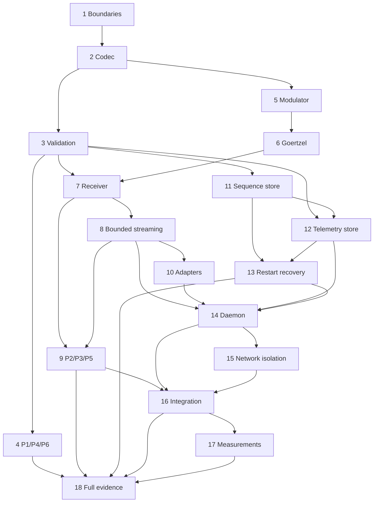

# Implementation Plan: Acoustic Link

## Overview

This plan decomposes the approved acoustic-link design into ordered, traceable implementation and validation work.

## Notes

- This file is an implementation plan only; this spec task does not implement production code.
- Complete tasks in numeric order unless a task explicitly lists independent parallel work.
- Every completed task must retain the validation command, exit code, and output/report path. Do not mark a target measured or verified without evidence.
- Python quick validation: `python -m pytest -m "not slow"`.
- Python full validation: `python -m pytest`.
- If these commands do not exist when implementation begins, add the project test configuration before marking the affected task complete.
- Test names must include the requirement/property ID where applicable, for example `test_p6_rejects_replay_after_restart`.

## Task Dependency Graph

```json
{
  "waves": [
    { "wave": 1, "tasks": ["1"] },
    { "wave": 2, "tasks": ["2"] },
    { "wave": 3, "tasks": ["3", "5"] },
    { "wave": 4, "tasks": ["4", "6", "11"] },
    { "wave": 5, "tasks": ["7", "12"] },
    { "wave": 6, "tasks": ["8", "13"] },
    { "wave": 7, "tasks": ["9", "10"] },
    { "wave": 8, "tasks": ["14"] },
    { "wave": 9, "tasks": ["15"] },
    { "wave": 10, "tasks": ["16"] },
    { "wave": 11, "tasks": ["17"] },
    { "wave": 12, "tasks": ["18"] }
  ]
}
```

The graph also has external gates: task 6 and task 17 require `TASK.md` task 1.2 evidence; task 16's DSKY assertion requires `TASK.md` task 3.8.



## Tasks

- [ ] 1. Establish acoustic package and typed boundaries
  - **Depends on:** approved `requirements.md` and `design.md`.
  - Define package modules and public typed values for frame types, validated fields, receiver states, validation checks, stable reject reasons, source metadata, and operational errors.
  - Define ports for key material, clock, event IDs, audio source, sequence store, telemetry store, diagnostic sink, and local publisher; keep side effects out of pure modules.
  - **Requirements:** AL-REQ-3, AL-REQ-6, AL-REQ-11, AL-REQ-12.
  - **Validation:** `python -m pytest -m "not slow"` plus architecture/import tests proving `acoustic/frame.py` and pure DSP modules do not access filesystem, microphone, network, clock, environment, MCP, or AGC.

- [ ] 2. Implement the pure frame encoder and decoder
  - **Depends on:** 1.
  - Encode/decode the exact 34-byte layout, big-endian integer fields, signed fixed-point values, COMMAND/AUTH discriminated types, CRC-16/CCITT-FALSE, and 8-byte HMAC truncation.
  - Inject key bytes; use a standard constant-time compare; do not read environment in library code.
  - Load `contracts/vectors/frames.json` directly in tests and keep its status unchanged until TypeScript verification exists.
  - **Requirements:** AL-REQ-3, AL-REQ-4.
  - **Properties:** P1 foundation.
  - **Validation:** `python -m pytest tests/test_frame.py -k "p1 or golden or layout"` then `python -m pytest -m "not slow"`.

- [ ] 3. Implement deterministic ordered frame validation
  - **Depends on:** 2.
  - Implement first-failure order for length, sync, version/type, CRC, flags/type semantics, HMAC, replay, range/domain, and sequence commit handoff.
  - Ensure skipped telemetry checks remain `null`, invalid frames never call persistence/publication, and COMMAND/AUTH use separate injected keys.
  - **Requirements:** AL-REQ-4, AL-REQ-5.
  - **Properties:** P4 and in-memory P6 foundation.
  - **Validation:** `python -m pytest tests/test_frame.py -k "p4 or p6 or validation_order"` then `python -m pytest -m "not slow"`.

- [ ] 4. Add full frame properties P1, P4, and P6
  - **Depends on:** 3.
  - Generate valid COMMAND/AUTH frames across field boundaries for P1.
  - Generate single/double-bit mutations without integrity recomputation for P4.
  - Generate wrong-HMAC frames with valid recomputed CRC and stale/equal sequences for P6.
  - Configure the full Hypothesis profile for 10,000 examples per property and retain seed, duration, count, command, and exit code.
  - **Requirements:** AL-REQ-3, AL-REQ-4, AL-REQ-5, AL-REQ-12, AL-REQ-13.
  - **Properties:** P1, P4, P6 (restart portion remains task 13).
  - **Validation:** `python -m pytest tests/test_frame.py` and `python -m pytest`.

- [ ] 5. Implement 8N1 serialization and phase-continuous modulation
  - **Depends on:** 2.
  - Serialize 75-or-more mark preamble symbols and exactly 340 body symbols at 300 baud.
  - Use one phase accumulator across all bit/byte boundaries; support only 48 kHz and 44.1 kHz with 160/147 samples per symbol.
  - Add waveform tests for frequencies, duration, byte bit order, no gaps, amplitude bounds, and phase continuity.
  - **Requirements:** AL-REQ-1.
  - **Properties:** P2/P3 transmitter foundation.
  - **Validation:** `python -m pytest tests/test_modem.py -k "modulat or serialize or phase"` then `python -m pytest -m "not slow"`.

- [ ] 6. Implement Goertzel tone decisions and frequency estimation
  - **Depends on:** 5 and recorded task 1.2 channel-spike evidence when available.
  - Implement mark/space Goertzel energy, configurable validated confidence thresholds, overlapping acquisition windows, and qualified phase-slope deviation estimates.
  - Keep spike-derived thresholds/configuration separate from pure DSP. If spike evidence is absent, retain `UNMEASURED` and do not invent SNR/deviation values.
  - Test 1200/2200 Hz detection, unsupported rates, insufficient-confidence behavior, exactly 50 Hz, and greater-than-50-Hz boundaries.
  - **Requirements:** AL-REQ-1, AL-REQ-10, AL-REQ-12.
  - **Properties:** P2/P3/P5 DSP foundation.
  - **Validation:** `python -m pytest tests/test_modem.py -k "goertzel or frequency or anomaly"` then `python -m pytest -m "not slow"`.

- [ ] 7. Implement the streaming receiver state machine and synchronization
  - **Depends on:** 3 and 6.
  - Implement IDLE/PREAMBLE/SYNC/RECEIVE/VALIDATE transitions with an injected monotonic clock.
  - Qualify 250 ms mark, acquire UART start edge and `A5 26`, center-sample symbols with bounded early/late correction, freeze exactly 34 bytes, and reset after every result.
  - Enforce 150 ms sync and 1.25 s receive deadlines; map sync mismatch to `SYNC` and incomplete/framing failure to `LENGTH`.
  - **Requirements:** AL-REQ-2, AL-REQ-5, AL-REQ-10.
  - **Properties:** P2/P3/P5 receiver foundation.
  - **Validation:** `python -m pytest tests/test_modem.py -k "receiver or sync or timeout or framing"` then `python -m pytest -m "not slow"`.

- [ ] 8. Implement the fixed ring buffer and bounded audio queue
  - **Depends on:** 7.
  - Add the preallocated two-second mono float32 ring and at-most-32-block queue with blocks no longer than 20 ms.
  - Keep callbacks free of DSP, filesystem, schema, and network work.
  - On overflow, invalidate the candidate, emit one `INTERNAL` incident, reset synchronization, and require a fresh preamble.
  - **Requirements:** AL-REQ-7.
  - **Properties:** P5 boundedness.
  - **Validation:** `python -m pytest tests/test_modem.py -k "ring or queue or overflow or p5"` plus a bounded-memory load test, then `python -m pytest -m "not slow"`.

- [ ] 9. Add clean/noisy/random-audio properties P2, P3, and acoustic P5
  - **Depends on:** 7 and 8.
  - P2: generate frames and both sample rates, then assert clean waveform round-trip identity.
  - P3: define and document signal/noise power calculation, additive-white-noise generation, seed, normalization, clipping exclusion, and SNR distribution at or above 15 dB.
  - P5: generate random noise, unrelated tones, clicks, arbitrary chunks, timeouts, and bounded overload; assert no accepted frame and eventual recovery.
  - Run full profiles with P2=500, P3=300, P5=1,000 examples and retain runtime/seed/count. Do not claim that the finite suite proves “never.”
  - **Requirements:** AL-REQ-1, AL-REQ-2, AL-REQ-7, AL-REQ-10, AL-REQ-12, AL-REQ-13.
  - **Properties:** P2, P3, P5 acoustic portion.
  - **Validation:** `python -m pytest tests/test_modem.py` and `python -m pytest`.

- [ ] 10. Implement microphone, WAV, and loopback adapters
  - **Depends on:** 8.
  - Implement the shared `AudioSource` boundary, 48 kHz preference/44.1 kHz fallback, WAV format validation/EOF drain, loopback metadata, source failure translation, one-second bounded retry, and fresh-preamble recovery.
  - Verify equivalent PCM produces equivalent verdicts across all source kinds.
  - Create the planned sample burst only in the later implementation task; do not embed synthetic evidence in UI or reports.
  - **Requirements:** AL-REQ-6, AL-REQ-7.
  - **Properties:** P2 adapter equivalence; P5 recovery.
  - **Validation:** `python -m pytest tests/test_audio_adapters.py` and `python -m pytest -m "not slow"`; after fixture creation, `python -m acoustic.daemon --input web-dashboard/public/sample_burst.wav` must produce the expected inbox verdict.

- [ ] 11. Implement atomic sequence-store provisioning and commit
  - **Depends on:** 3.
  - Add explicit provisioning, versioned state loading, restrictive local access where supported, same-directory temp write/flush/close/atomic replace, and maximum-sequence lockout.
  - Fail closed on missing, malformed, unreadable, unsupported, or out-of-range state; do not auto-create zero at daemon startup.
  - **Requirements:** AL-REQ-5, AL-REQ-9.
  - **Properties:** P6 persistence foundation.
  - **Validation:** `python -m pytest tests/test_sequence_store.py` with fault injection for every write step, then `python -m pytest -m "not slow"`.

- [ ] 12. Implement schema-valid atomic telemetry storage
  - **Depends on:** 3 and 11.
  - Map validation results to `contracts/telemetry-frame.schema.json`, including null checks not run and null frame for LENGTH/SYNC.
  - Implement accepted staging, sequence-before-promotion ordering, atomic inbox/rejected writes, unique immutable rejected names, and diagnostic handling for audit write failure.
  - Treat finalized files as an append-only audit collection.
  - **Requirements:** AL-REQ-5, AL-REQ-8, AL-REQ-12.
  - **Properties:** P4/P6 no-publication side effects.
  - **Validation:** `python -m pytest tests/test_telemetry_store.py` with schema validation and filesystem fault injection, then `python -m pytest -m "not slow"`.

- [ ] 13. Implement startup recovery and replay-after-restart tests
  - **Depends on:** 11 and 12.
  - Run recovery before opening audio. Promote only a valid staged record matching persisted sequence and lacking a final inbox file; fail closed on every inconsistency.
  - Inject crashes before/after staging, sequence replace, inbox promotion, and publication. Prove an old sequence remains `REPLAY` after process restart and recovered publication occurs at most once.
  - Verify reprovisioning requires downstream pending COMMAND/AUTH state clearance through an explicit integration contract; do not duplicate safety-gate state in `acoustic/`.
  - **Requirements:** AL-REQ-8, AL-REQ-9.
  - **Properties:** P6 restart portion.
  - **Validation:** `python -m pytest tests/test_daemon_restart.py tests/test_sequence_store.py` and `python -m pytest`.

- [ ] 14. Compose the daemon and operational event flow
  - **Depends on:** 8, 10, 12, and 13.
  - Build the composition root that validates environment/configuration once, injects keys/clocks/stores/adapters, drives the bounded worker, and remains alive after candidate rejection.
  - Emit typed receiver/status events and schema-valid telemetry; never log keys.
  - Keep standalone frequency anomalies in the typed diagnostic boundary until a separately approved contract change adds a cross-process schema; expose per-candidate maximum deviation through existing telemetry schema.
  - **Requirements:** AL-REQ-2, AL-REQ-6, AL-REQ-7, AL-REQ-8, AL-REQ-10, AL-REQ-12.
  - **Properties:** P5 daemon-liveness portion.
  - **Validation:** `python -m pytest tests/test_daemon.py tests/test_audio_adapters.py tests/test_daemon_restart.py` and `python -m pytest -m "not slow"`.

- [ ] 15. Add loopback-only serving and network-isolation tests
  - **Depends on:** 14.
  - Bind HTTP/WebSocket/local RPC adapters explicitly to `127.0.0.1`, reject every alternative before socket creation, and keep the acoustic command path free of outbound sockets.
  - Validate every emitted WebSocket payload against `contracts/websocket-events.schema.json`.
  - Inspect daemon, MCP, and AGC processes in an integration test and store actual socket evidence; label the result `TARGET`/`UNMEASURED` until that report exists.
  - **Requirements:** AL-REQ-11, AL-REQ-12.
  - **Validation:** `python -m pytest tests/test_network_isolation.py` and `python -m pytest`.

- [ ] 16. Add end-to-end acoustic integration and cross-module P5 safety test
  - **Depends on:** 9, 14, and 15; cross-module DSKY assertion also depends on AGC integration task 3.8 in `TASK.md`.
  - Exercise valid COMMAND, valid AUTH, CRC failure, wrong HMAC with valid CRC, replay after restart, framing timeout, source failure/recovery, and anomaly-plus-independent-verdict behavior.
  - Extend P5 at integration level to assert random audio cannot result in DSKY actuation; keep authorization policy assertions in P7/mcp-bridge tests.
  - **Requirements:** AL-REQ-2, AL-REQ-4, AL-REQ-5, AL-REQ-6, AL-REQ-8, AL-REQ-9, AL-REQ-10.
  - **Properties:** P2–P6 integration coverage.
  - **Validation:** `python -m pytest tests/test_acoustic_integration.py tests/test_daemon_restart.py tests/test_network_isolation.py` and `python -m pytest`.

- [ ] 17. Measure performance, room reliability, and resources
  - **Depends on:** 16 and completion of the real channel spike in `TASK.md` task 1.2.
  - Measure first-preamble-sample to final-inbox latency, exactly 20 phone transmissions at 0.5 m, resident memory, and idle process CPU with hardware, room, method, duration, and environment recorded.
  - Store actual results even when targets fail; use target/measured/verified labels from `docs/evidence-matrix.md` and never invent missing values.
  - **Requirements:** AL-REQ-12, AL-REQ-13.
  - **Validation:** run the documented benchmark command created by this task, retain its exit code/output in `docs/metrics.json`, then run `python -m pytest`.

- [ ] 18. Produce the full P1–P6 evidence report and pass the M2 gate
  - **Depends on:** 4, 9, 13, 16, and 17.
  - Run the complete suite with P1=10,000, P2=500, P3=300, P4=10,000, P5=1,000, and P6=10,000 examples.
  - Save command, exit code, property counts, duration, seeds, environment, failures, and counterexamples to `docs/pbt-report.md`.
  - Recheck the shared golden vectors. Do not mark them verified across implementations until the TypeScript encoder task 5.3 in `TASK.md` also passes the same vectors.
  - Confirm one real phone frame is decoded into the inbox for the M2 gate; if unavailable, report the gate as failed rather than substituting WAV evidence.
  - **Requirements:** all AL-REQ requirements.
  - **Properties:** P1–P6.
  - **Validation:** `python -m pytest -m "not slow"` followed by `python -m pytest`; retain both outputs and exit codes.
