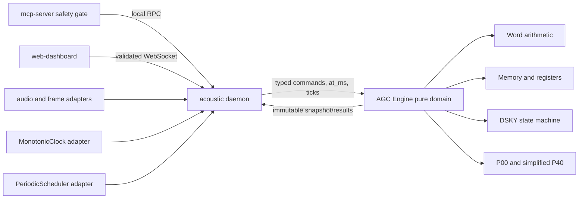

# Design Document

## Overview

This design specifies a pure domain core for the Apollo-26 AGC-faithful subset. The core models:

- 15-bit words plus odd parity;
- ones' complement negation and addition;
- 2048 words of erasable memory and A/L/Q/Z registers;
- deterministic DSKY input with V25, V34, and V37;
- simplified P00 and P40 behavior;
- immutable snapshots and stable domain errors.

The feature does not emulate a complete AGC CPU or original Apollo flight software. It preserves selected hardware and DSKY concepts while making Apollo-26-specific program and display choices explicit.

## 2. Source Decisions and Historical Boundary

### 2.1 Source priority

1. `docs/state-machines.md` is normative for the local DSKY states, cadence, `KEY REL`, `OPR ERR`, and V37 ordering.
2. `PRD.md` v2.3.0 is normative for scope, FR-10 through FR-12, and P8.
3. `TASK.md` is normative for dependency order and the M3 gate.
4. Active steering files are normative for module ownership, dependency direction, safety ownership, injected I/O, and evidence wording.
5. Historical references inform names and interaction patterns but do not enlarge Apollo-26 v1 scope.

### 2.2 Verified verb/noun table

| Code | Historical meaning checked | Apollo-26 subset behavior | Decision |
| :-- | :-- | :-- | :-- |
| V25 | Load components 1, 2, and 3 into R1-R3 | Load one signed three-component P40 tuple and commit it atomically | Keep the operation code and three-register interaction. Do not claim original scaling. |
| V34 | Terminate the current extended operation | Leave simplified P40 for P00; in P00, terminate idempotently | Keep the terminate meaning. |
| V37 | Change major mode/program | Accept only P00 and P40 through `VERB 3 7 ENTR p1 p2 ENTR` | Keep the program-change meaning and the project-normative sequence. |
| N81 | Apollo references associate N81 with a three-component delta-v load used around powered-flight preparation | Apollo-26's only V25 noun; R1 is azimuth centidegrees, R2 elevation centidegrees, and R3 delta-v tenths ft/s | Use N81 as a recognizable three-component maneuver noun, but label the mixed tuple and scaling as Apollo-26-specific. |

Historical checks:

- The [Virtual AGC reference-card collection](https://ibiblio.org/apollo/Documents/Retread50AuroraSundialBCCards.pdf) identifies the regular operations for loading components 1-3, terminating, and changing major mode.
- The [Apollo 11 program notes](https://ibiblio.org/apollo/Documents/apollo_11_program_notes.pdf) discuss which nouns may or may not be loaded through V24/V25; N81 is not in the listed V25 exclusions.
- The [Virtual AGC powered-flight memo](https://ibiblio.org/apollo/Documents/LUM166-DM_text.pdf) records an operational sequence that loads N81 as delta-v before P40-related powered-flight work.
- NASA's [Computers in Spaceflight account](https://www.nasa.gov/wp-content/uploads/static/history/computers/Ch2-7.html) documents the DSKY's two-digit displays, three signed numeric registers, warning/activity lamps, and key set.

These sources do not establish Apollo-26's mixed azimuth/elevation/delta-v tuple or its fixed-point units. Those are local product-contract choices from `PRD.md`, and the UI/README must continue to call P40 simplified. Content from the linked sources is paraphrased for licensing compliance.

## Architecture



### 3.1 Dependency rule

`agc-core` has no outgoing dependency on `acoustic`, `mcp-server`, `web-dashboard`, filesystem, environment, clocks, schedulers, audio, or network code. The daemon imports the core, constructs adapters, validates boundary data once, and passes typed values inward.

Critical-command authorization remains in `mcp-server/safety_gate.py`. The core only executes an already-authorized key stream and enforces its own state, range, cadence, and `KEY REL` invariants.

## Components and Interfaces

### Pure domain components

| Planned module | Responsibility | Must remain pure |
| :-- | :-- | :-- |
| `agc-core/word.py` | `AgcWord`, parity, conversion, negation, addition, overflow | Yes |
| `agc-core/errors.py` | Stable `AgcErrorCode`, typed failure payload | Yes |
| `agc-core/agc_engine.py` | 2048-word memory, A/L/Q/Z, revision, orchestration, snapshots | Yes |
| `agc-core/dsky.py` | Key enum, entry buffers, DSKY transitions, lamps, V25/V34/V37 | Yes |
| `agc-core/programs.py` | Typed P00/P40 transition and scheduler-tick rules | Yes |
| `agc-core/models.py` | Frozen command/result/snapshot dataclasses and enums | Yes |

Exact file splits may combine `errors.py`, `models.py`, or `programs.py` when implementation remains single-purpose and dependency direction is unchanged.

### 3.3 Boundary adapters

The daemon owns these adapters; they are not implemented by this feature spec:

- `MonotonicClock`: returns integer milliseconds from a monotonic source.
- `PeriodicScheduler`: emits the next typed `CompActyTick` every 500 ms while P40 is active.
- RPC translator: validates JSON and maps it to typed keys, words, and timestamps.
- WebSocket projector: maps a domain `AgcSnapshot` to the applicable versioned schema.
- Receiver-activity adapter: passes explicit `UPLINK ACTY` boolean events.

The Engine never calls an adapter. The daemon calls the adapter, then invokes the Engine with a value. Tests bypass all adapters and supply deterministic values directly.

## Data Models

### 4.1 Word representation

```text
Physical word:  p ddddddddddddddd
bit index:      15 14          0
```

- `data_raw`: integer `0x0000..0x7FFF`.
- `parity_bit`: bit 15, derived so `popcount(physical_raw) % 2 == 1`.
- `physical_raw`: `(parity_bit << 15) | data_raw`.
- `+0`: `data_raw == 0x0000`.
- `-0`: `data_raw == 0x7FFF`.
- Positive values: `0x0001..0x3FFF`, mathematical `1..16383`.
- Negative values: `0x4000..0x7FFE`, mathematical value `-(~data_raw & 0x7FFF)`.

`AgcWord` is immutable. Construction from data derives parity. Construction from a physical value validates parity. No valid `AgcWord` instance can contain bad parity.

The parity bit is storage/transport metadata and does not participate in arithmetic. Every arithmetic result derives fresh odd parity from the resulting 15-bit data.

### 4.2 Ones' complement addition

For raw operands `x` and `y`:

1. Compute `wide = x + y`.
2. Compute `folded = (wide & 0x7FFF) + (wide >> 15)`.
3. Repeat step 2 while `folded > 0x7FFF`.
4. Keep `folded` exactly, including `0x7FFF` negative zero.
5. Set overflow when both operands are nonzero and have the same sign, and the nonzero result has the opposite sign.
6. Return `AddResult(word, overflow)`.

This rule deliberately does not normalize `-0` to `+0`.

### 4.3 Memory and machine registers

- Erasable memory is an internal fixed-size sequence of 2048 `AgcWord` values.
- Legal addresses are `0..2047` inclusive.
- A/L/Q/Z are fields keyed by a `MachineRegister` enum, not entries addressed by free-form strings.
- Reset value is parity-valid raw `+0` for every location and register.
- A write validates or receives an `AgcWord` before mutating state.
- An invalid address/register returns a failure and performs no mutation.

No instruction set, bank switching, or implicit aliasing between low memory and A/L/Q/Z is introduced in v1.

### 4.4 Display values

A `DisplayValue` holds an `AgcWord` and exposes:

- `raw_data`: preserves `+0/-0`;
- `signed_value`: integer `-16383..16383`, with both zeros projected as integer `0`;
- `zero_sign`: `POSITIVE`, `NEGATIVE`, or `NOT_ZERO`;
- `wire_unit`: `CENTIDEGREES` for R1/R2 or `TENTHS_FPS` for R3.

R1-R3 are not aliases for A/L/Q/Z. The boundary must reject values outside `-16383..16383` before creating a `DisplayValue`. It must not truncate the acoustic frame's wider `int16`/`int32` fields.

### 4.5 Engine state

```text
EngineState
├── erasable[2048]: AgcWord
├── registers: A/L/Q/Z -> AgcWord
├── program: P00 | P40
├── dsky_state: IDLE | VERB_ENTRY | NOUN_ENTRY | DATA_ENTRY | EXECUTING | OPR_ERR
├── verb_display: optional 00..99
├── noun_display: optional 00..99
├── pending_entry: typed EntryBuffer
├── display: R1/R2/R3 -> DisplayValue
├── lamps: COMP_ACTY/UPLINK_ACTY/KEY_REL/OPR_ERR -> bool
├── last_accepted_key_ms: optional nonnegative integer
├── next_comp_acty_tick: optional positive integer
└── revision: nonnegative integer
```

All state changes occur through Engine methods. Callers cannot mutate collections or nested values returned by a Snapshot.

## 5. Public Domain API Shape

The following signatures are conceptual contracts, not implementation code:

| Operation | Typed input | Result |
| :-- | :-- | :-- |
| construct/reset | no I/O dependencies | `AgcEngine` in the AGC-REQ-4 state |
| word from data | integer raw data | `AgcWord` or `WORD_RANGE` |
| word from physical | integer physical word | `AgcWord` or `WORD_RANGE`/`PARITY` |
| add/negate | validated `AgcWord` values | `AddResult`/`AgcWord` |
| read/write memory | typed address and validated word | word or typed result |
| read/write register | `MachineRegister`, validated word | word or typed result |
| press key | `DskyKey`, integer `at_ms` | `KeyResult` with accepted/rejected, code, revision |
| set receiver activity | typed boolean event | mutation result |
| set display busy | typed boolean event | mutation result |
| apply P40 tick | `CompActyTick(index)` | mutation result or `SCHEDULER_STATE` |
| snapshot | none | immutable `AgcSnapshot` |

A rejected operation never increments revision. An accepted key that changes a buffer, state, display, program, or lamp increments revision once. A successful operation that leaves every snapshot-visible field equal, such as setting an already-equal activity flag, does not increment revision.

## 6. Guard Order and Mutation Model

Every key event is processed in this order:

1. Validate typed key and nonnegative integer timestamp at the boundary.
2. If `KEY REL` is on, return `KEY_REL_ACTIVE` with no mutation.
3. If time regresses, return `TIME_REGRESSION` with no mutation.
4. If elapsed time from the last accepted key is below 100 ms, return `KEY_CADENCE` with no mutation.
5. Dispatch the key to the DSKY transition table.
6. If it is logically invalid, atomically latch `OPR ERR`, set state `OPR_ERR`, update `last_accepted_key_ms`, and preserve program, R1-R3, memory, and A/L/Q/Z.
7. If it is valid, apply all transition effects atomically and update `last_accepted_key_ms`.
8. Increment revision exactly once if snapshot-visible state changed.

Timing and `KEY REL` failures do not count as Accepted keys and do not latch `OPR ERR`. Logical sequence failures pass the guards, count as Accepted keys, and do latch `OPR ERR`.

A daemon helper may stop a list after the first rejected key, but the core does not provide transactional rollback across multiple key calls. This preserves the visible prefix of keys already accepted.

## 7. DSKY Transition Tables

### 7.1 General transitions

`DIGIT` means one of `0..9`; `SIGN` means `PLUS` or `MINUS`.

| Current state | Input | Guard | Next state | Effect | Failure |
| :-- | :-- | :-- | :-- | :-- | :-- |
| `IDLE` | `VERB` | — | `VERB_ENTRY` | Clear verb buffer | — |
| `IDLE` | `NOUN` | A completed V25 is awaiting its noun | `NOUN_ENTRY` | Clear noun buffer | Otherwise `INVALID_KEY_SEQUENCE` |
| `IDLE` | `RSET` | — | `IDLE` | Clear transient entry only | — |
| `IDLE` | `KEY_REL` | lamp off | `IDLE` | Clear transient entry and VERB/NOUN entry display | — |
| `IDLE` | other | — | `OPR_ERR` | Latch `OPR ERR` | `INVALID_KEY_SEQUENCE` |
| `VERB_ENTRY` | `DIGIT` | buffer length < 2 | `VERB_ENTRY` | Append digit | — |
| `VERB_ENTRY` | `CLR` | buffer nonempty | `VERB_ENTRY` | Remove final digit | — |
| `VERB_ENTRY` | `ENTR` | exactly 2 digits | command-specific | Decode V25/V34/V37 | Unsupported -> `UNSUPPORTED_VERB` |
| `NOUN_ENTRY` | `DIGIT` | buffer length < 2 | `NOUN_ENTRY` | Append digit | — |
| `NOUN_ENTRY` | `CLR` | buffer nonempty | `NOUN_ENTRY` | Remove final digit | — |
| `NOUN_ENTRY` | `ENTR` | exactly `81` and V25 pending | `DATA_ENTRY` | Start R1 field | Other noun -> `UNSUPPORTED_NOUN` |
| `DATA_ENTRY` | `SIGN` | active field empty | `DATA_ENTRY` | Record explicit sign | — |
| `DATA_ENTRY` | `DIGIT` | sign present and <5 digits | `DATA_ENTRY` | Append digit | — |
| `DATA_ENTRY` | `CLR` | field nonempty | `DATA_ENTRY` | Remove final digit or sign | — |
| `DATA_ENTRY` | `ENTR` | field valid | command-specific | Advance/execute | — |
| `DATA_ENTRY` | `PRO` | valid final V25 R3 only | `EXECUTING` | Commit V25 | Else `INVALID_KEY_SEQUENCE` |
| `EXECUTING` | internal completion | same key operation | `IDLE` | Publish command effects atomically | — |
| `OPR_ERR` | `RSET` | key guards passed | `IDLE` | Clear latch and transient entry | — |
| `OPR_ERR` | other | — | `OPR_ERR` | No mutation | `OPR_ERR_LATCHED` |
| any non-error | invalid input | key guards passed | `OPR_ERR` | Preserve protected fields and latch lamp | Specific stable code |

`RSET` from any non-error state clears pending input and returns to `IDLE`. `KEY_REL` key cancellation has the same transient effect only while the lamp is off. When the `KEY REL` lamp is on, the guard runs first and blocks every key, including `RSET` and `KEY_REL`, as required by the normative invariant.

### 7.2 Command-specific transition table

| Completed verb | Required continuation | Completion effect |
| :-- | :-- | :-- |
| V25 | Return to `IDLE` with V25 pending; require `NOUN 8 1 ENTR`; then require signed R1 `ENTR`, signed R2 `ENTR`, and signed R3 `ENTR` or `PRO` | Parse all three values first, then atomically replace R1-R3 and display V25/N81 |
| V34 | No noun or data | Set program P00, cancel P40 schedule, force `COMP ACTY` off, preserve R1-R3, display V34, return `IDLE` |
| V37 | Enter `DATA_ENTRY` with field kind `PROGRAM`; require exactly two unsigned digits followed by `ENTR` | Activate P00 or P40, display V37 and target program, return `IDLE` |

The V25 "pending" marker is typed state even though the externally visible top-level state returns to `IDLE` after entering V25. This permits the normative `IDLE -> NOUN_ENTRY` transition without accepting arbitrary standalone NOUN loads.

### 7.3 Canonical V37 sequence

For P40, the canonical key stream is:

```text
VERB, 3, 7, ENTR, 4, 0, ENTR
```

For P00, replace `4, 0` with `0, 0`. Each key has an explicit timestamp and consecutive timestamps differ by at least 100 ms.

State trace for P40:

| Key | Before | After | Important effect |
| :-- | :-- | :-- | :-- |
| `VERB` | `IDLE` | `VERB_ENTRY` | Empty verb buffer |
| `3` | `VERB_ENTRY` | `VERB_ENTRY` | Buffer `3` |
| `7` | `VERB_ENTRY` | `VERB_ENTRY` | Buffer `37` |
| `ENTR` | `VERB_ENTRY` | `DATA_ENTRY(PROGRAM)` | Recognize V37; no NOUN |
| `4` | `DATA_ENTRY(PROGRAM)` | same | Program buffer `4` |
| `0` | `DATA_ENTRY(PROGRAM)` | same | Program buffer `40` |
| `ENTR` | `DATA_ENTRY(PROGRAM)` | `IDLE` | Activate P40 atomically |

`V37 + NOUN`, `VERB 3 7 ENTR 4 ENTR`, and any target other than `00` or `40` latch `OPR ERR` and preserve the old program.

### 7.4 Canonical V25/N81 sequence

```text
VERB, 2, 5, ENTR,
NOUN, 8, 1, ENTR,
SIGN, R1_DIGITS..., ENTR,
SIGN, R2_DIGITS..., ENTR,
SIGN, R3_DIGITS..., ENTR|PRO
```

Each field has one explicit sign and one to five decimal digits. Leading zeros are legal. `-00000` creates raw `-0`; `+00000` creates raw `+0`. Values are parsed without floating point and must fit `-16383..16383`.

No display register changes until the final terminator validates all three fields. On any malformed field, all committed display values remain unchanged and `OPR ERR` latches.

## 8. Program and Lamp Behavior

### 8.1 P00

P00 is the reset and safe idle program. Scheduler ticks cannot mutate its memory, registers, or displays. `COMP ACTY` is always off in P00. DSKY entry remains available.

### 8.2 Simplified P40

P40 is a display-oriented demonstration state, not a propulsion simulation.

On successful V37 activation:

- program becomes P40;
- existing R1-R3 remain unchanged;
- `COMP ACTY` turns on immediately;
- expected P40 tick index becomes 1.

The daemon scheduler emits `CompActyTick(1)` 500 ms after activation, then increasing integer indices at 500 ms intervals. The Engine accepts only the exact next index while P40 is active and toggles `COMP ACTY` once. A duplicate, skipped, regressing, or P00 tick returns `SCHEDULER_STATE` without mutation.

On V34 or V37-to-P00:

- program becomes P00;
- expected P40 tick becomes absent;
- `COMP ACTY` turns off;
- R1-R3 remain unchanged.

`UPLINK ACTY` and `KEY REL` are independently driven by explicit typed inputs. `OPR ERR` is driven only by the DSKY transition rules and cleared by an accepted `RSET`.

## 9. Snapshot Design

`AgcSnapshot` is a frozen dataclass composed only of frozen dataclasses, tuples, enums, booleans, and integers. It includes:

| Group | Fields |
| :-- | :-- |
| Identity | `schema_version`, fixed subset identifier `apollo26-agc-subset-v1`, `revision` |
| Program/input | `program`, `dsky_state`, `verb_display`, `noun_display`, structured pending entry |
| Display | R1-R3 `raw_data`, `physical_raw`, `signed_value`, `zero_sign`, `wire_unit` |
| Machine registers | A/L/Q/Z `raw_data` and `physical_raw` |
| Lamps | `comp_acty`, `uplink_acty`, `key_rel`, `opr_err` |
| Scheduling | `next_comp_acty_tick` only; no wall-clock timestamp |

The full 2048-word memory is intentionally excluded from routine snapshots. A typed memory-read API supports diagnostics without making every WebSocket event large. Snapshot construction reads one Engine state version and cannot interleave with another mutation.

The current `contracts/websocket-events.schema.json` projects only program, verb, noun, signed R1-R3, and lamps. Before an adapter claims to preserve negative zero, revision, machine registers, pending input, or subset identity across processes, the relevant contract must be versioned in the separate integration task. The core snapshot remains richer than the current UI projection.

## Error Handling

`AgcErrorCode` is a domain enum. Human-readable messages and structured context may change; adapters and tests branch only on the code.

| Code | Trigger | OPR ERR | Mutation |
| :-- | :-- | :-- | :-- |
| `PARITY` | Even-popcount physical word | No | None |
| `WORD_RANGE` | Raw word outside its legal integer range | No | None |
| `ADDRESS_RANGE` | Memory address outside 0..2047 | No | None |
| `REGISTER` | Unknown register at a trust boundary | No | None |
| `KEY_REL_ACTIVE` | Any key while `KEY REL` lamp is on | No | None |
| `KEY_CADENCE` | Key delta below 100 ms | No | None |
| `TIME_REGRESSION` | Negative or regressing key timestamp | No | None |
| `INVALID_KEY_SEQUENCE` | Key is illegal for the current logical state | Yes | DSKY error state/lamp and accepted timestamp only |
| `OPR_ERR_LATCHED` | Non-RSET key while error is latched | Already on | None |
| `UNSUPPORTED_VERB` | Completed verb is not V25/V34/V37 | Yes | DSKY error state/lamp and accepted timestamp only |
| `UNSUPPORTED_NOUN` | V25 noun is not N81 | Yes | DSKY error state/lamp and accepted timestamp only |
| `UNSUPPORTED_PROGRAM` | V37 target is not P00/P40 | Yes | DSKY error state/lamp and accepted timestamp only |
| `DISPLAY_RANGE` | Display input outside -16383..16383 | Yes for accepted DSKY data; no at pre-key boundary validation | Per trigger path; committed R1-R3 never change |
| `SCHEDULER_STATE` | Duplicate, skipped, regressing, off-boundary, or P00 tick | No | None |

A domain failure result includes `code`, optional typed context such as address or expected delay, and a message. No broad exception catch is required inside pure control flow. Adapters may catch unexpected exceptions only to log context and translate them to their own stable boundary `INTERNAL` result.

## Correctness Properties

### Property 1: P8-A valid representation and parity

For every raw value in `0x0000..0x7FFF`, constructing an `AgcWord` yields a physical value in `0x0000..0xFFFF` with odd population count, and physical decode returns the same raw value.

**Validates: Requirements 1.1, 1.2, 1.3, 1.4**

**Requirement IDs:** AGC-REQ-1.1, AGC-REQ-1.2, AGC-REQ-1.3, AGC-REQ-1.4

### Property 2: P8-B negation and signed zeros

For every valid word `x`, `negate(negate(x)) == x`, `negate(+0) == -0`, and `negate(-0) == +0`, comparing raw values rather than projected Python integers.

**Validates: Requirements 1.5, 2.1, 2.6**

**Requirement IDs:** AGC-REQ-1.5, AGC-REQ-2.1, AGC-REQ-2.6

### Property 3: P8-C additive inverse

For every valid word `x`, `add(x, negate(x)).word.raw_data == 0x7FFF`.

**Validates: Requirements 2.2, 2.3**

**Requirement IDs:** AGC-REQ-2.2, AGC-REQ-2.3

This is the required P8 inverse property.

### Property 4: P8-D commutativity and overflow consistency

For every pair of valid words `x, y`, `add(x, y)` and `add(y, x)` have equal raw words, parity, and overflow flags, and both equal an independent end-around-carry oracle.

**Validates: Requirements 2.2, 2.4, 2.5**

**Requirement IDs:** AGC-REQ-2.2, AGC-REQ-2.4, AGC-REQ-2.5

This is the required P8 commutativity/overflow property.

### Property 5: AGC-PROP-1 storage round trip and bounds

For every valid address/register and word, write then read returns the identical raw and physical value. For every invalid address/register, the stable error is correct and the complete snapshot is unchanged.

**Validates: Requirements 3.1, 3.2, 3.3, 3.4, 3.5**

**Requirement IDs:** AGC-REQ-3.1, AGC-REQ-3.2, AGC-REQ-3.3, AGC-REQ-3.4, AGC-REQ-3.5

### Property 6: AGC-PROP-2 deterministic replay

For every generated sequence of typed operations, timestamps, and ticks, two reset Engines receive the same results and snapshots after every operation.

**Validates: Requirements 4.3, 14.2, 14.3, 14.4**

**Requirement IDs:** AGC-REQ-4.3, AGC-REQ-14.2, AGC-REQ-14.3, AGC-REQ-14.4

### Property 7: AGC-PROP-3 key guards preserve state

For every reachable Engine state and key, a `KEY REL`, sub-100-ms, or regressing-time rejection leaves the full snapshot and last accepted timestamp unchanged and returns its exact stable code.

**Validates: Requirements 6.1, 6.2, 6.3, 6.4, 6.5, 6.6, 15.4**

**Requirement IDs:** AGC-REQ-6.1, AGC-REQ-6.2, AGC-REQ-6.3, AGC-REQ-6.4, AGC-REQ-6.5, AGC-REQ-6.6, AGC-REQ-15.4

### Property 8: AGC-PROP-4 invalid logical input preserves protected state

For every reachable non-error DSKY state and illegal logical key, the next state is `OPR_ERR`, its lamp is on, and program, R1-R3, memory, and A/L/Q/Z are unchanged.

**Validates: Requirements 7.1**

**Requirement IDs:** AGC-REQ-7.1

Also validates PRD FR-12.

### Property 9: AGC-PROP-5 OPR ERR is latched

For every state with `OPR ERR` on and every key other than guard-valid `RSET`, the error remains latched and no protected or transient state changes. A guard-valid `RSET` alone returns to `IDLE` and preserves committed values.

**Validates: Requirements 7.2, 7.3, 7.4**

**Requirement IDs:** AGC-REQ-7.2, AGC-REQ-7.3, AGC-REQ-7.4

### Property 10: AGC-PROP-6 V37 accepts only canonical targets

Mutations of the canonical V37 sequence cannot change the program unless the exact two-digit target is `00` or `40`, no NOUN occurs, and all key guards pass.

**Validates: Requirements 8.1, 8.2, 8.3, 8.4**

**Requirement IDs:** AGC-REQ-8.1, AGC-REQ-8.2, AGC-REQ-8.3, AGC-REQ-8.4

Also validates the M3 V37 gate.

### Property 11: AGC-PROP-7 V25 commit is atomic

For every valid prior R1-R3 tuple and generated V25/N81 input, committed registers either all become the three parsed values after a valid final terminator or all remain the prior tuple when any field is invalid.

**Validates: Requirements 9.1, 9.2, 9.3, 9.4, 9.5**

**Requirement IDs:** AGC-REQ-9.1, AGC-REQ-9.2, AGC-REQ-9.3, AGC-REQ-9.4, AGC-REQ-9.5

Also validates FR-11 input preparation.

### Property 12: AGC-PROP-8 program and lamp scheduler invariants

For generated P00/P40 transitions and scheduler ticks, P00 always has `COMP ACTY` off; P40 activation starts it on; only the exact next tick toggles it; and termination cancels future ticks while preserving R1-R3.

**Validates: Requirements 10.1, 10.2, 10.3, 11.1, 11.2, 11.3, 12.1, 12.2, 12.3, 12.4, 13.1, 13.2, 13.3, 13.4, 13.5**

**Requirement IDs:** AGC-REQ-10.1, AGC-REQ-10.2, AGC-REQ-10.3, AGC-REQ-11.1, AGC-REQ-11.2, AGC-REQ-11.3, AGC-REQ-12.1, AGC-REQ-12.2, AGC-REQ-12.3, AGC-REQ-12.4, AGC-REQ-13.1, AGC-REQ-13.2, AGC-REQ-13.3, AGC-REQ-13.4, AGC-REQ-13.5

### Property 13: AGC-PROP-9 revision matches visible mutation

For every generated operation history, a rejected or visible no-op operation keeps revision unchanged, while each successful snapshot-visible mutation increments it exactly once.

**Validates: Requirements 14.2, 14.3**

**Requirement IDs:** AGC-REQ-14.2, AGC-REQ-14.3

## Testing Strategy

### 12.1 Unit and example tests

- Exhaustive 15-bit raw-word parity and conversion tests where runtime remains practical.
- Explicit `+0`, `-0`, largest positive, largest negative, carry-fold, and overflow examples.
- Memory addresses `0`, `2047`, `-1`, and `2048`; all A/L/Q/Z registers.
- Initial snapshot and P00 behavior.
- Cadence examples at first key, 99 ms, exactly 100 ms, over 100 ms, negative time, and regressing time.
- Canonical V37-to-P40 and V37-to-P00 traces.
- V25 values at `-16383`, `-0`, `+0`, and `+16383`, plus malformed fields.
- V34 from P40 and P00.
- `COMP ACTY` tick sequence and cancellation.
- Snapshot immutability and negative-zero projection.

Test names include requirement/property identifiers, for example `test_agc_req_6_accepts_exactly_100_ms` and `test_p8_c_additive_inverse_is_negative_zero`.

### 12.2 Hypothesis P8

`tests/test_word.py` owns P8. Strategies generate the full 15-bit domain and operand pairs. Tests compare raw results and parity, not only mathematical integers. A small independent oracle implements end-around carry without using production helpers.

- Development profile: approximately 100 generated examples per property and not marked `slow`.
- Full profile: 10,000 generated examples per required P8 property, marked/configured for the full release run.
- Required report fields: property ID, examples run, duration, and reproducibility seed in `docs/pbt-report.md`.

### 12.3 Stateful Hypothesis model

A `RuleBasedStateMachine` models the Engine at the public API boundary. Rules include:

- set/clear `KEY REL` and `UPLINK ACTY`;
- press every DSKY key with generated valid, boundary, and invalid timestamp deltas;
- write/read memory and registers;
- start/cancel V25, V34, and V37 sequences;
- enter valid and malformed fields;
- apply valid, duplicate, skipped, and regressing scheduler ticks;
- request repeated snapshots.

Stateful invariants check:

- no key mutation while `KEY REL` is on;
- no accepted keys less than 100 ms apart;
- timing rejection does not move the cadence anchor;
- logical invalid input latches `OPR ERR` and protects program/register state;
- only RSET clears `OPR ERR`;
- R1-R3 never partially commit;
- P00/P40 and `COMP ACTY` remain consistent;
- revisions and deterministic snapshots follow the mutation rules.

This suite supplies the `stateful PBT` evidence named for FR-10 and FR-12 in `docs/evidence-matrix.md`.

### 12.4 Integration and contract tests

The later daemon integration task verifies:

- the clock adapter supplies monotonic integer milliseconds;
- the scheduler emits consecutive 500-ms P40 boundary ticks;
- multi-key execution stops at the first rejection or `OPR ERR`;
- the M3 sequence `V37 E 40 E`, then V25/N81 and data, yields P40 with exact R1-R3;
- projected WebSocket/RPC JSON validates against versioned contracts;
- boundary range errors preserve `DISPLAY_RANGE` without truncation;
- no `agc-core` import opens audio, filesystem, clock, environment, MCP, or network dependencies.

## 13. Requirement-to-Design Traceability

| Requirement | Design sections | Main verification |
| :-- | :-- | :-- |
| AGC-REQ-1 | 4.1 | P8-A, P8-B |
| AGC-REQ-2 | 4.2 | P8-B through P8-D |
| AGC-REQ-3 | 4.3 | AGC-PROP-1 |
| AGC-REQ-4 | 4.5, 9 | AGC-PROP-2 |
| AGC-REQ-5 | 6, 7.1 | stateful model |
| AGC-REQ-6 | 6 | AGC-PROP-3 |
| AGC-REQ-7 | 6, 7.1 | AGC-PROP-4, AGC-PROP-5 |
| AGC-REQ-8 | 7.2, 7.3 | AGC-PROP-6 |
| AGC-REQ-9 | 2.2, 7.2, 7.4 | AGC-PROP-7 |
| AGC-REQ-10 | 7.2, 8 | examples, AGC-PROP-8 |
| AGC-REQ-11 | 8.1 | AGC-PROP-8 |
| AGC-REQ-12 | 4.4, 8.2 | AGC-PROP-7, integration |
| AGC-REQ-13 | 3.3, 8 | AGC-PROP-8 |
| AGC-REQ-14 | 9 | AGC-PROP-2, AGC-PROP-9 |
| AGC-REQ-15 | 3, 5, 10 | architecture and integration tests |

## 14. Risks and Explicit Non-Decisions

- The mixed R1/R2/R3 tuple is an Apollo-26 product simplification. N81 is selected because it is historically associated with a three-component maneuver delta-v load, not because original flight software used Apollo-26's mixed units.
- The current WebSocket schema cannot preserve negative zero, pending entry, revision, A/L/Q/Z, or subset identity. Contract evolution belongs to the daemon integration work and must update producers, consumers, and tests together.
- This design does not set the MCP high-delta-v authorization threshold. The `mcp-bridge` spec and `safety_gate.py` own it.
- This design does not make a performance or fidelity claim. All evidence remains `PLANNED` until tests run and reports are stored.
