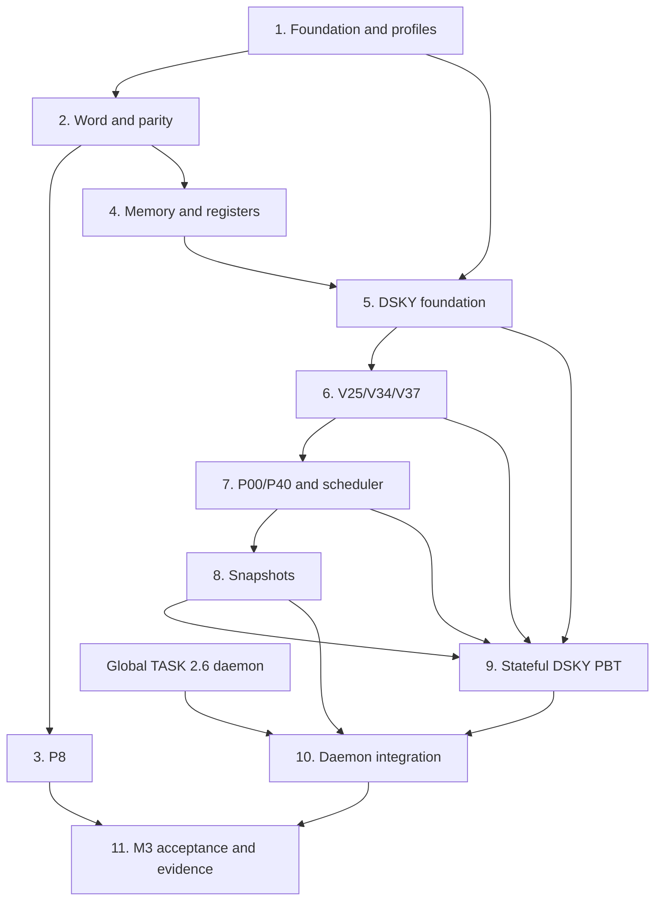

# Implementation Plan: AGC Emulator

## Overview

This plan implements the approved requirements and design in dependency order while preserving the pure-core boundary.

## Notes

- This file plans implementation; creating this spec does not implement any task below.
- Complete tasks in dependency order. Tasks with satisfied dependencies may run in parallel.
- Keep `agc-core` pure. Put clock, scheduler, RPC, WebSocket, filesystem, environment, audio, and network access in adapters outside the core.
- Use typed public APIs and stable `AgcErrorCode` values from the design.
- Name tests with requirement/property IDs.
- Do not mark a verification task complete without storing the command, exit code, and relevant output. Do not change `PLANNED` evidence to `VERIFIED` until its stated test has passed.
- If a task changes a cross-process JSON shape, update the applicable schema, producer, consumer, and schema tests in the same change.

## Task Dependency Graph

```json
{
  "waves": [
    { "wave": 1, "tasks": ["1.1"] },
    { "wave": 2, "tasks": ["1.2", "1.3"] },
    { "wave": 3, "tasks": ["2.1"] },
    { "wave": 4, "tasks": ["2.2", "4.1", "4.2"] },
    { "wave": 5, "tasks": ["2.3", "3.1", "4.3"] },
    { "wave": 6, "tasks": ["3.2", "5.1"] },
    { "wave": 7, "tasks": ["3.3", "5.2"] },
    { "wave": 8, "tasks": ["5.3", "7.4"] },
    { "wave": 9, "tasks": ["5.4", "6.1", "6.2"] },
    { "wave": 10, "tasks": ["6.3", "6.4"] },
    { "wave": 11, "tasks": ["7.1", "7.2"] },
    { "wave": 12, "tasks": ["7.3"] },
    { "wave": 13, "tasks": ["8.1"] },
    { "wave": 14, "tasks": ["8.2"] },
    { "wave": 15, "tasks": ["8.3", "9.1"] },
    { "wave": 16, "tasks": ["9.2", "9.3", "9.4"] },
    { "wave": 17, "tasks": ["10.1", "10.2", "10.3"] },
    { "wave": 18, "tasks": ["10.4"] },
    { "wave": 19, "tasks": ["11.1"] },
    { "wave": 20, "tasks": ["11.2"] },
    { "wave": 21, "tasks": ["11.3"] }
  ]
}
```

The graph has one external gate: tasks 10.1-10.3 also require global `TASK.md` task 2.6 (daemon).



## Tasks

### 1. Establish typed domain and test foundations

- [ ] 1.1 Add the Python package/test scaffold · Dependencies: none · Requirements: AGC-REQ-15
  - Create an importable `agc-core` package layout that does not import application adapters.
  - Add or complete pytest and Hypothesis configuration, including a default development profile and a full 10,000-example profile.
  - Define a `slow` marker or equivalent so `python -m pytest -m "not slow"` excludes release-scale runs.
  - Ensure the two required Python validation commands exist before implementation tasks can be marked complete.
  - Completion check: importing the package and collecting tests performs no filesystem, environment, audio, clock, MCP, or network access.

- [ ] 1.2 Define stable domain errors · Dependencies: 1.1 · Requirements: AGC-REQ-3.5, AGC-REQ-6, AGC-REQ-7, AGC-REQ-13.5, AGC-REQ-15.4-15.5
  - Add typed `AgcErrorCode`, error context, and operation result types for every code in the Error Handling section.
  - Keep human-readable messages separate from codes.
  - Add table-driven tests that instantiate every code and reject unknown free-form codes at boundaries.
  - Completion check: tests assert the exact enum set and stable serialization value for every code.

- [ ] 1.3 Define shared immutable domain models · Dependencies: 1.1 · Requirements: AGC-REQ-4, AGC-REQ-5.1, AGC-REQ-14, AGC-REQ-15.3
  - Add enums and frozen dataclasses for programs, machine registers, DSKY keys/states, lamps, display units, zero sign, ticks, and operation results.
  - Avoid free-form dictionaries and strings in the public API.
  - Completion check: type checking passes and tests prove returned nested values cannot mutate Engine state.

### 2. Implement 15-bit words and odd parity

- [ ] 2.1 Implement validated word construction · Dependencies: 1.2, 1.3 · Requirements: AGC-REQ-1.1-1.4
  - Implement immutable construction from 15-bit data and from a 16-bit physical value.
  - Place parity in bit 15 and enforce odd population count over all 16 bits.
  - Reject out-of-range and even-parity physical values without truncation.
  - Add exhaustive tests over all 32,768 data patterns and all relevant invalid boundaries.
  - Completion check: AGC-REQ-1 parity and round-trip tests pass.

- [ ] 2.2 Implement signed conversion and zero preservation · Dependencies: 2.1 · Requirements: AGC-REQ-1.5, AGC-REQ-2.1, AGC-REQ-2.6
  - Preserve raw `+0` and `-0` and expose explicit `ZeroSign` when projected to integer values.
  - Implement 15-bit bitwise-complement negation.
  - Cover both zeros and magnitude boundaries with examples and generated tests.
  - Completion check: no public conversion silently normalizes raw `-0` to raw `+0`.

- [ ] 2.3 Implement end-around-carry addition and overflow · Dependencies: 2.2 · Requirements: AGC-REQ-2.2-2.5
  - Implement repeated end-around carry over the 15 data bits.
  - Return an immutable result containing the parity-valid word and overflow flag.
  - Keep the arithmetic oracle in tests independent from production helpers.
  - Completion check: examples cover carry fold, same-sign overflow, opposite signs, and both zeros.

### 3. Add and run Property P8

- [ ] 3.1 Add Hypothesis strategies and P8-A/P8-B · Dependencies: 2.2 · Requirements: AGC-REQ-1, AGC-REQ-2.1, AGC-REQ-2.6
  - Generate the full raw 15-bit domain without filtering away either zero.
  - Verify valid representation/parity, physical round trip, double negation, and signed-zero behavior.
  - Put tests in `tests/test_word.py` and include `p8` in test names.
  - Completion check: development profile passes and reports minimized counterexamples on forced failure.

- [ ] 3.2 Add Hypothesis P8-C/P8-D · Dependencies: 2.3, 3.1 · Requirements: AGC-REQ-2.2-2.5
  - Verify `x + negate(x)` returns raw `-0` for every generated x.
  - Verify commutativity and overflow consistency against an independent oracle.
  - Configure the full profile for 10,000 examples per required P8 property.
  - Completion check: test metadata identifies P8-C and P8-D separately.

- [ ] 3.3 Run and record the full P8 profile · Dependencies: 3.2
  - Run the full Python test command with the full Hypothesis profile selected by project configuration.
  - Record property IDs, examples, duration, reproducibility seed, command, and exit code in the test-run evidence consumed by `docs/pbt-report.md`.
  - If a property fails, retain the exact minimized failing example and leave P8 `PLANNED` or `FAILED` as appropriate.
  - Completion check: P8 may become `VERIFIED` only after the stored full-profile run passes.

### 4. Implement erasable memory and machine registers

- [ ] 4.1 Implement fixed 2048-word erasable memory · Dependencies: 2.1 · Requirements: AGC-REQ-3.1, AGC-REQ-3.3-3.5, AGC-REQ-4.1
  - Initialize exactly 2048 locations to parity-valid raw `+0`.
  - Implement typed reads/writes for addresses 0 through 2047.
  - Reject negative and high addresses with `ADDRESS_RANGE` and no mutation.
  - Completion check: property tests cover arbitrary valid addresses/words and both address edges.

- [ ] 4.2 Implement A/L/Q/Z registers · Dependencies: 2.1, 1.3 · Requirements: AGC-REQ-3.2-3.5, AGC-REQ-4.1
  - Store one `AgcWord` per typed `MachineRegister` enum value.
  - Do not alias A/L/Q/Z to display registers or untyped memory addresses.
  - Add generated read-after-write and invalid-boundary tests.
  - Completion check: all four reset to raw `+0`, preserve parity, and reject invalid identifiers without mutation.

- [ ] 4.3 Add storage invariant tests · Dependencies: 4.1, 4.2 · Requirements: AGC-REQ-3, AGC-REQ-4.1
  - Implement AGC-PROP-1 for memory and registers.
  - Verify invalid operations preserve a before/after state digest or snapshot.
  - Completion check: fast Python validation passes the storage suite.

### 5. Implement the DSKY state-machine foundation

- [ ] 5.1 Implement reset state and typed entry buffers · Dependencies: 1.2, 1.3, 4.1, 4.2 · Requirements: AGC-REQ-4.2, AGC-REQ-5
  - Implement `IDLE`, `VERB_ENTRY`, `NOUN_ENTRY`, `DATA_ENTRY`, `EXECUTING`, and `OPR_ERR` with typed buffer variants.
  - Initialize program P00, blank pending input, positive-zero R1-R3, and all lamps off.
  - Add direct tests for VERB/NOUN entry, `CLR`, `RSET`, and `KEY_REL` cancellation.
  - Completion check: state transitions match `design.md` section 7.1.

- [ ] 5.2 Implement KEY REL and cadence guards · Dependencies: 5.1 · Requirements: AGC-REQ-6
  - Accept explicit nonnegative integer `at_ms`; do not read a clock.
  - Apply guards in the exact order specified in `design.md` section 6.
  - Treat exactly 100 ms as valid and rejected attempts as not moving the cadence anchor.
  - Add boundary tests at first key, 99 ms, 100 ms, greater than 100 ms, negative time, and time regression.
  - Completion check: AGC-PROP-3 passes for generated reachable states and keys.

- [ ] 5.3 Implement logical invalid-input handling and OPR ERR · Dependencies: 5.2 · Requirements: AGC-REQ-7
  - Latch `OPR ERR` only after timing/`KEY REL` guards pass and logical validation fails.
  - Preserve program, R1-R3, memory, and A/L/Q/Z on logical failure.
  - Permit only guard-valid `RSET` to clear a latched error.
  - Return stable specific errors for unsupported verb/noun/program choices.
  - Completion check: AGC-PROP-4 and AGC-PROP-5 pass.

- [ ] 5.4 Add sequential execution stop behavior · Dependencies: 5.3 · Requirements: AGC-REQ-7.5
  - Add a test helper or boundary-facing orchestration contract that sends one key at a time and stops on the first rejection or observed `OPR ERR`.
  - Do not implement rollback of previously accepted keys.
  - Completion check: tests prove that no suffix key executes after the first failure and that the accepted prefix remains visible.

### 6. Implement the approved V25/V34/V37 subset

- [ ] 6.1 Implement canonical V37 · Dependencies: 5.3 · Requirements: AGC-REQ-8
  - Implement only `VERB 3 7 ENTR 0 0 ENTR` and `VERB 3 7 ENTR 4 0 ENTR`.
  - Reject NOUN, wrong digit counts, and other programs without changing the prior program.
  - Add the exact M3 V37 sequence with timestamps at least 100 ms apart.
  - Completion check: AGC-PROP-6 passes and snapshots show the completed verb/program.

- [ ] 6.2 Implement V25/N81 field parsing · Dependencies: 5.3, 2.2 · Requirements: AGC-REQ-9.1-9.2, AGC-REQ-9.5
  - Require the canonical V25 then N81 sequence.
  - Parse one explicit sign and one to five decimal digits per field without floating point.
  - Preserve `-00000` as raw `-0` and `+00000` as raw `+0`.
  - Reject every other noun and malformed field with the specified stable code.
  - Completion check: generated grammar tests cover all sign, length, terminator, and noun branches.

- [ ] 6.3 Implement atomic V25 R1-R3 commit · Dependencies: 6.2 · Requirements: AGC-REQ-9.3-9.4, AGC-REQ-12.1-12.3
  - Validate all three fields and the `-16383..16383` range before replacing any committed display value.
  - Store R1/R2 in centidegrees and R3 in tenths ft/s as typed units.
  - Return `DISPLAY_RANGE` instead of truncating wider boundary inputs.
  - Completion check: AGC-PROP-7 passes across prior tuples, boundaries, negative zero, and malformed final fields.

- [ ] 6.4 Implement V34 termination · Dependencies: 6.1 · Requirements: AGC-REQ-10
  - Implement `VERB 3 4 ENTR` without NOUN or data.
  - Make termination idempotent in P00 and program-changing in P40.
  - Preserve R1-R3 and publish completed verb 34.
  - Completion check: tests cover P00, P40, and invalid extra-input paths.

### 7. Implement P00, simplified P40, and activity lamps

- [ ] 7.1 Implement P00 invariants · Dependencies: 6.1, 6.4 · Requirements: AGC-REQ-11
  - Keep `COMP ACTY` off and prevent autonomous register/memory/display changes.
  - Preserve R1-R3 on reset construction, V34, and V37-to-P00 as specified.
  - Completion check: generated scheduler attempts and program transitions cannot violate P00 invariants.

- [ ] 7.2 Implement simplified P40 activation and termination · Dependencies: 6.1, 6.3, 6.4 · Requirements: AGC-REQ-10.1, AGC-REQ-12
  - On activation, preserve R1-R3, set `COMP ACTY` on, and expect tick index 1.
  - Identify the program as the Apollo-26 subset; add no propulsion dynamics or original-flight-software metadata.
  - On termination, cancel the expected tick and force `COMP ACTY` off.
  - Completion check: V37 then V25/N81 exposes exact fixed-unit values while P40 remains active.

- [ ] 7.3 Implement deterministic COMP ACTY ticks · Dependencies: 7.2 · Requirements: AGC-REQ-13.1-13.2, AGC-REQ-13.5
  - Accept only the exact next typed tick index; do not read time or schedule work internally.
  - Toggle once per accepted P40 tick and reject duplicate, skipped, regressing, or P00 ticks with `SCHEDULER_STATE`.
  - Add AGC-PROP-8 across generated program/tick histories.
  - Completion check: test fixtures can reproduce any lamp trace from reset with no wall clock.

- [ ] 7.4 Implement explicit UPLINK ACTY and KEY REL inputs · Dependencies: 5.2 · Requirements: AGC-REQ-13.3-13.4
  - Add typed boolean domain events for receiver activity and display busy state.
  - Avoid imports or callbacks into the daemon/audio layers.
  - Completion check: setting each lamp is deterministic, idempotent when unchanged, and covered by key-guard tests.

### 8. Implement immutable deterministic snapshots

- [ ] 8.1 Implement Engine revision semantics · Dependencies: 4.3, 5.3, 7.3, 7.4 · Requirements: AGC-REQ-14.2-14.4
  - Increment once per snapshot-visible mutation, never for rejection or a visible no-op.
  - Keep revision monotonic without wall-clock fields.
  - Add AGC-PROP-9 across generated operation histories.
  - Completion check: revision differences equal the model's visible mutation count.

- [ ] 8.2 Implement the complete frozen AgcSnapshot · Dependencies: 8.1 · Requirements: AGC-REQ-14.1, AGC-REQ-14.4
  - Include every field in `design.md` section 9, with raw and signed display values and raw A/L/Q/Z.
  - Exclude mutable references and the full 2048-word memory from the routine snapshot.
  - Add initial, nontrivial P40, OPR ERR, negative-zero, and repeated-inspection examples.
  - Completion check: equal operation histories serialize to field-for-field equal normalized values.

- [ ] 8.3 Add deterministic replay property · Dependencies: 8.2 · Requirements: AGC-REQ-4.3, AGC-REQ-14.2-14.4
  - Implement AGC-PROP-2 by replaying each generated operation history into two reset Engines.
  - Compare every operation result and snapshot after every step.
  - Completion check: failures report a minimized reproducible history and no test depends on real time.

### 9. Add stateful Hypothesis coverage for FR-10 and FR-12

- [ ] 9.1 Build the reference state machine · Dependencies: 5.3, 6.4, 7.4, 8.2 · Requirements: AGC-REQ-4 through AGC-REQ-14
  - Model DSKY state, pending fields, cadence anchor, lamps, program, R1-R3, next tick, and revision independently from production code.
  - Add rules listed in `design.md` section 12.3.
  - Avoid calling production transition helpers from the model.
  - Completion check: the model reaches every top-level DSKY state and both programs under test coverage.

- [ ] 9.2 Verify FR-10 key safety invariants statefully · Dependencies: 9.1 · Requirements: AGC-REQ-5, AGC-REQ-6; Evidence: FR-10
  - Generate arbitrary keys and timestamp deltas around 100 ms while toggling `KEY REL`.
  - Assert no key mutation while busy and no accepted keys below cadence.
  - Assert rejected attempts do not alter the next valid acceptance time.
  - Completion check: fast and full profiles pass with requirement IDs in test names/output.

- [ ] 9.3 Verify FR-12 OPR ERR invariants statefully · Dependencies: 9.1 · Requirements: AGC-REQ-7; Evidence: FR-12
  - Generate invalid logical input from every reachable input state.
  - Assert protected-state invariance, latch persistence, and RSET-only recovery.
  - Assert multi-key execution stops when the latch appears.
  - Completion check: fast and full profiles pass with minimized histories available on failure.

- [ ] 9.4 Verify V25/V34/V37 and P00/P40 statefully · Dependencies: 9.1 · Requirements: AGC-REQ-8 through AGC-REQ-13
  - Generate valid commands, near-valid mutations, display boundaries, and scheduler histories.
  - Assert canonical V37, atomic V25, V34 termination, P00 invariants, and P40 lamp behavior.
  - Completion check: AGC-PROP-6 through AGC-PROP-8 pass in the full suite.

### 10. Integrate the pure Engine with daemon adapters

- [ ] 10.1 Add monotonic-clock and 500-ms scheduler adapters · Dependencies: 7.3, 7.4, 9.2, global TASK 2.6 daemon · Requirements: AGC-REQ-6, AGC-REQ-13, AGC-REQ-15.1-15.2
  - Keep adapters under daemon ownership; pass integer milliseconds and typed tick indices into the core.
  - Cancel P40 scheduling on V34/V37-to-P00 and prevent stale ticks from toggling the lamp.
  - Use fake adapters in integration tests.
  - Completion check: core tests still run without a clock/scheduler and adapter tests reproduce exact cadence/tick traces.

- [ ] 10.2 Map validated command fields without truncation · Dependencies: 6.3, 9.4, global TASK 2.6 daemon · Requirements: AGC-REQ-9, AGC-REQ-12.3, AGC-REQ-15.5
  - Convert frame R1/R2/delta-v integers to canonical V25/N81 keys or typed values only after range validation.
  - Preserve fixed units and return `DISPLAY_RANGE` for values outside the core display range.
  - Do not move AUTH or critical-command policy into the Engine.
  - Completion check: boundary integration tests prove no `int16`/`int32` input is silently wrapped.

- [ ] 10.3 Project snapshots through versioned contracts · Dependencies: 8.2, 9.3, global TASK 2.6 daemon · Requirements: AGC-REQ-14.5, AGC-REQ-15.5
  - Compare `AgcSnapshot` with the current WebSocket and planned RPC schemas.
  - If revision, pending state, raw zero sign, A/L/Q/Z, or subset identity crosses a process boundary, version and update the JSON contract before emitting it.
  - Validate JSON once at the trust boundary and preserve stable error codes.
  - Run producer, consumer, and schema tests together for every contract change.
  - Completion check: every emitted example validates and negative-zero behavior is explicit rather than silently lost.

- [ ] 10.4 Add architecture-boundary checks · Dependencies: 10.1-10.3 · Requirements: AGC-REQ-15
  - Verify `agc-core` does not import daemon, acoustic, MCP, UI, filesystem, environment, audio, clock, scheduler, or network modules.
  - Verify adapters depend inward on typed core APIs.
  - Completion check: architecture tests run in fast Python validation.

### 11. Run M3 acceptance and publish evidence

- [ ] 11.1 Add the M3 deterministic acceptance script/test · Dependencies: 3.3, 9.4, 10.4 · Requirements: AGC-REQ-8, AGC-REQ-9, AGC-REQ-12; Evidence: FR-11
  - From reset, send canonical `V37 E 40 E` with key spacing at least 100 ms.
  - Send canonical V25/N81 plus representative in-range R1-R3 data.
  - Assert P40 active, exact raw/signed R1-R3 values, no `OPR ERR`, and deterministic `COMP ACTY` behavior.
  - Use fixed test values and injected times; do not fabricate measured latency or performance.
  - Completion check: the acceptance test produces a stored result and AGC snapshot.

- [ ] 11.2 Run required validation commands · Dependencies: 11.1
  - Run fast Python validation and store command, output, and exit code.
  - Run full Python validation, including full P8 and stateful profiles, and store command, output, exit code, example counts, duration, and seeds.
  - If task 10.3 changed contracts consumed by the frontend, also run and store the complete frontend validation chain.
  - Completion check: no command is reported as passing without exit code 0 in stored output.

- [ ] 11.3 Update evidence only from test output · Dependencies: 11.2
  - Update FR-10 and FR-12 from stateful PBT output, FR-11 from the integration snapshot, and P8 from the full property run.
  - Record failures and unmet targets as failures; do not replace them with planned claims.
  - Keep performance values `UNMEASURED` until the separate measurement task runs.
  - Completion check: evidence paths resolve to generated runner output and match the tested behavior version.

## Validation Commands

Run from the repository root after the corresponding scaffold exists.

### Fast Python feedback

```powershell
python -m pytest -m "not slow"
```

This command must include word, memory/register, deterministic DSKY examples, architecture checks, and development-profile property/state-machine tests.

### Full Python verification

```powershell
python -m pytest
```

This command must include the 10,000-example P8 properties, full stateful Hypothesis tests for FR-10/FR-12, integration tests, and the M3 acceptance test.

### Frontend and shared-contract regression

Run this chain when AGC snapshot/error schema changes affect `web-dashboard`:

```powershell
npm run lint && npm run typecheck && npm test -- --run && npm run build
```

Run it from `web-dashboard/`. The build must retain static export output in `web-dashboard/out/`.

## Requirement Coverage

| Requirement | Primary tasks |
| :-- | :-- |
| AGC-REQ-1 | 2.1-2.2, 3.1 |
| AGC-REQ-2 | 2.2-2.3, 3.1-3.3 |
| AGC-REQ-3 | 4.1-4.3 |
| AGC-REQ-4 | 4.1-4.2, 5.1, 8.3 |
| AGC-REQ-5 | 5.1, 9.1 |
| AGC-REQ-6 | 5.2, 9.2, 10.1 |
| AGC-REQ-7 | 5.3-5.4, 9.3 |
| AGC-REQ-8 | 6.1, 9.4, 11.1 |
| AGC-REQ-9 | 6.2-6.3, 9.4, 10.2, 11.1 |
| AGC-REQ-10 | 6.4, 7.2, 9.4 |
| AGC-REQ-11 | 7.1, 9.4 |
| AGC-REQ-12 | 6.3, 7.2, 10.2, 11.1 |
| AGC-REQ-13 | 7.3-7.4, 9.4, 10.1 |
| AGC-REQ-14 | 8.1-8.3, 10.3 |
| AGC-REQ-15 | 1.1-1.3, 10.1-10.4 |
