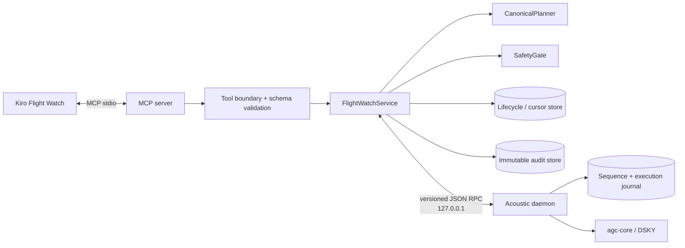

# MCP Bridge Design

**Feature:** `mcp-bridge`  
**Workflow:** Design-First  
**Status:** Draft for review  
**Normative precedence:** `contracts/acoustic-frame-v1.md` controls the wire frame; `docs/state-machines.md` controls control-flow state; this design controls the MCP bridge and local RPC behavior.

## Overview

The bridge is a Python 3.12 MCP server using stdio. It lets one operator-started Flight Watch session wait for daemon-validated telemetry, inspect AGC state, obtain a deterministic DSKY plan, and request execution. The agent remains an untrusted planner. `SafetyGate` independently reloads the command and current AGC state, recomputes criticality and the canonical plan, verifies AUTH and lifecycle state, and only then asks the daemon to actuate.

The official runtime path is:

```text
operator starts Flight Watch
  -> agent calls await_telemetry_frame(timeout_sec)
  -> MCP stdio server
  -> schema-validated local RPC on 127.0.0.1
  -> acoustic daemon
  -> agc-core
```

`PostFileCreate` is not part of this path. Hooks guard Kiro activity and run development checks only.

### 1.1 Goals

- Expose the six MCP tools defined by the PRD with strict typed contracts.
- Enforce inspect-before-plan/act and exact canonical-plan equality.
- Enforce critical-command AUTH independently of the agent and frame flag.
- Make AUTH expiry, one-time consumption, retries, concurrency, and restarts fail closed.
- Prevent duplicate or interleaved DSKY key sequences.
- Produce durable, schema-valid audit evidence without claiming unmeasured results.

### 1.2 Non-goals

- Parsing or authenticating raw acoustic bytes in the MCP process.
- Reading `telemetry/inbox` as the runtime event bus; the daemon owns publication and sequence.
- Implementing DSKY state transitions in the MCP server.
- Remote MCP, remote daemon RPC, AUTH-before-COMMAND buffering, or sequence wraparound.
- Automatic recovery or retry after partial execution.
- UI-based authorization or safety decisions.

## 2. Decisions and trade-offs

| Decision | Choice | Reason / consequence |
| :-- | :-- | :-- |
| Flight Watch delivery | Durable single-consumer cursor advanced by `await_telemetry_frame` | Prevents duplicate delivery within a session and survives restart. Historical reads do not mutate it. |
| Await frame types | Typed union of accepted `COMMAND` and `AUTH` | Flight Watch can observe AUTH while a command is held. Only COMMAND starts inspect/plan. |
| Inspect freshness | Same session, after COMMAND delivery, age `< inspection_max_age_ms` (20 s), matching AGC revision and sequence epoch | Originally 5 s. Changed 12 Nov 2026 after a live Kiro session measured 5–30 s between consecutive agent tool calls, which made every plan stale. Staleness of *state* is still caught exactly by the revision check at plan, gate, and daemon actuation; the age window only bounds how long an unchanged inspection may be reused. |
| P40 threshold | `P40_CRITICAL_DELTA_V_THRESHOLD_TENTHS_FPS = 0`; critical when absolute value is greater than zero | Any non-zero burn request requires operator AUTH. Zero is a boundary/no-burn case unless V37/V34-in-P40 rules apply. One exported domain constant is used; equality tests prevent duplication. |
| AUTH-before-COMMAND | Reject with `STATE` | Matches the v1 simplification recommended by the wire contract and avoids an orphan AUTH cache. |
| Held expiry | `hold_expiry_ms` (120 s) from daemon `received_at`; expired when `now >= deadline` | Gives one unambiguous clock origin and exact boundary. Clock is injected. Originally 30 s. Changed 12 Nov 2026 (catalog 1.2): the window must cover the agent seeing HELD, a human operator sending AUTH, and the agent's await/inspect/plan/execute calls at 5–30 s each, which cannot fit in 30 s. AUTH key, `ref_seq` binding, single use, and sequence ordering are unchanged. |
| AUTH consumption | Atomic with `READY -> EXECUTING` claim, before RPC actuation | At most one attempt. Failure and unknown outcome do not restore AUTH. |
| Execution identity | `frame_seq` plus canonical key digest | A COMMAND has at most one attempt; retries reconcile rather than actuate again. |
| Write concurrency | One global daemon DSKY writer plus transactional per-command claim | Different command sequences cannot interleave; same-command races have one winner. |
| Timeout after possible actuation | `OUTCOME_UNKNOWN`, reconcile by `frame_seq`, never resend blindly | Favors safety over automatic availability. |
| Audit storage | Immutable event records atomically published; JSONL session view is derived | Satisfies append-only evidence while avoiding torn appends. |
| Command mapping | Versioned shared command catalog in `contracts/`; MCP and daemon consume validated typed representations | Prevents guessed key sequences and duplicated protocol constants. M3 must approve V25/V34/V37 semantics before bridge implementation. |
| Tool approval | Execute omitted from all auto-approval rules | Read approval cannot imply write approval. |

## Architecture



### 3.1 Dependency direction

```text
MCP SDK adapter -> application services -> pure domain types/policies
                                  |
                                  +-> injected RPC/store/clock/audit ports

mcp-server -> local RPC -> acoustic/daemon -> agc-core
```

The MCP server does not import `agc-core`, `acoustic.frame`, frontend code, or audio adapters. Shared values cross the process boundary only through versioned schemas in `contracts/` and validated domain types.

## Components and Interfaces

| Component | Responsibility | Owned state |
| :-- | :-- | :-- |
| `McpStdioAdapter` | Register six tools, validate tool input/output, map domain errors to MCP results | MCP session ID only |
| `FlightWatchService` | Session lifecycle, durable await cursor, inspection context, orchestration | Active session lease and in-memory cache backed by store |
| `DaemonRpcClient` | Validate request/result/error envelopes and enforce loopback endpoint | No domain state |
| `TelemetryRepository` | Read accepted frames through daemon RPC and convert to validated frame types | No sequence authority |
| `CanonicalPlanner` | Load versioned catalog, derive exact keys/postcondition/digest | Catalog version only |
| `CriticalityPolicy` | Recompute criticality from trusted command and current AGC state | Threshold constant |
| `AuthorizationLedger` | COMMAND/AUTH lifecycle, expiry, one-time consumption, epoch reconciliation | Durable lifecycle records |
| `SafetyGate` | Inspect freshness, canonical equality, criticality, AUTH, and atomic claim | No state outside ledger transaction |
| `ExecutionCoordinator` | RPC actuation, timeout reconciliation, post-inspection, final state | Durable execution result by `frame_seq` |
| `AuditSink` | Atomically publish immutable schema-valid events | Monotonic audit event ID |
| Acoustic daemon | Accepted-frame publication, global sequence/epoch, AGC snapshots, single DSKY writer, execution journal | Authoritative sequence and AGC state |

## 4. Runtime flows

### 4.1 Flight Watch start and frame delivery

```mermaid
sequenceDiagram
  actor Operator
  participant K as Kiro
  participant M as MCP bridge
  participant D as Daemon RPC
  Operator->>K: Start Flight Watch
  K->>M: await_telemetry_frame(timeout_sec)
  M->>M: acquire/renew single session lease
  M->>D: telemetry.await(after_seq=cursor, deadline)
  alt accepted frame arrives
    D-->>M: ValidatedFrame + sequence_epoch
    M->>M: validate schema; atomically persist cursor
    M->>M: ingest COMMAND/AUTH lifecycle; audit
    M-->>K: FRAME(frame)
  else deadline expires
    D-->>M: TIMEOUT
    M-->>K: TIMEOUT(cursor unchanged)
  end
```

The first await call starts the bridge-side live lease and creates the `telemetry/FLIGHT_MODE` marker through an injected marker adapter. The durable cursor is scoped to the configured daemon identity and sequence epoch. `read_telemetry_frames` never changes it.

A delivered COMMAND becomes `READY` if noncritical or `HELD` if critical without matching AUTH. A delivered AUTH is ingested into the authorization ledger. Because AUTH-before-COMMAND is rejected, AUTH can only transition its referenced live `HELD` command to `READY`.

### 4.2 Inspect, plan, gate, execute, verify

```mermaid
sequenceDiagram
  participant K as Kiro
  participant M as MCP bridge
  participant D as Daemon
  K->>M: inspect_agc_status()
  M->>D: agc.inspect
  D-->>M: snapshot(revision, epoch, lamps)
  M-->>K: typed snapshot
  K->>M: plan_dsky_sequence(frame_seq)
  M->>M: require fresh inspection
  M->>M: load COMMAND; canonical plan; criticality
  M-->>K: plan + digest + auth_state + postcondition
  K->>M: execute_dsky_sequence(keys, frame_seq)
  M->>M: reload COMMAND + ledger
  M->>D: execution.preflight(frame_seq)
  D-->>M: current snapshot/revision + journal state
  M->>M: recompute plan/criticality; exact key comparison
  M->>M: atomically claim command and consume AUTH if required
  M->>D: dsky.execute(frame_seq, digest, canonical keys, expected revision)
  D->>D: global write lock; KEY REL before every key; >=100 ms cadence; OPR ERR after every key
  D-->>M: terminal or unknown result
  M->>D: agc.inspect
  D-->>M: post snapshot
  M->>M: verify postcondition; close lifecycle; audit
  M-->>K: EXECUTED or typed failure
```

The preflight snapshot is authoritative for gate evaluation. The earlier explicit `inspect_agc_status` call is still required as workflow evidence, but cannot override a newer daemon state.

### 4.3 Timeout and reconciliation

- A timeout before daemon acceptance returns `TIMEOUT` and does not claim execution.
- Once the ledger claim is committed, the command can never return to `READY`.
- If the RPC connection fails after actuation may have started, the coordinator records `OUTCOME_UNKNOWN` and queries `execution.get(frame_seq)` with bounded retries that do not actuate.
- If the daemon journal reports a terminal result, the coordinator performs post-inspection and stores the reconciled result.
- If the result remains unknown, Flight Watch enters `HALTED`. Operator acknowledgement and a readable safe AGC state are required before later commands. The original command remains closed.

## Data Models

### 5.1 Core value types

```text
FrameSeq          = integer 1..4294967295
SequenceEpoch     = opaque UUID string issued by daemon
StateRevision     = integer >= 1, monotonically increasing per epoch
SessionId         = opaque UUID string
AuditEventId      = integer >= 1, monotonically increasing per session
Key               = VERB | NOUN | DIGIT_0..DIGIT_9 | PLUS | MINUS | ENTR | PRO | CLR | RSET | KEY_REL
CommandState      = VALIDATED | HELD | READY | EXECUTING | EXECUTED | FAILED | EXPIRED | OUTCOME_UNKNOWN
AuthState         = NOT_REQUIRED | REQUIRED | MATCHED | CONSUMED | EXPIRED | REJECTED
GateDecision      = ALLOW | REJECT | RECONCILE
ExecutionStatus   = EXECUTED | FAILED | OUTCOME_UNKNOWN
```

Only keys present in the versioned command catalog can appear in a canonical plan. `execute_dsky_sequence` accepts the complete `Key` enum at schema validation, but the exact-plan check ensures control keys such as `RSET`, `CLR`, or `KEY_REL` cannot be injected unless a future approved catalog explicitly includes them.

### 5.2 COMMAND lifecycle record

```text
CommandRecord
  frame_seq: FrameSeq                 # primary idempotency key
  sequence_epoch: SequenceEpoch
  accepted_at: RFC3339 timestamp      # supplied by daemon
  expires_at: accepted_at + hold_expiry_ms (120 s)   # only relevant while HELD
  command_digest: sha256 canonical JSON of accepted command
  state: CommandState
  critical_reasons: set[CriticalReason]
  auth_seq: FrameSeq | null
  auth_state: AuthState
  plan_digest: sha256 | null
  inspection_revision: StateRevision | null
  execution_started_at: timestamp | null
  execution_finished_at: timestamp | null
  terminal_result: ExecutionResult | null
```

Allowed transitions:

```text
VALIDATED -> READY                     noncritical
VALIDATED -> HELD                      critical, no AUTH
HELD -> READY                          fresh matching accepted AUTH
HELD -> EXPIRED                        now >= expires_at
READY -> EXECUTING                     atomic claim; consume AUTH if matched
EXECUTING -> EXECUTED                  postcondition matched
EXECUTING -> FAILED                    known failure or postcondition mismatch
EXECUTING -> OUTCOME_UNKNOWN           actuation may have started, no confirmation
OUTCOME_UNKNOWN -> EXECUTED | FAILED   journal reconciliation only
```

Terminal or unknown records never return to READY. `FAILED` includes partial execution. `AUTH` reuse against `EXECUTING`, terminal, expired, or outcome-unknown records returns `AUTH_USED` or `COMMAND_CLOSED` and causes no actuation.

### 5.3 AUTH lifecycle

An accepted AUTH may be recorded only when all conditions hold:

1. The daemon marks the frame accepted and operator-key validated.
2. Its `ref_seq` identifies a `HELD` command in the same sequence epoch.
3. `AUTH.seq` is globally newer because daemon validation already enforced the sequence contract.
4. `now < command.expires_at`.
5. No AUTH was previously matched or consumed for that command.

The ledger transaction stores `auth_seq`, transitions AUTH to `MATCHED`, and transitions the command to `READY`. Claiming execution transitions AUTH to `CONSUMED` in the same transaction as `READY -> EXECUTING`. The AUTH remains consumed after success, failure, timeout, cancellation, restart, or reconciliation.

### 5.4 Inspection context

```text
InspectionContext
  session_id
  delivered_frame_seq
  sequence_epoch
  agc_revision
  captured_at
  snapshot_digest
```

Planning and execution require: same session; same relevant COMMAND; same epoch; capture after frame delivery; age less than `inspection_max_age_ms` (20 seconds); `KEY REL=false`; readable AGC. Planning does not consume the context. Any execution attempt, epoch change, detected revision mismatch, or Flight Watch stop invalidates it.

## 6. Canonical planning

### 6.1 Command catalog

The authoritative v1 catalog is a versioned contract artifact planned as `contracts/dsky-command-catalog-v1.json` plus schema. It contains the verified V25, V34, and V37 templates, allowed field ranges, fixed-point-to-register conversion, expected preconditions, and postconditions. This bridge design does not invent Apollo key semantics not yet approved by M3 task 3.1.

Known normative V37 expansion from `docs/state-machines.md` is:

```text
VERB, DIGIT_3, DIGIT_7, ENTR, tens(program), ones(program), ENTR
```

V25 and V34 templates MUST be populated from the approved AGC-emulator command catalog before bridge implementation. The catalog must reject unsupported verb/noun/program combinations and register values that cannot be represented by the AGC subset. The MCP server and daemon validate the same catalog version; a version mismatch returns `CATALOG_MISMATCH` and prevents actuation.

### 6.2 Plan algorithm

Given `(accepted COMMAND, fresh inspection snapshot, catalog_version)`:

1. Confirm frame type is COMMAND, epoch matches, and state is open.
2. Select exactly one supported catalog entry by verb/program/precondition.
3. Convert fixed-point payload fields using catalog-declared integer operations only; reject overflow rather than clamp.
4. Expand key tokens deterministically, including explicit signs and zero-padded digits defined by the catalog.
5. Derive a postcondition over program, registers, lamps, and `OPR ERR=false`.
6. Compute critical reasons independently from the frame flag.
7. Serialize `{catalog_version, frame_seq, command_digest, inspection_revision, keys, postcondition}` as canonical JSON and calculate SHA-256 `plan_digest`.

No wall clock, random value, filesystem read, network call, or agent text enters this function.

### 6.3 Criticality policy

```text
V37_WHILE_P40:
  command verb == 37 AND inspected program == 40

V34_WHILE_P40:
  command verb == 34 AND inspected program == 40

NONZERO_P40_ACTIVATION:
  canonical postcondition enters program 40
  AND inspected program != 40
  AND abs(delta_v_tenths_fps) > 0
```

The policy returns the union of reasons. The frame `critical` bit may add an audit warning when inconsistent, but it can never remove a computed reason. The threshold constant is defined once in the domain policy and exposed in the command-catalog metadata; a contract equality test prevents drift.

## 7. MCP tool contracts

All tool requests are JSON objects with `additionalProperties: false`. All results include `schema_version: "1.0"` and `request_id`. Expected domain rejection is returned as a structured tool result with `ok: false`; malformed MCP input uses the MCP SDK invalid-parameters mechanism and performs no domain call.

### 7.1 Shared result shapes

```json
{
  "schema_version": "1.0",
  "request_id": "uuid",
  "ok": true,
  "data": {}
}
```

```json
{
  "schema_version": "1.0",
  "request_id": "uuid",
  "ok": false,
  "error": {
    "code": "STABLE_CODE",
    "message": "human-readable text",
    "retryable": false,
    "frame_seq": 123,
    "details": {}
  }
}
```

`message` is not stable. `code` is stable. `details` is code-specific, schema-constrained, and never contains secrets or raw exception traces.

### 7.2 `read_telemetry_frames`

**Request**

```json
{
  "since_seq": 0,
  "limit": 100
}
```

- `since_seq`: optional integer `0..4294967295`, default `0`, exclusive.
- `limit`: optional integer `1..500`, default `100`.

**Success data**

```json
{
  "frames": ["ValidatedFrame"],
  "next_since_seq": 123,
  "truncated": false,
  "sequence_epoch": "uuid"
}
```

Only `verdict=ACCEPTED` frame objects conforming to `contracts/telemetry-frame.schema.json` appear. `next_since_seq` equals the greatest returned sequence, or the request cursor if empty. An epoch mismatch returns `SEQUENCE_EPOCH_CHANGED`; historical reads do not mutate the Flight Watch cursor.

### 7.3 `await_telemetry_frame`

**Request**

```json
{ "timeout_sec": 30 }
```

- `timeout_sec`: required number `0.1..30.0` seconds.

**Success data, frame**

```json
{
  "status": "FRAME",
  "frame": "ValidatedFrame",
  "cursor_seq": 124,
  "sequence_epoch": "uuid"
}
```

**Success data, timeout**

```json
{
  "status": "TIMEOUT",
  "frame": null,
  "cursor_seq": 123,
  "sequence_epoch": "uuid"
}
```

Timeout is a successful wait outcome, not an internal error. Cursor persistence and lifecycle ingestion occur atomically before a FRAME result is returned. Cancellation returns `CANCELLED` without advancing for an undelivered frame.

### 7.4 `inspect_agc_status`

**Request:** `{}`

**Success data**

```json
{
  "sequence_epoch": "uuid",
  "state_revision": 456,
  "captured_at": "RFC3339 timestamp",
  "program": 40,
  "verb": 25,
  "noun": 0,
  "registers": { "r1": 0, "r2": 0, "r3": 0 },
  "input_state": "IDLE",
  "lamps": {
    "comp_acty": false,
    "uplink_acty": false,
    "key_rel": false,
    "opr_err": false
  },
  "snapshot_digest": "64 lowercase hex"
}
```

The daemon creates a coherent snapshot under its AGC read boundary. The MCP service stores the corresponding inspection context for the current delivered COMMAND. Unavailable or incoherent state returns `AGC_UNAVAILABLE`.

### 7.5 `plan_dsky_sequence`

**Request**

```json
{ "frame_seq": 123 }
```

- `frame_seq`: required integer `1..4294967295`.

**Success data**

```json
{
  "frame_seq": 123,
  "sequence_epoch": "uuid",
  "inspection_revision": 456,
  "catalog_version": "1.0",
  "keys": ["VERB", "DIGIT_3", "DIGIT_7", "ENTR", "DIGIT_4", "DIGIT_0", "ENTR"],
  "plan_digest": "64 lowercase hex",
  "critical": true,
  "critical_reasons": ["NONZERO_P40_ACTIVATION"],
  "auth_state": "REQUIRED",
  "postcondition": {
    "program": 40,
    "registers": {},
    "required_clear_lamps": ["opr_err"]
  }
}
```

Planning rejects AUTH frame IDs, expired/closed commands, stale inspection, unsupported commands, catalog mismatch, and unrepresentable payloads. It does not reserve execution or consume AUTH.

### 7.6 `execute_dsky_sequence`

**Request**

```json
{
  "frame_seq": 123,
  "keys": ["VERB", "DIGIT_3", "DIGIT_7", "ENTR", "DIGIT_4", "DIGIT_0", "ENTR"]
}
```

- `frame_seq`: required integer `1..4294967295`.
- `keys`: required array of `1..128` key enum values; no free-form strings.

**Success data**

```json
{
  "frame_seq": 123,
  "execution_id": "uuid",
  "status": "EXECUTED",
  "idempotent_replay": false,
  "plan_digest": "64 lowercase hex",
  "keys_accepted": 7,
  "started_at": "RFC3339 timestamp",
  "finished_at": "RFC3339 timestamp",
  "pre_revision": 456,
  "post_revision": 463,
  "postcondition_matched": true
}
```

A known partial failure is `ok:false` with `EXECUTION_FAILED`, `keys_accepted`, terminal lifecycle state, and no retry permission. Lost confirmation is `OUTCOME_UNKNOWN`. Repeating an identical request returns the stored result with `idempotent_replay:true`; it never presses keys again.

### 7.7 `verify_crc16`

**Request**

```json
{ "hex_payload": "0123abcd" }
```

- Required lowercase or uppercase even-length hex string representing `2..4096` bytes.
- The final two bytes are the supplied big-endian CRC; all preceding bytes are the CRC input.

**Success data**

```json
{
  "input_bytes": 4,
  "algorithm": "CRC-16/CCITT-FALSE",
  "computed_crc_hex": "cdef",
  "supplied_crc_hex": "abcd",
  "matches": false
}
```

This pure audit utility has no telemetry, cursor, AUTH, lifecycle, AGC, audit-decision, or execution side effect. A matching CRC does not imply HMAC authenticity or authorization.

## 8. Local RPC contracts

All cross-process messages are planned under `contracts/mcp-daemon-rpc.schema.json`. Each newline-delimited JSON message is bounded to 64 KiB and validated before dispatch.

### 8.1 Envelope

**Request**

```json
{
  "schema_version": "1.0",
  "request_id": "uuid",
  "method": "telemetry.await",
  "deadline_ms": 30000,
  "params": {}
}
```

**Success**

```json
{
  "schema_version": "1.0",
  "request_id": "same uuid",
  "ok": true,
  "daemon_instance_id": "uuid",
  "sequence_epoch": "uuid",
  "result": {}
}
```

**Error**

```json
{
  "schema_version": "1.0",
  "request_id": "same uuid",
  "ok": false,
  "daemon_instance_id": "uuid",
  "sequence_epoch": "uuid",
  "error": { "code": "STABLE_CODE", "message": "text", "retryable": false, "details": {} }
}
```

The client rejects mismatched request IDs, versions, instance/epoch regressions, oversized messages, unknown methods, extra properties, and responses arriving after cancellation.

### 8.2 Required RPC methods

| Method | Purpose | Mutation |
| :-- | :-- | :-- |
| `telemetry.read` | Accepted frames after exclusive cursor, bounded limit | None |
| `telemetry.await` | Wait for next accepted frame after cursor | None in daemon domain |
| `agc.inspect` | Coherent AGC snapshot and revision | None |
| `execution.preflight` | Current snapshot plus journal state for `frame_seq` | None |
| `dsky.execute` | Idempotent canonical sequence actuation under global writer lock | Execution journal + AGC |
| `execution.get` | Reconcile execution by `frame_seq` and digest | None |

`dsky.execute` requires `frame_seq`, plan digest, catalog version, canonical keys, expected AGC revision, minimum cadence `100 ms`, and operation ID. The daemon rejects plan/catalog/revision conflicts and owns before-each-key `KEY REL` and after-each-key `OPR ERR` checks. The RPC does not carry raw HMAC keys.

## 9. Concurrency and persistence

### 9.1 Session concurrency

- One live Flight Watch lease is allowed per MCP server instance. A second session receives `FLIGHT_WATCH_BUSY`.
- Read-only tools may run concurrently.
- `await_telemetry_frame` calls for one session are serialized; a second overlapping wait receives `BUSY` rather than racing the cursor.
- Tool transport serialization is not treated as a safety guarantee; stores and daemon operations remain concurrency-safe.

### 9.2 Transaction boundaries

The authorization ledger must support compare-and-swap transactions keyed by `(sequence_epoch, frame_seq)`:

```text
load current record
verify expected state/revision/expiry/auth
write READY -> EXECUTING
write AUTH MATCHED -> CONSUMED when required
write execution_id + plan_digest
commit atomically
```

Audit persistence of the allow decision must succeed before `dsky.execute`. If audit publication fails, claim is marked `FAILED`/closed and no actuation occurs. Final execution/audit updates are idempotent.

### 9.3 Daemon writer lock

The daemon acquires one process-wide DSKY writer lock before checking expected revision and before the first key. It writes an execution-journal `STARTED` record before key actuation. The lock remains held through key processing and terminal journal persistence. No two frame sequences can interleave keys.

### 9.4 Restart

At startup the MCP bridge:

1. Reads daemon instance ID, sequence epoch, high-water sequence, and nonterminal execution journal entries.
2. Loads its cursor/lifecycle store through an injected persistence adapter.
3. Invalidates inspection contexts.
4. If epochs match, reconciles every `EXECUTING`/`OUTCOME_UNKNOWN` record by `frame_seq`.
5. If epochs differ, atomically expires all old pending records and starts a new cursor namespace.
6. Refuses execute until reconciliation and required audit writes complete.

## Error Handling

| Code | Meaning | Retry policy / mutation |
| :-- | :-- | :-- |
| `INVALID_ARGUMENT` | MCP input failed schema/range validation | Fix request; none |
| `SCHEMA_VERSION` | Unsupported boundary schema | Upgrade/configure; none |
| `RPC_PROTOCOL` | Malformed/mismatched daemon response | Fail closed; none |
| `DAEMON_UNAVAILABLE` | Local RPC unavailable | Retry read/inspect; never assume execute failed safely |
| `TIMEOUT` | Read-only operation deadline elapsed | Retry explicitly; cursor unchanged |
| `CANCELLED` | Wait cancelled before delivery | Safe to wait again |
| `FLIGHT_WATCH_BUSY` | Another live session owns lease | Operator resolves lease |
| `NOT_FOUND` | Frame sequence not known | No mutation |
| `SEQUENCE_EPOCH_CHANGED` | Daemon was explicitly reprovisioned | Reconcile/restart workflow |
| `INSPECTION_REQUIRED` | No qualifying prior inspect | Inspect, then plan again |
| `INSPECTION_STALE` | Age, revision, or epoch mismatch | Inspect and plan again |
| `AGC_UNAVAILABLE` | Coherent AGC state cannot be read | Halt; no actuation |
| `KEY_REL_ACTIVE` | KEY REL precondition failed | Halt; no/new keys |
| `OPR_ERR_ACTIVE` | OPR ERR precondition or mid-sequence stop | Halt; attempt closed |
| `UNSUPPORTED_COMMAND` | No approved catalog mapping | No actuation |
| `CATALOG_MISMATCH` | MCP/daemon catalog versions differ | Deploy matching versions |
| `PLAN_MISMATCH` | Agent keys differ from recomputed plan | No actuation |
| `AUTH_REQUIRED` | Critical command has no matching AUTH | Remain HELD until deadline |
| `AUTH_INVALID` | Wrong ref/provenance/state | Remain HELD or close if deadline passed |
| `AUTH_EXPIRED` | `now >= expires_at` | Command becomes EXPIRED |
| `AUTH_USED` | AUTH already matched/consumed/closed | No actuation |
| `COMMAND_CLOSED` | Command terminal or unknown | Return stored result if identical |
| `BUSY` | Wait or global writer already active | Explicit retry only when safe |
| `IDEMPOTENCY_CONFLICT` | Same frame, different request digest | No actuation |
| `EXECUTION_FAILED` | Known failed/partial attempt | Closed; no automatic retry |
| `OUTCOME_UNKNOWN` | Actuation may have started | Reconcile only; no resend |
| `POSTCONDITION_MISMATCH` | Observed AGC state differs | FAILED + HALTED |
| `AUDIT_FAILURE` | Required audit event could not persist | Fail closed before actuation |
| `INTERNAL` | Translated unexpected internal failure | Context logged; fail closed |

Expected safety rejections are normal domain results and must not be hidden in generic `INTERNAL`. Unexpected exceptions are logged with request/session context and translated without exposing secrets.

## 11. Audit design

A planned `contracts/mcp-audit-event.schema.json` defines this immutable event envelope:

```json
{
  "schema_version": "1.0",
  "session_id": "uuid",
  "event_id": 17,
  "timestamp": "RFC3339 timestamp",
  "event_type": "gate.decision",
  "request_id": "uuid",
  "frame_seq": 123,
  "ref_seq": null,
  "sequence_epoch": "uuid",
  "agc_revision": 456,
  "plan_digest": "64 lowercase hex or null",
  "decision": "ALLOW",
  "error_code": null,
  "command_state": "EXECUTING",
  "details": {}
}
```

Required event types include session start/stop, frame delivered, AUTH accepted/rejected/consumed, inspection, plan generated, gate allow/reject, execution started/progress/stopped, reconciliation, postcondition result, cursor commit, and hook validation summary. Events use monotonically increasing IDs and are written as new immutable files via temp file plus atomic rename. A JSONL session report is generated from validated events in event-ID order; it is not the primary write format.

Raw accepted frame hex remains in daemon telemetry evidence under `telemetry-frame.schema.json`. MCP audit references frame sequence and digest instead of duplicating secrets or trusting mutable UI state.

## 12. Hooks and MCP configuration

Hooks are planned deliverables only; none are created by this spec-writing task.

### 12.1 `flight-mode-shell-guard` (`PreToolUse`)

- Reads the live Flight Watch lease marker through a small command boundary.
- When live, blocks shell/process tools and project-file create/write/edit/delete/move tools with exit code 2.
- Allows the six Apollo-26 MCP tools. It does not turn arbitrary tools into MCP tools.
- Treats a marker as live only when session ID, owner process, and lease expiry validate; stale markers fail closed until explicit operator cleanup.
- Never implements AUTH, canonical planning, or execute approval.

### 12.2 `test-after-spec-task` (`PostTaskExec`)

- Maps task areas to focused pytest/schema/import-boundary checks.
- Captures command, start/finish time, output path, and exit code.
- A nonzero exit is reported as failure and cannot be rewritten as success.
- Full validation remains required at the integration gate.

### 12.3 `pbt-on-save` (`PostFileSave`)

- Matcher: `(mcp-server|agc-core|acoustic)[\\/].*\.py$`.
- Does not run during a live Flight Watch session.
- Debounces saves into one quick run and prevents overlapping runs.
- Runs `python -m pytest -m "not slow"` after the test scaffold provides that command.
- This hook may be deferred only by the explicit schedule cut in `TASK.md`; if deferred, evidence must say so. It must never display a fabricated pass.

### 12.4 MCP approval configuration

`.kiro/settings/mcp.json` registers the local stdio server. `execute_dsky_sequence` is absent from every auto-approval list and wildcard. Read-only approval entries, if used, name tools explicitly. A configuration test parses the effective settings and fails if execute is auto-approved directly or transitively.

## Correctness Properties

### Property 1: P7 — Critical commands without fresh matching AUTH never actuate

**Validates: Requirements 11.1, 12.1, 13.1, 14.1, 15.1, 17.1, 29.1**  
**Requirement IDs:** MCP-REQ-11, MCP-REQ-12, MCP-REQ-13, MCP-REQ-14, MCP-REQ-15, MCP-REQ-17, MCP-REQ-29

For any supported command, initial AGC state, agent key sequence, frame critical flag, AUTH state/provenance/ref sequence, injected time, retry history, and concurrent schedule: if independently computed criticality is true and there is not exactly one fresh matching unused accepted AUTH at atomic claim time, the observed daemon key-send count is zero.

Use a stateful Hypothesis rule machine with independent model policy, fake clock, transactional fake ledger, and instrumented daemon adapter. Include values immediately below, at, and above the delta-v threshold and the `hold_expiry_ms` deadline.

### Property 2: MCP-P1 — Canonical planning is deterministic

**Validates: Requirements 9.1, 10.1**  
**Requirement IDs:** MCP-REQ-9, MCP-REQ-10

For any catalog-supported accepted COMMAND and valid inspection snapshot, repeated planning with the same catalog version produces identical keys, postcondition, critical reasons, and digest. Any sequence with insertion, deletion, substitution, or reordering fails exact comparison and causes zero actuation.

### Property 3: MCP-P2 — AUTH permits at most one attempt

**Validates: Requirements 13.1, 15.1, 16.1, 21.1, 22.1**  
**Requirement IDs:** MCP-REQ-13, MCP-REQ-15, MCP-REQ-16, MCP-REQ-21, MCP-REQ-22

For any valid matching AUTH and any sequence of duplicate, failed, cancelled, restarted, and concurrent execute operations, at most one transition to `EXECUTING` occurs, at most one daemon execution operation ID exists, and AUTH never returns from `CONSUMED` to a usable state.

### Property 4: MCP-P3 — Execute is idempotent by frame and plan digest

**Validates: Requirements 20.1, 21.1**  
**Requirement IDs:** MCP-REQ-20, MCP-REQ-21

For any claimed/terminal command, any number of identical repeats returns the same stored/reconciled terminal information with no additional key sends. A different plan digest for the same frame always returns `IDEMPOTENCY_CONFLICT` with no mutation.

### Property 5: MCP-P4 — DSKY writes are serializable

**Validates: Requirements 17.1, 18.1, 22.1**  
**Requirement IDs:** MCP-REQ-17, MCP-REQ-18, MCP-REQ-22

For any concurrent set of execute requests, the emitted key trace is equivalent to zero or more complete non-overlapping canonical sequences. Every adjacent accepted key within one sequence is separated by at least 100 ms; no key follows the first observed `KEY REL=true` or `OPR ERR=true` in that attempt.

### Property 6: MCP-P5 — Safety rejection preserves AGC state

**Validates: Requirements 8.1, 10.1, 13.1, 17.1, 25.1**  
**Requirement IDs:** MCP-REQ-8, MCP-REQ-10, MCP-REQ-13, MCP-REQ-17, MCP-REQ-25

For any missing/stale inspection, plan mismatch, invalid/expired/used AUTH, unavailable AGC, epoch mismatch, active KEY REL, audit failure, or closed command, the gate returns its stable code and the AGC key trace and state revision remain unchanged.

### Property 7: MCP-P6 — Await cursor is monotonic and timeout-safe

**Validates: Requirements 4.1, 5.1, 32.1**  
**Requirement IDs:** MCP-REQ-4, MCP-REQ-5, MCP-REQ-32

For any accepted-frame history, arrival schedule, timeout, cancellation, and restart sequence within one epoch, `await` returns frames in strictly increasing sequence order at most once and never advances the cursor on timeout/cancellation before delivery. Historical reads never change that cursor.

### Property 8: MCP-P7 — Epoch change invalidates old authority

**Validates: Requirements 16.1**  
**Requirement ID:** MCP-REQ-16

For any pre-reset cursor, inspection, pending COMMAND, matched AUTH, or execution request, changing sequence epoch makes every old value unusable for planning or actuation, even if a numeric sequence is reused after explicit reprovisioning.

## Testing Strategy

### 14.1 Unit and contract tests

- JSON Schema positive/negative fixtures for every MCP tool, RPC method, audit event, and catalog entry.
- Pure planner tests for V25/V34/V37 approved catalog vectors and integer overflow/range rejection.
- Criticality examples for P00/P40 and delta-v `-1, 0, +1` tenths ft/s.
- Lifecycle transition table tests with fake clock at `deadline-ε`, `deadline`, and `deadline+ε`.
- Error translation and secret-redaction tests.
- CRC utility vectors from the normative contract; verify it has no state effects.

### 14.2 Property-based P7 suite

P7 runs against pure/in-memory adapters and records Hypothesis seed and failing example. Required generated dimensions include:

- AGC program P00/P40 and all lamp combinations.
- Supported and unsupported command forms, including misleading `CRITICAL=false`.
- Correct, wrong-ref, wrong-provenance, expired, duplicate, consumed, and absent AUTH.
- Canonical and arbitrary key arrays.
- Restarts, epoch changes, timeout points, and interleavings.
- Audit failure and daemon unavailability.

The property oracle is a separate minimal safety model, not a call back into `SafetyGate`.

### 14.3 Integration and E2E abuse tests

The suite uses real MCP stdio and local RPC boundaries, a deterministic daemon/audio fixture where needed, and the real AGC subset. It covers:

1. Valid COMMAND is delivered, inspected, canonically planned, executed, and post-verified.
2. Invalid CRC returns daemon `CRC` rejection and never reaches MCP accepted-frame tools.
3. Valid CRC with invalid HMAC returns `HMAC` and no key.
4. Old global sequence is rejected as `REPLAY` after daemon restart.
5. Critical P40 command becomes HELD; wrong AUTH keeps it held; matching AUTH permits one attempt.
6. Reused AUTH returns `AUTH_USED`, `STATE`, or daemon `REPLAY` according to rejection boundary.
7. Agent key insertion/deletion/reorder returns `PLAN_MISMATCH`.
8. Noise/jamming produces zero wild keys and daemon remains available or reports bounded timeout.
9. `KEY REL` before start and mid-sequence stops keys.
10. `OPR ERR` mid-sequence stops before the next key and closes the command FAILED.
11. Duplicate identical execute returns stored result; conflicting duplicate is rejected.
12. Concurrent same/different-frame requests do not interleave and actuate at most one writer.
13. AUTH/COMMAND expiry is correct immediately before, at, and after `hold_expiry_ms`.
14. RPC disconnect before actuation is retryable; disconnect after claim is OUTCOME_UNKNOWN and reconciled without resend.
15. Postcondition mismatch enters FAILED/HALTED.
16. Effective MCP configuration does not auto-approve execute.
17. Hook fixtures validate PreToolUse, PostTaskExec, and PostFileSave behavior; no PostFileCreate telemetry hook exists.
18. Process/network inspection verifies the command path has no socket outside `127.0.0.1` before changing evidence status.

### 14.4 Evidence

Test runners, not UI constants, produce reports. The full P7 run stores case count, duration, seed, environment, command, output, and exit code in the project test report. Performance and network claims remain `TARGET` or `UNMEASURED` until evidence-matrix status is updated by a later approved task.

## 15. Traceability

| Requirements | Design areas | Verification |
| :-- | :-- | :-- |
| MCP-REQ-1–3 | Architecture; runtime flow; tool contracts | Tool discovery, stdio/local-RPC E2E, no-PostFileCreate config review |
| MCP-REQ-4–6 | Tool contracts; RPC contracts | MCP-P6, schema fixtures |
| MCP-REQ-7–11 | Inspection context; planner; SafetyGate | P7, MCP-P1, MCP-P5, attack E2E |
| MCP-REQ-12–16 | Criticality; lifecycle; persistence | P7, MCP-P2, MCP-P7, expiry/restart tests |
| MCP-REQ-17–22 | Execution flow; concurrency; errors | MCP-P3, MCP-P4, KEY REL/OPR ERR/timeout E2E |
| MCP-REQ-23–25 | Audit; approval; error model | Audit/schema tests, config review, MCP-P5 |
| MCP-REQ-26–28 | Hooks | Hook fixture tests and preserved exit-code evidence |
| MCP-REQ-29–30 | Test strategy | P7 report and E2E abuse suite |
| MCP-REQ-31–32 | Ownership; session shutdown | Import-boundary tests, socket inspection, cancellation/restart E2E |

## 16. Risks and open dependencies

- The AGC-emulator spec must approve exact V25/V34 semantics and numeric representation. Bridge implementation must not guess them. The catalog task is blocked on `TASK.md` M3.1/M3.8.
- The daemon local RPC and execution journal do not exist yet. Their schema and idempotency behavior must be implemented before execute integration.
- The telemetry schema does not currently express all conditional COMMAND/AUTH semantics. Those remain enforced by the normative wire validator; a contract-alignment task should add schema conditionals without weakening the wire contract.
- A localhost socket is still an IP interface. Claims must use the approved wording: no socket outside `127.0.0.1` after verification.
- `pbt-on-save` is listed in the schedule cut ladder. It remains in the nominal design; deferral requires an explicit project decision and truthful evidence.
