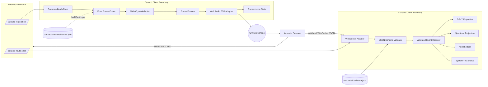
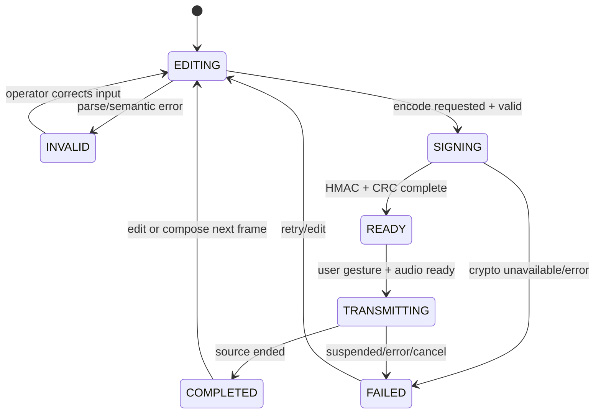

# Mission Console Design

## Overview

The feature is one static Next.js application with two routes and a small set of shared, typed browser modules:

- `/ground` is a phone-first frame composer, signer, byte/bit inspector, and 300-baud Bell-202 transmitter.
- `/console` is a read-only operational display driven only by schema-valid WebSocket events from the daemon.

The application does not implement daemon validation, sequence persistence, AGC logic, MCP orchestration, or safety authorization. It provides early input feedback on `/ground`, then leaves acceptance and execution decisions to the daemon and MCP safety gate. On `/console`, it projects validated events and explicitly marks missing or stale data.

### Goals

- Produce exact 34-byte COMMAND and AUTH frames and transmit those bytes as real audio.
- Project the existing WebSocket contract without synthetic fallback data.
- Preserve the strongest mockup patterns: precision hairlines, restrained corner ticks, a dense audit ledger, and a responsive DSKY dock.
- Keep every browser API behind a Client Component or injected adapter.
- Make evidence state, loading, disconnection, validation failure, and unmeasured data visible.
- Detect Python/TypeScript protocol drift through shared golden vectors and P9.

### Non-goals

- No command submission from `/console`.
- No browser safety gate, sequence authority, AGC state machine, or test runner.
- No detailed hook, safety-gate, receiver, or COMMAND/AUTH lifecycle display until a versioned event contract exposes those facts.
- No marketing landing route, command palette, settings/palette editor, orbital visualization, synthetic telemetry, or unsupported v1 verb/baud mode.
- No Luminary 99, Colossus 249, SSR, API route, Server Action, or Next.js runtime.

## Design Decisions

### Sequence entry

The protocol requires one global, persistent sequence across COMMAND and AUTH, but the current contracts do not define a sender-to-daemon sequence-allocation API. `/ground` therefore requires explicit operator entry for `seq` and, for AUTH, `ref_seq`. The client may warn about a sequence not increasing relative to frames transmitted in the current tab, but it does not persist or claim authority over freshness. The daemon remains authoritative and may reject a replay.

This choice avoids inventing a network command path, a browser-owned counter, or restart semantics. A later synchronization feature requires a separate versioned contract.

### Console is read-only

The current WebSocket schema defines server-to-browser events only. The DSKY keypad treatment from the mockups remains visual instrument framing, not an active controller. Interactive keypad controls and the 900 Hz membrane click are omitted because no validated browser-to-daemon action exists. DSKY interaction belongs to the MCP/AGC path.

### Contract gaps

Before WebSocket integration is marked complete, the daemon and frontend owners must agree on:

- WebSocket path and supported origins.
- Whether connection establishment sends current snapshots.
- Heartbeat/idle timeout behavior.
- Audit backfill and retention expectations.
- Whether `event_id` restarts with a daemon process or a connection.

The frontend policy below is safe without assuming answers: ordering is connection-scoped, reconnects retain stale UI state, and history completeness is never claimed. Detailed hook/safety/lifecycle panels are excluded because the current schema cannot support them.

## Architecture



### Dependency rules

- Route components depend on feature components and browser adapters.
- Presentation components depend on validated domain models, never raw WebSocket data.
- The pure frame codec has no React, DOM, Web Audio, Web Crypto, network, clock, or storage dependency.
- The Web Crypto adapter receives key material and bytes explicitly.
- The Web Audio adapter receives an immutable copy of the final 34 bytes explicitly.
- The console reducer accepts only `ValidatedConsoleEvent` values produced by the validator.
- No frontend module imports Python code or reimplements AGC/safety decisions.

## Components and Interfaces

```text
web-dashboard/
├── app/
│   ├── layout.tsx                         # static root, local fonts, metadata
│   ├── globals.css                        # Tailwind layers and accessibility defaults
│   ├── ground/
│   │   └── page.tsx                       # static route shell
│   └── console/
│       └── page.tsx                       # static route shell
├── components/
│   ├── shared/
│   │   ├── AppHeader.tsx
│   │   ├── ConnectionBadge.tsx
│   │   ├── EvidenceValue.tsx
│   │   ├── InstrumentPanel.tsx            # hairlines and optional corner ticks
│   │   └── StatusNotice.tsx               # loading/error/stale/unmeasured
│   ├── ground/
│   │   ├── GroundClient.tsx               # client composition root
│   │   ├── FrameTypeTabs.tsx
│   │   ├── CommandForm.tsx
│   │   ├── AuthForm.tsx
│   │   ├── SecretKeyField.tsx
│   │   ├── FrameInspector.tsx
│   │   └── TransmissionControls.tsx
│   └── console/
│       ├── ConsoleClient.tsx              # client composition root
│       ├── ConsoleShell.tsx
│       ├── SystemStatusStrip.tsx
│       ├── SpectrumPanel.tsx
│       ├── AuditLedger.tsx
│       ├── FrameDetailInspector.tsx
│       ├── TestSummaryPanel.tsx
│       └── DskyDock.tsx                   # read-only projection
├── lib/
│   ├── frame/
│   │   ├── domain.ts                      # branded/ranged domain values
│   │   ├── codec.ts                       # pure layout, CRC, decode
│   │   ├── bits.ts                        # 8N1 bit expansion
│   │   └── crypto.client.ts               # injected Web Crypto HMAC
│   ├── audio/
│   │   ├── bell202.ts                     # pure symbol/sample planning
│   │   └── transmitter.client.ts          # AudioContext adapter
│   ├── contracts/
│   │   ├── validator.ts                   # compiled Ajv validator/type guard
│   │   └── generated.ts                   # schema-generated TypeScript types
│   ├── console/
│   │   ├── websocket.client.ts
│   │   ├── reducer.ts
│   │   └── view-model.ts
│   └── config/
│       ├── paths.ts
│       └── public-config.ts
└── tests/
    ├── frame.test.ts
    ├── frame.property.test.ts
    ├── bell202.test.ts
    ├── contracts.test.ts
    ├── console-reducer.test.ts
    └── components/
```

Names are proposed, not a request to add extra scope. Implementation may combine small files while keeping the dependency and ownership boundaries.

## Static Rendering and Client Boundaries

### Server-safe static shells

`app/layout.tsx`, `app/ground/page.tsx`, and `app/console/page.tsx` render static structure only. They may import local fonts through `next/font/local`, metadata, and components. They do not read request headers, cookies, environment at request time, or browser globals.

### Client roots

`GroundClient.tsx` and `ConsoleClient.tsx` carry `'use client'`. Browser access stays below these boundaries:

- `GroundClient`: Web Crypto, Web Audio, optional session-only in-memory warnings, media-query state.
- `ConsoleClient`: WebSocket, timers for reconnection, document visibility, reduced-motion and responsive overlays.

Pure codec, reducer, formatting, and Bell-202 sample planning modules remain testable in Node without browser globals. Browser adapters are injected behind narrow interfaces.

```ts
interface HmacSigner {
  signSha256(keyUtf8: Uint8Array, message: Uint8Array): Promise<Uint8Array>;
}

interface AudioTransmitter {
  transmit(frame: Uint8Array, signal?: AbortSignal): Promise<TransmissionResult>;
}

interface ConsoleSocket {
  connect(handlers: SocketHandlers): () => void;
}
```

## Static Hosting and `basePath`

The build uses `output: 'export'` and `trailingSlash: true` so a simple static-file adapter can serve route directories consistently.

A single normalized build variable controls path generation:

- Daemon build: `NEXT_PUBLIC_APOLLO26_BASE_PATH=""`.
- GitHub Pages build: `NEXT_PUBLIC_APOLLO26_BASE_PATH="/apollo-26"` or the deployed repository name.

`next.config.ts` applies the normalized value to `basePath` and, where required by exported assets, `assetPrefix`. Internal links use Next.js navigation and shared path helpers rather than string-concatenating root-relative URLs. Local font files and public assets are emitted into the export.

For `/console`, the proposed documented default is a same-origin WebSocket path `/ws`: the client maps `http:` to `ws:` and `https:` to `wss:` and appends a build-time `NEXT_PUBLIC_APOLLO26_WS_PATH`. The final path and snapshot behavior remain a blocking daemon-contract task. No secret is placed in public build configuration. A GitHub Pages build can expose `/ground`; `/console` remains visibly disconnected unless a compatible daemon endpoint is explicitly configured.

## Data Models

The validated frame, connection, panel, and console-state models below are the only values permitted to cross from trust-boundary adapters into presentation code.

## Ground Station Design

### Domain model

```ts
type FrameType = 'COMMAND' | 'AUTH';

type CommandCandidate = {
  frameType: 'COMMAND';
  seq: UInt32NonZero;
  refSeq: 0;
  critical: boolean;
  verb: 25 | 34 | 37;
  noun: UInt8Decimal;
  program: 0 | 40;
  r1Centidegrees: Int16;
  r2Centidegrees: Int16;
  deltaVTenthsFps: Int32;
};

type AuthCandidate = {
  frameType: 'AUTH';
  seq: UInt32NonZero;
  refSeq: UInt32NonZero;
  critical: false;
  verb: 0;
  noun: 0;
  program: 0;
  r1Centidegrees: 0;
  r2Centidegrees: 0;
  deltaVTenthsFps: 0;
};
```

Runtime form parsing happens once at the input boundary. After parsing, branded integer types flow through the codec. The form displays human-readable units alongside raw wire values. It does not round decimal input into fixed-point fields.

`critical` is metadata, not authorization. Known P40 activation is marked critical while the policy threshold remains unresolved; the UI explains that the safety gate recalculates classification. The browser cannot weaken the safety gate by clearing a checkbox.

### Encoding pipeline

1. Parse and validate the active form into `CommandCandidate` or `AuthCandidate`.
2. Allocate a 34-byte array and write sync, version, type, sequence, flags, and payload at normative offsets.
3. UTF-8 encode the explicitly entered session key.
4. Ask the injected Web Crypto adapter for HMAC-SHA256 over bytes 2..23.
5. Copy the first eight HMAC bytes into bytes 24..31.
6. Calculate CRC-16/CCITT-FALSE over bytes 2..31 and write bytes 32..33 big-endian.
7. Clear temporary mutable key-byte buffers, clear the key field on operator request, and avoid logging key material. JavaScript cannot promise physical memory erasure, so the UI makes no such claim.
8. Freeze/copy the completed bytes into the preview and transmitter so the displayed and transmitted frame cannot diverge through later form edits.

The preview shows all 34 bytes grouped by normative field and derives the actual 8N1 stream from them. AUTH mode disables and zeroes all forbidden fields by construction.

### Bell-202 generation

The pure planner converts the final frame into this symbol sequence:

1. Mark samples for at least 250 ms.
2. For each byte: start bit 0, eight data bits least-significant first, stop bit 1.
3. No gap between bytes or after the preamble before sync.

The browser adapter creates an `AudioContext` only after a user gesture. For either supported context sample rate, 44,100 or 48,000 Hz, symbol lengths are integral at 300 symbols/s. A phase accumulator continues across preamble and symbol boundaries:

```text
phase[n+1] = (phase[n] + 2π × frequency(bit[n]) / sampleRate) mod 2π
sample[n]  = gain × sin(phase[n])
```

A short edge envelope may be applied only at the start and end of the entire buffer, never at symbol boundaries. The adapter schedules one generated `AudioBuffer` and resolves only from the actual source completion event. Cancellation stops the source and enters a non-success terminal state.

### Ground state machine



`COMPLETED` means only that browser playback ended. It does not mean accepted, authorized, or executed.

## Console Design

### Runtime schema validation

The implementation uses a JSON Schema 2020-12 validator such as Ajv 2020 with date-time format support. Both schema files are imported from `contracts/` at build time:

1. Register `telemetry-frame.schema.json` under its `$id` and relative reference name.
2. Compile `websocket-events.schema.json` once when the client module initializes.
3. Parse each socket message as JSON inside a bounded error adapter.
4. Validate the entire event, including `unevaluatedProperties` and nested telemetry.
5. Convert a successful result to `ValidatedConsoleEvent` and dispatch it.
6. Convert failure to a small diagnostic containing a stable local category, timestamp, and bounded validator paths. Do not include the complete raw payload.

TypeScript types are generated from the same schemas during development/build, or checked with compile-time equality tests against schema-derived types. A CI/test task fails when generated output is stale. Presentation code never accepts `unknown` or raw WebSocket messages.

The current schema permits independently sized `bin_hz` and `power_db` arrays. The validator adapter adds one documented visualization invariant after schema success: lengths must match. A mismatch does not mutate spectrum state and creates a bounded contract diagnostic. This frontend refinement does not claim the cross-process message itself violated the current JSON Schema.

### Console state

```ts
type ConnectionState =
  | { kind: 'connecting'; attempt: number }
  | { kind: 'connected'; connectedAt: string }
  | { kind: 'disconnected'; attempt: number; nextRetryMs: number }
  | { kind: 'failed'; message: string };

type PanelValue<T> =
  | { kind: 'loading' }
  | { kind: 'current'; value: T; eventId: number; timestamp: string }
  | { kind: 'stale'; value: T; eventId: number; timestamp: string }
  | { kind: 'unavailable'; reason: string };

type ConsoleState = {
  connection: ConnectionState;
  latestEventId: number | null;
  agc: PanelValue<AgcState>;
  spectrum: PanelValue<Spectrum>;
  system: PanelValue<SystemStatus>;
  tests: PanelValue<TestSummary>;
  audit: readonly AuditRow[];
  selectedAuditEventId: number | null;
  diagnostics: readonly ContractDiagnostic[];
};
```

The audit ledger retains the newest 500 validated telemetry rows. Diagnostics retain the newest 20 bounded entries. These are presentation limits, not claims about daemon history. The UI labels the ledger as a current client window and does not claim completeness after a reconnect.

### Validated event reducer

- Reject `event_id <= latestEventId` within the current connection.
- `telemetry.frame`: append one mapped audit row, evict oldest rows above the limit, and preserve nullable frame/gate values.
- `agc.state`: replace only the AGC snapshot.
- `audio.spectrum`: replace only the spectrum after the equal-length refinement.
- `test.summary`: replace only the latest test summary.
- `system.status`: replace only system status.
- On disconnect: convert each `current` panel to `stale`; retain audit rows and selection.
- On reconnect: reset `latestEventId` to null, retain stale values until a valid replacement arrives, and never infer event history.

Reconnect uses capped exponential backoff with jitter. Proposed defaults are 500 ms initial delay, factor 2, 15-second cap, and ±20% jitter. Tests inject random and timer functions so bounds are deterministic. The socket adapter cancels pending timers and closes the socket on unmount.

### DSKY projection

`DskyDock` formats event integers with fixed-width Space Mono output and projects the four lamp booleans. It never uses audit COMMAND values as an AGC substitute. Before the first AGC event, each register reads `—` and the instrument states “Awaiting AGC state.” On disconnect it preserves the last snapshot with a visible “STALE” label and non-color cue.

Desktop keeps the right pinned dock. Below 80rem it becomes a controlled slide-over with a persistent compact status bar. Below 48rem it becomes a bottom sheet capped to the viewport, with focus containment, close button, Escape handling, body-scroll control, and focus restoration. The dock is non-interactive apart from open/close behavior.

### Spectrum projection

The spectrum renderer receives already-paired points and draws only those values. Canvas is allowed as a rendering surface, but it is not allowed to generate data. A hidden or adjacent text summary identifies sample rate, bin range, peak frequency, and “current/stale” status from received values for non-visual access. Reduced motion disables interpolated transitions and auto-scrolling.

If tripwire T3 applies, `SpectrumPanel` renders real FFT bars instead of accumulating a waterfall. The event source and validation path remain unchanged.

### Audit ledger

Each row contains only data present in the validated telemetry event:

- `event_id`, event timestamp, and telemetry `received_at`.
- source kind, sample rate, SNR or `UNMEASURED`, and frequency deviation.
- frame type, `seq`, `ref_seq`, command fields, HMAC, CRC, and raw bytes when `frame` is non-null.
- gate values using pass/fail/unavailable.
- `ACCEPTED`/`REJECTED` and stable reason.
- a separate anomaly badge when frequency deviation is greater than 50 Hz.

The selected row opens a frame detail inspector that follows the 34-byte field layout. `LENGTH` and `SYNC` records show no decoded frame. A frequency anomaly does not change the displayed rejection reason and never becomes “CRC” unless `reason === 'CRC'`.

The table keeps the mockup's sticky first column, horizontal table-region scrolling, fine row rules, selected row treatment, and explicit loading, empty, error, and populated states. Column headers use native table semantics; detail disclosure is keyboard reachable.

### System and test evidence

`SystemStatusStrip` renders only the four schema enums. It may explain that `PROCESSING` is a compressed Flight Watch state, but it cannot invent `INSPECTING`, `AUTH_WAIT`, or `VERIFYING` events.

`TestSummaryPanel` renders exactly profile, passed, failed, skipped, report path, event timestamp, and stale/current state. It has no “Run” control. Additional fields such as seed, duration, commit, per-property counts, and evidence status require a schema change.

`EvidenceValue` accepts a value and evidence status. It renders a numeric fact only for `MEASURED` or `VERIFIED`; `PLANNED` and `IMPLEMENTED` render `TARGET` if a target is supplied, otherwise `UNMEASURED`; `FAILED` renders the measured failing value with a failed label. The current event schema does not publish metrics/evidence statuses, so performance KPI cards remain absent unless a versioned contract is added.

## Visual System

Tailwind theme names the approved tokens:

| Token | Value | Use |
| :-- | :-- | :-- |
| `cosmic-void` | `#050608` | page and deepest instrument background |
| `lunar-900` | `#0a0d12` | primary panel surface |
| `lunar-800` | `#0f141c` | raised/selected surface |
| `electrum` | `#e6c875` | focus, primary action, key status |
| `phosphor` | `#00ff88` | DSKY readout and positive instrument state |

Italiana is limited to large route headings. Syne labels navigation, controls, and tables. Space Mono renders bytes, timestamps, telemetry, DSKY digits, and measured values. All files are local and loaded through `next/font/local`.

Panels use one-pixel hairlines. Corner ticks frame only primary instruments: ground frame preview, console spectrum or selected-frame inspector, and DSKY bezel. Error and warning colors must pass contrast and always pair with text/icon/state labels.

English is the initial and fallback language. A translation system is not required for v1.

## Accessibility and Responsive Design

### Shared

- A skip link targets the main route content.
- Native form labels, descriptions, errors, tables, buttons, and landmarks are preferred over ARIA reconstruction.
- Async form, connection, and transmission messages use appropriately scoped polite/assertive live regions.
- Focus rings use electrum with sufficient separation from dark surfaces.
- Status always has text in addition to color or lamp illumination.
- Motion is limited to state transition support. `prefers-reduced-motion: reduce` removes interpolation, animated entry, and auto-scroll.

### `/ground`

- Phone-first single-column layout below 48rem.
- Numeric keyboards use suitable `inputMode` but still validate full signed integer syntax.
- The transmit control remains reachable without a sticky overlay covering errors.
- Frame bytes wrap or scroll inside their instrument, never the page.
- All touch targets are at least 44×44 CSS pixels on coarse pointers.

### `/console`

- Three-column desktop shell becomes a compact rail and DSKY slide-over below 80rem.
- Navigation becomes an accessible drawer below 48rem.
- DSKY becomes a bottom sheet below 48rem.
- Audit overflow stays inside a labelled scrolling region with table semantics.
- Drawers/sheets trap focus only while open, close on Escape and explicit close, restore focus to their opener, and do not depend on swipe gestures.

## Error Handling

| Boundary | Failure | UI behavior |
| :-- | :-- | :-- |
| Form parser | missing/range/type/semantic error | field-level error; no crypto/audio call |
| Web Crypto | unavailable/import/sign failure | retain candidate; enter failed state; no frame success |
| Web Audio | blocked/suspended/create/play failure | retain encoded frame; stop source; no transmission-success claim |
| WebSocket | connect/close/error | retain snapshots as stale; reconnect with capped backoff |
| JSON parse | malformed payload | ignore payload; append bounded diagnostic |
| JSON Schema | invalid/unknown event | ignore payload; append bounded diagnostic |
| Spectrum refinement | unequal arrays | preserve prior spectrum as stale; append diagnostic |
| Reducer ordering | duplicate or lower ID | ignore silently or increment a bounded diagnostic counter |
| Missing event | no initial panel data | loading/unavailable/UNMEASURED, never zeros or fake samples |

Exceptions are translated at adapters into typed UI errors with stable local categories. Raw keys and unbounded raw payloads never enter diagnostics.

## Security and State Ownership

- The static bundle contains no operational keys.
- Key input uses session React state only, is masked by default, and is not copied into URL/history/storage/logs.
- Validation occurs once at the raw WebSocket trust boundary; downstream code receives validated discriminated types.
- Browser input validation improves feedback but does not replace daemon frame validation.
- Daemon owns accepted sequence persistence and telemetry publication.
- `agc-core` owns AGC/DSKY state.
- `mcp-server/safety_gate.py` owns critical authorization.
- Test runners and stored reports own evidence. React state cannot upgrade evidence status.
- No console event causes a command, DSKY key, safety decision, or filesystem action.

## Testing Strategy

### Unit and example tests

- Exact golden COMMAND and AUTH vectors loaded directly from `contracts/vectors/frames.json`.
- Signed integer boundary encoding for int16/int32 and uint32 sequence boundaries.
- CRC mutation and replay expectation fixtures.
- COMMAND/AUTH semantic invalid cases and zeroed AUTH payload.
- 8N1 start/data/stop ordering, preamble length, 300-symbol timing, and phase continuity at 44.1/48 kHz.
- Every WebSocket event variant plus malformed JSON, unknown version/type, extra properties, nested telemetry failures, null frame/gates, and unequal spectrum arrays.
- Reducer initial, current, stale, reconnect, duplicate, out-of-order, retention, and selection behavior.
- Evidence labels and failed-result visibility.
- Keyboard, focus, live-region, reduced-motion, touch-target, table, drawer, and bottom-sheet behavior.
- Static builds for daemon root and GitHub Pages base path; no remote font/CDN requests.**

### Property-based tests

P9 runs 10,000 full-profile cases with fast-check. Generators create only valid domain values for COMMAND and AUTH, including integer boundaries and both critical values where semantics allow. Shrunk counterexamples must print domain fields without key material.

## Correctness Properties

### Property 1: Frame layout round trip

For every valid COMMAND or AUTH domain value and signing key, encoding then authenticated decoding shall return the same domain value, and the encoded result shall be exactly 34 bytes with all fields at normative offsets.  
**Validates: Requirements 3.2, 3.3, 4.1, 4.2, 18.3.**

### Property 2: AUTH canonicalization

For every valid AUTH input, encoded flags and payload fields shall be zero, `ref_seq` shall be preserved, and changing disabled form fields shall not change the encoded frame.  
**Validates: Requirements 3.3, 4.1.**

### Property 3: Checksum and authentication composition

For every valid frame, the HMAC bytes shall equal the first eight HMAC-SHA256 bytes over offsets 2..23 using the frame-type key, and CRC shall equal CRC-16/CCITT-FALSE over offsets 2..31.  
**Validates: Requirements 4.3, 4.4, 5.1.**

### Property 4: Preview/transmission identity

For every successfully encoded frame, the bytes used to derive the displayed fields and 8N1 bits shall equal the immutable bytes passed to the audio transmitter.  
**Validates: Requirements 4.5, 6.3.**

### Property 5: Bell-202 symbol fidelity

For every 34-byte input at 44,100 or 48,000 Hz, the generated signal shall contain at least 250 ms of mark followed by exactly the frame's 8N1 symbols at 300 symbols/s, with mark/space frequency selected by each bit and phase continuous across internal boundaries.  
**Validates: Requirements 6.1, 6.2, 6.5.**

### Property 6: Invalid input has no side effects

For every missing, non-integral, out-of-range, or frame-type-invalid form input, parsing shall fail and neither the HMAC signer nor audio transmitter shall be called.  
**Validates: Requirements 3.4, 7.2.**

### Property 7: Invalid events preserve console state

For every JSON value that fails the normative WebSocket schemas or the spectrum pair-length refinement, processing it shall not change AGC, system, test, audit, or spectrum projections; only the bounded diagnostic state may change.  
**Validates: Requirements 8.1, 8.2, 11.2.**

### Property 8: Connection-scoped monotonic reduction

For every sequence of schema-valid events in one connection, only events whose ID is strictly greater than the latest accepted ID shall mutate projection state; after a new connection, ordering shall restart without deleting stale values or claiming backfill.  
**Validates: Requirements 9.2, 9.3, 9.4.**

### Property 9: Projection provenance

For every accepted AGC, spectrum, telemetry, test, or system event, each dynamic value rendered by its panel shall equal a value from that validated event or an explicitly derived presentation value, and no event type shall mutate another type's owned panel except shared connection metadata.  
**Validates: Requirements 10.1, 11.1, 12.1, 13.1, 14.1, 16.3.**

### Property 10: Nullable telemetry stays unknown

For every schema-valid telemetry rejection with a null frame or null validation gates, audit mapping shall preserve each null as unavailable and shall never map it to zero, false, pass, or decoded command data.  
**Validates: Requirements 12.2.**

### Property 11: Anomaly and rejection independence

For every schema-valid telemetry event, frequency deviation greater than 50 Hz shall produce an anomaly indicator, while CRC-failure text shall appear if and only if `reason` is `CRC`.  
**Validates: Requirements 12.4.**

### Property 12: Bounded console memory

For every finite stream of validated telemetry events and contract diagnostics, console state shall retain no more than 500 audit rows and 20 diagnostics, preserving the newest entries in event order.  
**Validates: Requirements 12.5.**

### Property 13: Evidence honesty

For every evidence status and optional target/measured value, only `MEASURED` and `VERIFIED` shall render a value as factual success; `PLANNED` and `IMPLEMENTED` shall render `TARGET` or `UNMEASURED`, and `FAILED` shall retain the measured failing value and failure label.  
**Validates: Requirements 14.2, 14.3, 14.4.**

### Property 14: Shared-vector equivalence

For every canonical accepted vector loaded from `contracts/vectors/frames.json`, TypeScript output shall equal `expected_hex`; vector-defined mutations and preconditions shall yield their stated verdict/reason through the relevant test oracle.  
**Validates: Requirements 18.1, 18.2, 18.5.**

## Requirement Traceability

| Requirement | Primary design areas | Verification focus |
| :-- | :-- | :-- |
| 1–2 | Static boundaries; hosting/basePath | dual static builds, route smoke tests, bundle/network audit |
| 3–7 | Ground domain, codec, keys, Bell-202, safety boundary | vectors, P9, audio analysis, failure injection |
| 8–9 | Schema validator, socket adapter, reducer | schema fixtures, ordering/reconnect properties |
| 10–14 | Console projections and evidence | component/reducer tests, nullable data, stale states |
| 15–17 | Visual/accessibility/responsive system | token/font checks, accessibility and viewport tests |
| 18 | Shared-contract tests | fast-check full profile and golden vectors |

## Sources

- `PRD.md` v2.3.0, especially architecture, protocol, frontend rules, design system, and P9.
- `contracts/acoustic-frame-v1.md`.
- `contracts/telemetry-frame.schema.json`.
- `contracts/websocket-events.schema.json`.
- `contracts/vectors/frames.json`.
- `docs/state-machines.md`.
- `docs/evidence-matrix.md`.
- `TASK.md`, especially M5 and tripwire T3.
- `docs/archive/mockups/dashboard-page.html` and `landing-page.html`, used only as visual mockups.
