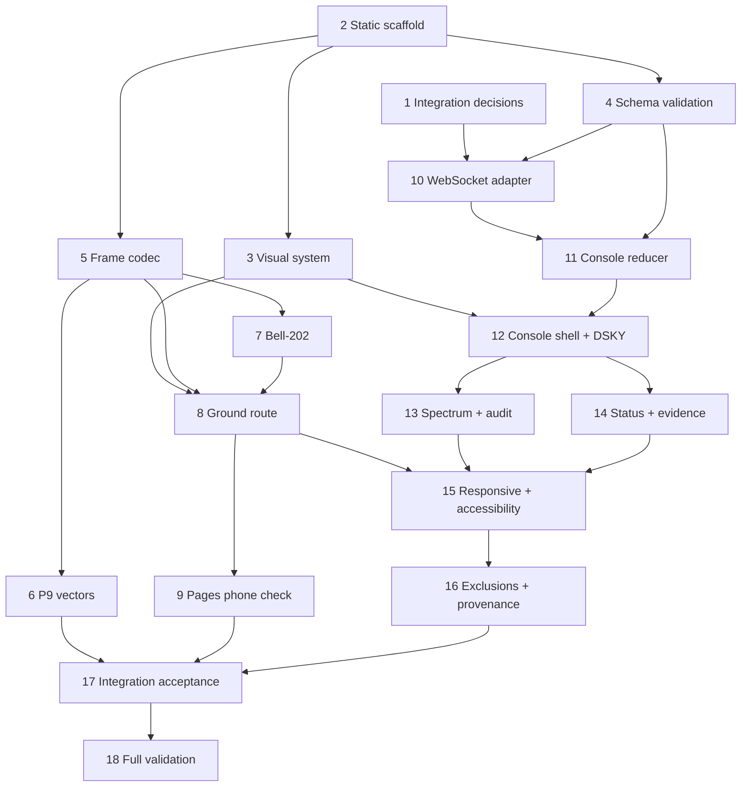

# Implementation Plan: Mission Console

## Overview

This dependency-ordered plan delivers the static `/ground` and `/console` routes, real frame/audio behavior, validated console projections, and required evidence checks without implementing any work in this specification phase.

## Notes

- This plan implements the approved `requirements.md` and `design.md`; it does not change `PRD.md` or project-level `TASK.md`.
- Complete tasks in dependency order. A task may start in parallel only when all dependencies listed for that task are complete.
- Use `contracts/acoustic-frame-v1.md` as the wire-format authority and the JSON Schemas in `contracts/` as the WebSocket authority.
- Do not add synthetic telemetry, test evidence, AGC state, safety state, or transmission success to unblock UI work.
- Do not mark a validation task complete without saving command output or at least its exit code in the project evidence location chosen by the implementation owner.
- Requirement references point to `.kiro/specs/mission-console/requirements.md`. Property references point to `design.md`.

## Tasks

- [ ] 1. Resolve browser/daemon integration decisions · Depends on: project M3.8 daemon integration design
  - [ ] 1.1 Agree with the daemon owner on the WebSocket path, permitted origins, initial snapshot behavior, heartbeat/idle timeout, audit backfill, and `event_id` restart scope.
  - [ ] 1.2 Record the chosen public build variable and same-origin fallback; ensure `/ground` does not require a daemon network connection.
  - [ ] 1.3 Confirm explicit manual `seq` entry as the v1 Ground Station workflow and document that the daemon remains sequence authority.
  - [ ] 1.4 Confirm that detailed hook status, safety-gate decisions, receiver substates, and COMMAND/AUTH lifecycle are excluded until a versioned schema exposes them.
  - [ ] 1.5 Add contract fixtures for the agreed connection bootstrap behavior before implementing the WebSocket adapter.
  - _Requirements: UI-REQ-2.4, UI-REQ-3.5, UI-REQ-9.4, UI-REQ-9.5, UI-REQ-13.2, UI-REQ-13.4_

- [ ] 2. Scaffold the static Next.js application · Depends on: Node.js LTS; may run after Task 1 starts
  - [ ] 2.1 Create `web-dashboard/` with Next.js, TypeScript strict mode, Tailwind, lint, typecheck, a non-watch test runner, and fast-check.
  - [ ] 2.2 Configure `output: 'export'`, `trailingSlash: true`, normalized base-path/asset-prefix handling, and output to `web-dashboard/out/`.
  - [ ] 2.3 Add static route shells for `/ground` and `/console` with no request-time data dependencies.
  - [ ] 2.4 Add `lint`, `typecheck`, `test`, and `build` package scripts required by the workspace validation command.
  - [ ] 2.5 Add a structural test or lint rule that rejects API routes, Server Actions, middleware, dynamic cookies, rewrites, and accidental server-runtime dependencies.
  - [ ] 2.6 Build once with an empty base path and once with the GitHub Pages project base path; verify both route artifacts and their JS/CSS references.
  - _Requirements: UI-REQ-1, UI-REQ-2.1, UI-REQ-2.2_

- [ ] 3. Implement approved visual tokens and local typography · Depends on: Task 2; project M5.0 design-system steering
  - [x] 3.1 Map the dashboard mockup palette (paper, ink, muted, rule, accent, cool, ok, bad) to named Tailwind tokens. (Changed 12 Nov 2026 from the PRD §8 palette by operator decision.)
  - [x] 3.2 Load Host Grotesk and Atkinson Hyperlegible Mono through `next/font` (build-time download, served locally).
  - [ ] 3.3 Create shared instrument primitives for one-pixel hairlines, restrained primary-instrument corner ticks, focus rings, and loading/error/stale/unmeasured notices.
  - [ ] 3.4 Set English as initial and fallback copy and describe the emulator only as an AGC-faithful subset with P00 and simplified P40.
  - [ ] 3.5 Add a build/network assertion that no font, icon, script, or styling CDN is requested at runtime.
  - _Requirements: UI-REQ-2.3, UI-REQ-15_

- [ ] 4. Establish schema-derived WebSocket types and runtime validation · Depends on: Task 2; normative JSON Schemas present
  - [ ] 4.1 Configure a JSON Schema 2020-12 validator with date-time format handling and register the telemetry schema so the relative `$ref` resolves.
  - [ ] 4.2 Generate TypeScript event types from the same schema files, or add compile-time equality checks that fail on type/schema drift.
  - [ ] 4.3 Implement one raw-message trust boundary that parses unknown JSON, validates the complete event, and returns a discriminated `ValidatedConsoleEvent`.
  - [ ] 4.4 Bound diagnostics by category, timestamp, and validator path; omit raw payload bodies and possible key material.
  - [ ] 4.5 Add the spectrum equal-length refinement after schema success and distinguish it from JSON Schema failure in diagnostics.
  - [ ] 4.6 Test every event variant, nested telemetry references, unknown versions/types, extra properties, malformed JSON, null telemetry stages, and unequal spectrum arrays.
  - _Requirements: UI-REQ-8, UI-REQ-11.2, UI-REQ-12.2; Properties: UI-P7, UI-P10_

- [ ] 5. Implement the pure TypeScript frame domain and codec · Depends on: Task 2; project M2.2 Python frame codec and vectors available
  - [ ] 5.1 Define parsed domain types for nonzero uint32 sequence, decimal uint8 fields, int16 R1/R2, int32 delta-v, COMMAND, and canonical AUTH.
  - [ ] 5.2 Implement trust-boundary parsing that rejects missing, non-integral, out-of-range, unsupported-vocabulary, and frame-type-inconsistent values once.
  - [ ] 5.3 Implement exact big-endian 34-byte field layout, signed two's-complement fields, and reserved flag behavior.
  - [ ] 5.4 Implement CRC-16/CCITT-FALSE over bytes 2..31 with the normative parameters.
  - [ ] 5.5 Define an injected HMAC interface and browser Web Crypto adapter that signs bytes 2..23 and truncates to eight bytes.
  - [ ] 5.6 Implement pure frame decoding/inspection and 8N1 bit expansion for tests and the exact frame preview.
  - [ ] 5.7 Ensure temporary mutable key-byte buffers are cleared where practical and key values never enter errors, logs, URLs, or persistent storage.
  - _Requirements: UI-REQ-3, UI-REQ-4, UI-REQ-5; Properties: UI-P1–UI-P4, UI-P6_

- [ ] 6. Implement P9 and golden-vector coverage · Depends on: Task 5; project M2.2 vector verification path
  - [ ] 6.1 Load `contracts/vectors/frames.json` directly from tests and verify the canonical COMMAND and AUTH hex byte for byte.
  - [ ] 6.2 Exercise the vector-defined CRC mutation and replay precondition through the relevant pure test oracle without copying expected protocol literals.
  - [ ] 6.3 Build fast-check generators for valid COMMAND and AUTH values, including every integer boundary and valid critical flag case.
  - [ ] 6.4 Run `decode(encode(value)) == value` for 10,000 generated cases in the full P9 profile and emit shrunk failures without key content.
  - [ ] 6.5 Add an equality guard for every protocol constant represented independently in Python and TypeScript.
  - [ ] 6.6 Keep the vector status described as unverified until both Python and TypeScript implementations have passed; update evidence only through the project evidence process.
  - _Requirements: UI-REQ-18; Properties: UI-P1–UI-P3, UI-P14_

- [ ] 7. Implement deterministic Bell-202 planning and Web Audio transmission · Depends on: Task 5
  - [ ] 7.1 Implement pure symbol planning for at least 250 ms mark preamble and all 34 bytes in 8N1, LSB-first, with no internal gap.
  - [ ] 7.2 Implement sample generation at 300 symbols/s with 1200 Hz mark, 2200 Hz space, and one continuous phase accumulator at 44.1 and 48 kHz.
  - [ ] 7.3 Put `AudioContext` creation and playback in an injected client-only adapter activated by a user gesture.
  - [ ] 7.4 Implement cancellation and unavailable, blocked, suspended, playback-failed, and source-completed outcomes; resolve success only from actual source completion.
  - [ ] 7.5 Test symbol count/order, frequency selection, sample count, preamble duration, phase continuity, immutable byte input, and all failure outcomes.
  - [ ] 7.6 Confirm no 600- or 1200-baud option or alternate code path exists.
  - _Requirements: UI-REQ-6; Properties: UI-P4, UI-P5_

- [ ] 8. Build the `/ground` route · Depends on: Tasks 3, 5, and 7
  - [ ] 8.1 Build distinct COMMAND and AUTH forms with visible integer wire units, supported v1 vocabulary, field help, and field-level errors.
  - [ ] 8.2 Require explicit sequence entry; add only a non-authoritative current-tab monotonicity warning and never persist a sequence counter as authoritative.
  - [ ] 8.3 Add masked session-only key fields, clear controls, and an optional clearly separated public-demo-key path.
  - [ ] 8.4 Derive canonical AUTH zero fields by construction and explain one-time `ref_seq` binding.
  - [ ] 8.5 Build the field-grouped 34-byte and actual 8N1 preview with the primary-instrument hairline/corner-tick treatment.
  - [ ] 8.6 Implement editing, invalid, signing, ready, transmitting, completed, failed, cancel, and retry states.
  - [ ] 8.7 Ensure completed copy means browser playback completed and never claims daemon acceptance, authorization, or AGC execution.
  - [ ] 8.8 Verify invalid form values call neither Web Crypto nor Web Audio and verify the preview bytes equal transmitter bytes for every successful case.
  - _Requirements: UI-REQ-3–UI-REQ-7, UI-REQ-15, UI-REQ-17; Properties: UI-P2, UI-P4, UI-P6_

- [ ] 9. Verify GitHub Pages phone hosting for `/ground` · Depends on: Tasks 2 and 8
  - [ ] 9.1 Produce the configured project-base-path export and verify direct navigation and refresh on `/ground/`.
  - [ ] 9.2 Verify HTTPS enables Web Audio/Web Crypto on a supported phone browser and that no Node.js runtime or CDN is needed.
  - [ ] 9.3 Transmit a canonical real frame from the deployed phone route and verify the daemon decodes the same 34 bytes through its normal receiver path.
  - [ ] 9.4 Record actual outcome and environment; do not convert target latency, SNR, or decode-rate values into facts during this check.
  - _Requirements: UI-REQ-1.2, UI-REQ-2, UI-REQ-6, UI-REQ-14.3_

- [ ] 10. Implement the console WebSocket adapter · Depends on: Tasks 1, 2, and 4; project M3.8 daemon WebSocket available
  - [ ] 10.1 Derive the socket URL from the agreed public path and page protocol; do not hard-code an undocumented host or outbound endpoint.
  - [ ] 10.2 Implement connect, open, message, close, error, and disposal handling with no direct reducer access for raw messages.
  - [ ] 10.3 Implement capped exponential reconnect with injected timers/randomness, cancellation on unmount, and a visible next-attempt state.
  - [ ] 10.4 Reset event ordering per connection while retaining prior projections as stale.
  - [ ] 10.5 Test initial connection, clean/unclean close, repeated failures, cap and jitter bounds, reconnect, disposal, and daemon restart behavior.
  - _Requirements: UI-REQ-2.4, UI-REQ-8, UI-REQ-9_

- [ ] 11. Implement the validated console reducer and view models · Depends on: Tasks 4 and 10
  - [ ] 11.1 Implement explicit loading/current/stale/unavailable panel states and connection-scoped `event_id` ordering.
  - [ ] 11.2 Route each event type only to its owned projection and keep connection metadata separate.
  - [ ] 11.3 Retain the newest 500 telemetry audit rows and newest 20 bounded diagnostics with deterministic eviction.
  - [ ] 11.4 Preserve null frame and validation fields as unavailable, never zero/pass/fail substitutes.
  - [ ] 11.5 On disconnect, mark current snapshots stale without clearing audit history or claiming complete backfill.
  - [ ] 11.6 Property-test arbitrary valid event sequences, duplicate/out-of-order IDs, reconnect boundaries, null stages, and retention limits.
  - _Requirements: UI-REQ-9, UI-REQ-10.2, UI-REQ-11.3, UI-REQ-12.2, UI-REQ-12.5; Properties: UI-P8–UI-P10, UI-P12_

- [ ] 12. Build the `/console` shell and read-only DSKY dock · Depends on: Tasks 3 and 11
  - [ ] 12.1 Build the console shell with semantic navigation, main content, connection badge, and explicit panel loading/disconnected states.
  - [ ] 12.2 Project only validated `agc.state` fields into PROG, VERB, NOUN, R1–R3, and all four lamps.
  - [ ] 12.3 Render em dashes and “Awaiting AGC state” before the first event; render retained values with text-labelled `STALE` after disconnect.
  - [x] 12.4 Recreate the pinned desktop dock, compact quick access, green mono readouts, and rounded bezel from the dashboard mockup.
  - [ ] 12.5 Keep the DSKY read-only: no key sends, lamp clearing, command composition, local AGC mutation, or fake 900 Hz click.
  - [ ] 12.6 Test that telemetry COMMAND fields never substitute for AGC state and no DSKY presentation action sends a socket message.
  - _Requirements: UI-REQ-9.1, UI-REQ-10, UI-REQ-13.3, UI-REQ-16.2; Property: UI-P9_

- [ ] 13. Build the real spectrum and audit ledger · Depends on: Tasks 11 and 12
  - [ ] 13.1 Render spectrum points only from validated equal-length `bin_hz`/`power_db` arrays and expose a text alternative derived from those values.
  - [ ] 13.2 Implement loading, unavailable, current, and stale spectrum states; add the real FFT-bar reduction path allowed by tripwire T3 without generated samples.
  - [ ] 13.3 Map validated telemetry events into accepted/rejected rows with source, available frame fields, gate states, verdict, and stable reason.
  - [ ] 13.4 Implement the selected-frame inspector against the normative 34-byte field layout, including null-stage handling.
  - [ ] 13.5 Add frequency-deviation anomaly presentation independent from rejection reason and show CRC failure only for reason `CRC`.
  - [ ] 13.6 Recreate hairline rows, sticky identity column, selected state, table-region horizontal scroll, and loading/empty/populated/error states.
  - [ ] 13.7 Test that plotted/audited values trace to input events and that long event streams stay within retention bounds.
  - _Requirements: UI-REQ-11, UI-REQ-12, UI-REQ-16.4, UI-REQ-17.6; Properties: UI-P9–UI-P12_

- [ ] 14. Build real system and test-evidence panels · Depends on: Tasks 11 and 12
  - [ ] 14.1 Render only the contracted daemon, audio, AGC, and Flight Watch enums from `system.status`.
  - [ ] 14.2 Render only profile, passed, failed, skipped, report path, event time, and current/stale state from `test.summary`.
  - [ ] 14.3 Implement `EvidenceValue` rules for `MEASURED`, `VERIFIED`, `TARGET`, `UNMEASURED`, and `FAILED` without inventing unavailable event fields.
  - [ ] 14.4 Omit the metric ribbon until a validated event contract supplies both values and evidence status.
  - [ ] 14.5 Confirm there is no browser PBT runner, fake hook trigger, safety toggle, settings save, command composer, or invented lifecycle state.
  - [ ] 14.6 Test failed summaries, unmeasured initial state, stale summaries, all status enums, and every evidence-label transition.
  - _Requirements: UI-REQ-13, UI-REQ-14, UI-REQ-16.2, UI-REQ-16.3; Properties: UI-P9, UI-P13_

- [ ] 15. Complete responsive and accessibility behavior · Depends on: Tasks 8 and 12–14
  - [ ] 15.1 Add skip links, landmarks, heading structure, labels/descriptions, field-error associations, live regions, and visible keyboard focus.
  - [ ] 15.2 Verify keyboard-only operation for `/ground`, console navigation, audit selection/detail, and all DSKY drawer/sheet controls.
  - [ ] 15.3 Implement the desktop dock, sub-80rem slide-over, and sub-48rem bottom sheet with focus containment, Escape/close, body-scroll handling, and focus restoration.
  - [ ] 15.4 Implement phone-first single-column `/ground`, 44×44 minimum coarse-pointer targets, no hover-only disclosure, and no horizontal page overflow.
  - [ ] 15.5 Keep audit horizontal overflow inside a labelled region with native table row/column associations.
  - [ ] 15.6 Honor reduced motion by disabling nonessential interpolation, entry animation, and auto-scroll without changing transmission or live-state behavior.
  - [ ] 15.7 Run automated accessibility checks and manual checks at 320 px, 390 px, 768 px, 1024 px, 1280 px, 200% zoom, coarse pointer, keyboard-only, and reduced-motion settings.
  - _Requirements: UI-REQ-10.4, UI-REQ-17_

- [ ] 16. Enforce v1 exclusions and provenance · Depends on: Tasks 8 and 12–15
  - [ ] 16.1 Add rendered-option/text checks that reject V97, V06, V16, V35, 600 baud, 1200 baud, Luminary 99, and Colossus 249 as supported behavior.
  - [ ] 16.2 Remove or fail tests on command palette, settings/palette editor, orbital/lunar visualizations, interactive footer mast, standalone landing route, fake hook/PBT controls, safety toggles, and console composer.
  - [ ] 16.3 Audit dynamic panels for constant arrays, timers, random values, generated canvases, and hard-coded rows that imitate data.
  - [ ] 16.4 Verify every dynamic console value traces to a validated event and every ground transmission visualization traces to the exact encoded frame.
  - [ ] 16.5 Scan rendered copy for fake SNR, latency, CRC rate, PBT totals, RAM, CPU, socket, immunity, or blanket offline claims.
  - _Requirements: UI-REQ-7, UI-REQ-14.5, UI-REQ-15.5, UI-REQ-16; Properties: UI-P4, UI-P9, UI-P13_

- [ ] 17. Run frontend integration and static-export acceptance · Depends on: Tasks 6–16
  - [ ] 17.1 Run all unit, component, schema, reducer, audio, accessibility, and fast-check tests with the normal frontend test command.
  - [ ] 17.2 Build `web-dashboard/out/`, serve it through the daemon on `127.0.0.1`, and open `/ground` and `/console` without `next dev`.
  - [ ] 17.3 Send real COMMAND and AUTH frames through browser audio and verify the daemon receives the exact expected bytes and emits schema-valid audit events.
  - [ ] 17.4 Verify real WebSocket events update DSKY, spectrum, audit, system status, and test summary; then disconnect/restart the daemon and verify stale/reconnect behavior.
  - [ ] 17.5 Verify a clean environment needs Python plus a browser to use the daemon-served export and makes no runtime CDN/font request.
  - [ ] 17.6 If tripwire T3 is active, verify the reduced console still has real DSKY and audit data and no synthetic replacement.
  - _Requirements: all; Properties: UI-P1–UI-P14_

- [ ] 18. Run repository validation and record evidence · Depends on: Task 17
  - [ ] 18.1 From the repository root, run fast Python validation: `python -m pytest -m "not slow"`.
  - [ ] 18.2 From the repository root, run full Python validation: `python -m pytest`.
  - [ ] 18.3 From `web-dashboard/`, run frontend validation: `npm run lint && npm run typecheck && npm test -- --run && npm run build`.
  - [ ] 18.4 Save each command's output or exit code before claiming success; if a required command/script is missing, add it and rerun the complete command.
  - [ ] 18.5 Confirm the exported route artifacts exist, the daemon serves both routes, P9 reads the shared vectors, and current planned metrics still render only as `TARGET` or `UNMEASURED`.
  - [ ] 18.6 Update evidence through the project evidence process only after measured or verified results exist; never mark vectors or metrics verified from UI appearance.
  - _Requirements: UI-REQ-1, UI-REQ-2, UI-REQ-14, UI-REQ-18_

## Task Dependency Graph

```json
{
  "waves": [
    { "wave": 1, "tasks": ["1", "2"] },
    { "wave": 2, "tasks": ["3", "4", "5"] },
    { "wave": 3, "tasks": ["6", "7", "10"] },
    { "wave": 4, "tasks": ["8", "11"] },
    { "wave": 5, "tasks": ["9", "12"] },
    { "wave": 6, "tasks": ["13", "14"] },
    { "wave": 7, "tasks": ["15"] },
    { "wave": 8, "tasks": ["16"] },
    { "wave": 9, "tasks": ["17"] },
    { "wave": 10, "tasks": ["18"] }
  ]
}
```

External gates still apply: Task 5 requires project M2.2, Tasks 1 and 10 require project M3.8, and Task 3 requires project M5.0.



## Completion Gate

The feature is complete only when:

- both routes are static exports served by the daemon;
- `/ground` transmits real, vector-compatible 34-byte COMMAND and AUTH frames at 300 baud;
- `/console` changes dynamic state only from schema-valid WebSocket events;
- the DSKY dock and audit ledger preserve the approved mockup treatment without inheriting mock behavior;
- loading, disconnected, stale, error, and unmeasured states are visible;
- accessibility, reduced motion, and responsive checks pass;
- P9 and shared golden vectors run through the real test suite;
- no excluded feature or synthetic evidence remains; and
- all prescribed validation commands have recorded output or exit codes.
