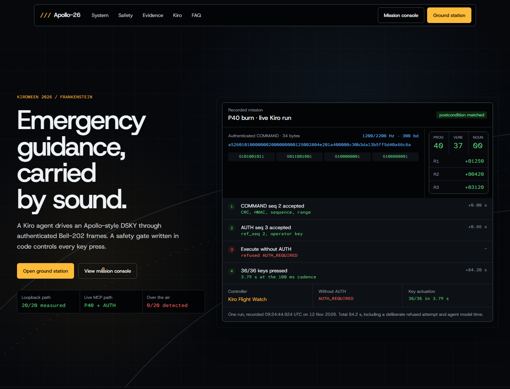
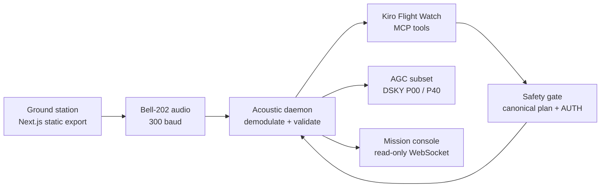

<h1 align="center">Apollo-26</h1>

<p align="center"><strong>An authenticated acoustic command link from a 2026 web ground station to a 1969-style DSKY, flown by a Kiro agent through a code-enforced MCP safety gate.</strong></p>

<p align="center"><strong>Kiroween 2026 · Frankenstein · MIT License</strong></p>

<p align="center">
  <a href="https://0xshalah.github.io/apollo-26/">Live landing page</a> ·
  <a href="https://0xshalah.github.io/apollo-26/ground/">Ground station</a> ·
  <a href="docs/evidence-matrix.md">Evidence matrix</a> ·
  <a href="docs/kiro-journal.md">Kiro journal</a>
</p>



> [!IMPORTANT]
> **Active development.** Apollo-26 is a software demonstration on an AGC-faithful subset emulator. It is not flight software, does not run Luminary or Colossus, and is not certified for operational use. WAV and loopback input work end to end; the first over-the-air trial did not decode a frame.

## The demo in one minute

1. `/ground` signs a **34-byte COMMAND** with a sequence number, truncated HMAC-SHA256, and CRC-16/CCITT-FALSE, then plays it as **300-baud Bell-202 FSK**.
2. The Python daemon demodulates the audio and checks sync → CRC → HMAC → replay → ranges. A rejected frame never enters Flight Watch.
3. Kiro calls `await_telemetry_frame` → `inspect_agc_status` → `plan_dsky_sequence` → `execute_dsky_sequence` over MCP.
4. The safety gate recomputes criticality and the exact canonical key sequence. Critical P40 actions also require one fresh, matching, single-use **AUTH** frame from the operator.
5. The daemon presses approved DSKY keys at a minimum 100 ms cadence and verifies the final AGC postcondition. `/console` displays the real state over a local WebSocket.

### Recorded critical-command result

| Stage | Result |
| :-- | :-- |
| COMMAND seq 2 | Accepted; classified critical for `NONZERO_P40_ACTIVATION` and `FRAME_CRITICAL_FLAG` |
| Execute before AUTH reached Flight Watch | Refused with `AUTH_REQUIRED`; no key sequence executed |
| AUTH seq 3, `ref_seq=2` | Accepted and matched |
| Canonical execution | `36/36` keys; postcondition matched |
| Final DSKY | P40 · V37 · R1/R2/R3 = `1250 / 420 / 3120` |
| One-run elapsed time | 84.2 s from COMMAND accepted to postcondition, including the deliberate refused attempt; the 10 s target was not met |

The timestamps, raw COMMAND/AUTH bytes, and DSKY result are stored in [`docs/metrics.json`](docs/metrics.json), then rendered by the landing page at build time.

## Architecture



| Boundary | Owns | Does not trust |
| :-- | :-- | :-- |
| `acoustic/frame.py` | Wire decoding, validation order, CRC/HMAC/replay/ranges | Audio candidates |
| `acoustic/daemon.py` | Sequence persistence, accepted telemetry, AGC writer, independent execution guard | Agent plans or UI state |
| `mcp_server/safety_gate.py` | Inspection freshness, canonical-plan equality, critical AUTH, at-most-once claim | Prompt text or frame CRITICAL flag alone |
| `agc_core/` | 15-bit words, DSKY state machine, P00/P40 state | Audio, filesystem, MCP, React |
| `web-dashboard/` | Presentation, frame composition, browser audio output | Safety decisions or authoritative AGC state |

The daemon, MCP RPC listener, and mission console bind to `127.0.0.1`. Kiro itself uses a cloud model, so the command path's **IP listeners** are loopback-only; the whole laptop is not offline.

## Run the working path

### Requirements

- Windows
- Python 3.12+
- Node.js is **not required** unless you rebuild the frontend; `web-dashboard/out/` is committed.

### Start from a WAV

```powershell
git clone https://github.com/0xshalah/apollo-26.git
cd apollo-26
python -m venv .venv
.venv\Scripts\python -m pip install -e ".[dev]"
copy .env.example .env
.venv\Scripts\python -m acoustic.daemon --provision-sequence 0
.venv\Scripts\python -m acoustic.daemon --input web-dashboard\public\sample_burst.wav --serve-after-input
```

Open <http://127.0.0.1:8026/console/>. The sample contains COMMAND seq 1 (`V25 N81`). Replaying the same WAV is rejected as `REPLAY`.

### Connect Kiro

The committed `.kiro/settings/mcp.json` registers `scripts/mcp.cmd`. Start the daemon first, enable `apollo26` in Kiro's MCP panel if needed, then ask Kiro to start Flight Watch.

- Read-only tools are auto-approved.
- `execute_dsky_sequence` is **never** auto-approved; a test enforces this.
- While Flight Watch is live, `flight-mode-shell-guard` blocks the agent's shell tools.
- The daemon should run in the operator's terminal; an agent-owned background terminal may end between turns.

### Critical P40 + AUTH over loopback

Sequence numbers are global and must exceed the daemon's last accepted sequence. Adjust `--seq` when needed.

```powershell
.venv\Scripts\python scripts\make_sample_wav.py --out p40.wav --seq 2 --verb 37 --noun 0 --program 40 --critical
.venv\Scripts\python scripts\make_sample_wav.py --out auth.wav --seq 3 --auth-ref 2
.venv\Scripts\python -m acoustic.daemon --loopback
```

In a second terminal:

```powershell
curl.exe -sS -X POST --data-binary "@p40.wav" http://127.0.0.1:8026/loopback
curl.exe -sS -X POST --data-binary "@auth.wav" http://127.0.0.1:8026/loopback
```

Then let Flight Watch receive the COMMAND, inspect and plan. An attempt before it consumes AUTH must return `AUTH_REQUIRED`; after AUTH is matched, inspect and plan again before requesting execution.

## Safety model

The LLM is an orchestrator, not the policy authority.

- **Inspect before act:** execution needs a fresh AGC snapshot with unchanged state revision.
- **Canonical plan only:** agent keys must exactly equal the independently recomputed command-catalog plan.
- **Critical authorization:** P40 activation with non-zero delta-v, V37 during P40, and V34 during P40 need a matching operator AUTH.
- **Single use and ordering:** AUTH binds through `ref_seq`, expires after 120 s, and is consumed atomically with the execution claim.
- **Cadence and lamps:** keys are at least 100 ms apart; KEY REL blocks input; OPR ERR stops a sequence.
- **Independent guard:** the daemon checks catalog version, command digest, canonical keys, AGC revision, and AUTH again.
- **Fail closed:** stale inspection, catalog mismatch, unknown outcome, failed postcondition, and invalid persistence halt or refuse actuation.

See [`docs/threat-model.md`](docs/threat-model.md), [`docs/state-machines.md`](docs/state-machines.md), and the normative [`contracts/dsky-command-catalog-v1.json`](contracts/dsky-command-catalog-v1.json).

## Kiro is part of the implementation

| Kiro feature | Repository evidence | Role |
| :-- | :-- | :-- |
| Specs | [`.kiro/specs/`](.kiro/specs/) | Four EARS requirements → design → tasks workflows: acoustic link, AGC emulator, MCP bridge, mission console |
| Steering | [`.kiro/steering/`](.kiro/steering/) | Product claims, stack, module boundaries, safety rules S-01–S-07, visual system |
| Hooks | [`.kiro/hooks/`](.kiro/hooks/) | PreToolUse shell guard, Python tests on save, tests after spec tasks |
| MCP | [`mcp_server/`](mcp_server/) | Six Flight Watch tools over stdio; execution approval remains manual |
| PBT | [`tests/`](tests/) and [`web-dashboard/tests/`](web-dashboard/tests/) | Hypothesis P1–P8 and fast-check P9 against shared golden vectors |
| Build record | [`docs/kiro-journal.md`](docs/kiro-journal.md) | Decisions and three bugs found only in live Kiro sessions |
| Design contract | [`DESIGN.md`](DESIGN.md) and [`docs/design-sources.md`](docs/design-sources.md) | Portable visual contract plus source/license audit |

### Bugs the live agent run found

- **Inspection was always stale:** 5 s was shorter than real agent tool-call latency. The window is now 20 s; exact state-revision checks remain.
- **Key 2/29 was rejected on Windows:** a coarse monotonic clock made some 100 ms sleeps last 93–94 ms. Production now uses `perf_counter_ns` plus deadline re-sleeping; [`tests/test_system_clock.py`](tests/test_system_clock.py) covers it.
- **AUTH always expired:** 30 s could not contain a human action plus multiple model/tool turns. The hold is now 120 s; key provenance, `ref_seq`, ordering, and single-use checks remain.

## Verification

### Commands

```powershell
scripts\pytest.cmd
.venv\Scripts\python -m pytest -m "not slow"
scripts\pbt_full.cmd

cd web-dashboard
npm ci
npm run lint
npm run typecheck
npm test -- --run
npm run build
npm run verify:export
```

- Latest Python suite: **133 passed**.
- Saved full Hypothesis profile: **132 passed**, fixed seed 2026. P1/P4/P6/P7/P8 and the stateful AGC machine ran 10,000 examples each; audio-heavy P2/P3/P5 ran 500/300/1,000. See [`docs/pbt-report.md`](docs/pbt-report.md).
- Frontend suite: **65 passed**. P9 uses 10,000 fast-check runs per property.
- Clean-clone check: fresh GitHub clone, fresh venv, no Node.js; sample accepted, replay rejected, 125 fast tests passed.

### Measured results

Measured on the Windows laptop recorded in [`docs/metrics.json`](docs/metrics.json). Status definitions and permitted copy live in [`docs/evidence-matrix.md`](docs/evidence-matrix.md).

| Measurement | Result | Status |
| :-- | :-- | :-- |
| Loopback decode + validation + atomic inbox write, 20 frames | 20/20 accepted; median 0.59 s, max 0.89 s | MEASURED |
| Daemon idle while listening, 30 s | 3.5% of one core; 54 MB working set | MEASURED |
| Live Kiro P40 + AUTH, one run | 84.2 s; target 10 s | FAILED |
| Same-laptop speaker → microphone, 20 frames | 0/20 detected | FAILED |
| Phone → laptop at 0.5 m | Not run | UNMEASURED |


## Protocol and emulator scope

- Frame v1 is fixed at 34 bytes; HMAC is truncated to 64 bits to keep the demo frame short.
- The acoustic channel is not encrypted and can be overheard or jammed. HMAC prevents forgery, not eavesdropping or denial of service.
- Demo keys in `.env.example` are public and must not protect anything real.
- A user with full local-OS access can alter processes, state, and keys.
- v1 supports only 300 baud, V25/V34/V37, and simplified P00/P40.
- This project does not run the original Apollo Luminary or Colossus programs.

## Repository map

```text
acoustic/          frame codec, Bell-202 modem, audio adapters, daemon, RPC/WebSocket, persistence
agc_core/          15-bit word, memory/registers, DSKY state machine, P00/P40 subset
mcp_server/        MCP tools, orchestration service, canonical planner, safety gate, audit ledger
web-dashboard/     Next.js static landing, ground station, mission console, committed out/
contracts/         normative wire format, JSON Schemas, command catalog, golden vectors
tests/             Python unit, property, stateful, integration, abuse, and stdio tests
.kiro/             specs, steering, hooks, workspace MCP registration
docs/              evidence, measurements, PBT report, threat model, design audit, submission drafts
```

## Project links

- **Landing:** <https://0xshalah.github.io/apollo-26/>
- **Ground station:** <https://0xshalah.github.io/apollo-26/ground/>
- **Product requirements:** [`PRD.md`](PRD.md)
- **Project status:** [`TASK.md`](TASK.md)
- **Devpost draft:** [`docs/devpost.md`](docs/devpost.md)
- **Video script:** [`docs/video-script.md`](docs/video-script.md)

MIT licensed. See [`LICENSE`](LICENSE).
