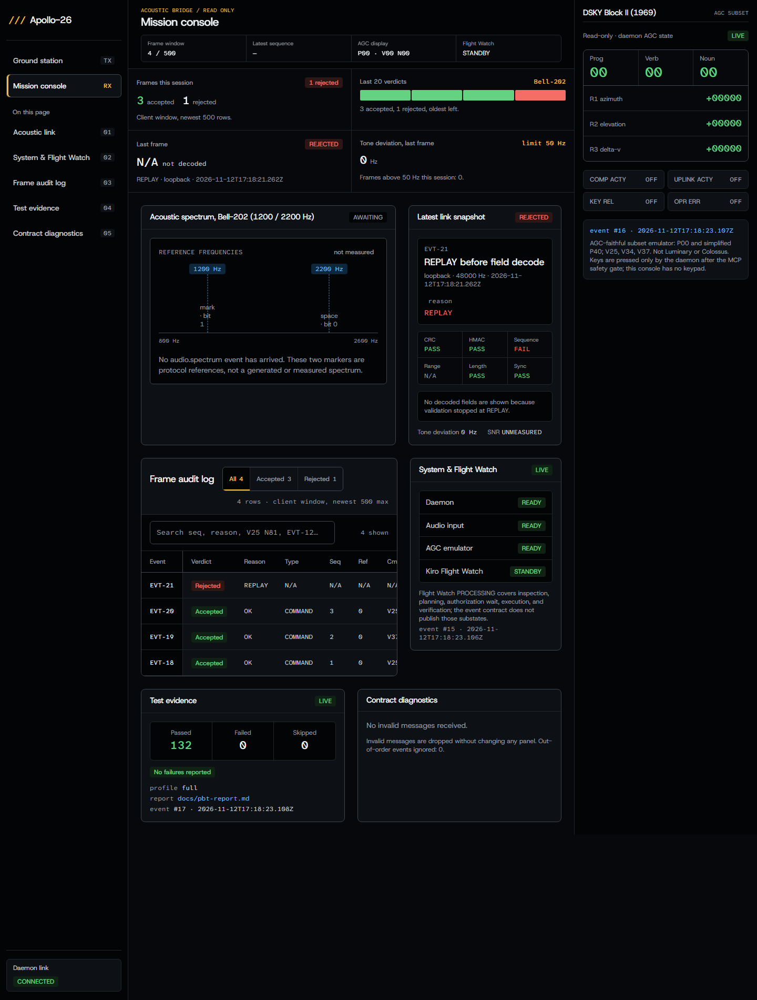

# Apollo-26

**An authenticated acoustic command link between a 2026 ground station and an AGC-inspired 1969 DSKY, flown by a Kiro agent through MCP.**
Kiroween 2026 · Frankenstein category · MIT License

Landing page: <https://0xshalah.github.io/apollo-26/> · Ground station: <https://0xshalah.github.io/apollo-26/ground/> · Build log with Kiro: [`docs/kiro-journal.md`](docs/kiro-journal.md)

> **Status: active development.** This is a software demonstration on an emulator. It is not flight software, it does not run the original Apollo programs (Luminary/Colossus), and it is not certified for anything.

## What it does

1. A ground station page (`/ground`) builds a 34-byte frame (CRC-16 + truncated HMAC-SHA256 + sequence number) and plays it as Bell-202 FSK at 300 baud (1200 Hz mark / 2200 Hz space).
2. The acoustic daemon listens (microphone, WAV file, or loopback), demodulates, and validates every frame: sync → CRC → HMAC → replay → ranges. Rejected frames are logged with a reason and never reach the agent.
3. A Kiro agent in a **Flight Watch** session waits for accepted frames over MCP (`await_telemetry_frame`), inspects the AGC, and asks for the canonical DSKY key plan.
4. `execute_dsky_sequence` passes a **code-enforced safety gate** (`mcp_server/safety_gate.py`) and a second, independent guard inside the daemon. Critical commands (P40 activation, V37/V34 during P40) require a separate operator `AUTH` frame that references the command's sequence number, is single-use, and expires 120 s after the COMMAND was accepted.
5. The AGC subset emulator (15-bit ones' complement words, DSKY state machine, V25/V34/V37, P00/P40) executes the keys at ≥100 ms cadence; the mission console (`/console`) shows its real state over a local WebSocket.

The command path (daemon, MCP server, emulator) binds only to `127.0.0.1`. The Kiro agent itself uses a cloud LLM; the "no IP interface" claim applies to the command path, not to the whole laptop.

## Quick start (Windows, no microphone, no Node.js)

Requires Python 3.12+.

```powershell
python -m venv .venv
.venv\Scripts\python -m pip install -e ".[dev]"
copy .env.example .env                     # public demo keys only
.venv\Scripts\python -m acoustic.daemon --provision-sequence 0
.venv\Scripts\python -m acoustic.daemon --input web-dashboard\public\sample_burst.wav --serve-after-input
```

Then open <http://127.0.0.1:8026/console/>. The sample WAV contains one authenticated COMMAND (seq 1, V25 N81). Running the same WAV again is rejected as `REPLAY`.

Other inputs: `--loopback` (POST a WAV to `/loopback`) or `--device <index|name>` for a real microphone.

Critical-command demo with loopback (P40 needs an operator AUTH):

```powershell
.venv\Scripts\python scripts\make_sample_wav.py --out p40.wav --seq 2 --verb 37 --noun 0 --program 40 --critical
.venv\Scripts\python scripts\make_sample_wav.py --out auth.wav --seq 3 --auth-ref 2
.venv\Scripts\python -m acoustic.daemon --loopback          # keep this terminal open
curl.exe -sS -X POST --data-binary "@p40.wav" http://127.0.0.1:8026/loopback
curl.exe -sS -X POST --data-binary "@auth.wav" http://127.0.0.1:8026/loopback
```

Sequence numbers are global and must increase; adjust `--seq` if the daemon has already accepted higher numbers.

## Using it from Kiro

`.kiro/settings/mcp.json` registers the `apollo26` MCP server (`scripts/mcp.cmd`). If it shows as disabled, enable it in the Kiro MCP panel. Start the daemon in your own terminal first, then ask Kiro to start Flight Watch. While Flight Watch is live, the `flight-mode-shell-guard` hook blocks the agent's shell tools. Read-only tools are auto-approved; **`execute_dsky_sequence` is never auto-approved** (a test enforces this).

| Kiro feature | Where |
| :-- | :-- |
| Specs (EARS requirements → design → tasks) | `.kiro/specs/{acoustic-link,agc-emulator,mcp-bridge,mission-console}/` |
| Steering | `.kiro/steering/` (product, tech, structure, safety rules, design system) |
| Hooks | `.kiro/hooks/`: shell guard during Flight Watch (`PreToolUse`), quick tests after spec tasks (`PostTaskExec`) and on Python save (`PostFileSave`) |
| MCP | `mcp_server/` – six tools over stdio |
| Property-based tests | Hypothesis (P1–P8) and fast-check (P9) – see below |

## Tests

```powershell
scripts\pytest.cmd                          # all Python tests incl. slow; output in telemetry\state\last-pytest.txt
.venv\Scripts\python -m pytest -m "not slow"
cd web-dashboard; npm ci; npm run lint; npm run typecheck; npm test -- --run; npm run build
scripts\pbt_full.cmd                        # full Hypothesis profile -> docs\pbt-report.md, docs\test-summary.json
scripts\clean_clone_check.cmd               # README quick start in a fresh clone
```

GitHub Actions workflows for CI and Pages are kept in `docs/ci/` (the publishing token lacked the `workflow` scope). To enable them, run `gh auth refresh -s workflow` and move them to `.github/workflows/`. The Pages site is currently published from the `gh-pages` branch by `scripts\deploy_pages.cmd`.

Covered properties: frame round-trip (P1), clean and noisy audio round-trip (P2, P3 at SNR ≥ 15 dB), bit flips rejected (P4), random audio never yields a frame (P5), wrong HMAC and replays rejected (P6), critical commands without matching AUTH never actuate (P7), ones' complement invariants (P8), Python ↔ TypeScript encoder equality (P9). End-to-end abuse scenarios from `docs/threat-model.md` run against the real daemon and MCP tool layer.

Full-profile run, fixed seed: [`docs/pbt-report.md`](docs/pbt-report.md). 132 tests passed; P1, P4, P6, P7, P8 and the stateful AGC machine ran 10,000 examples each; the audio-heavy modem properties ran P2 = 500, P3 = 300, P5 = 1,000. The daemon publishes the summary in [`docs/test-summary.json`](docs/test-summary.json) to the console's test panel.

## Measured so far

From [`docs/metrics.json`](docs/metrics.json) (Windows 10 21H1 laptop, Intel, 8 logical CPUs, Python 3.12, `scripts/measure_metrics.py`). Status words follow [`docs/evidence-matrix.md`](docs/evidence-matrix.md).

| What | Result | Status |
| :-- | :-- | :-- |
| Loopback decode + validation + inbox write, 20 frames | 20/20 accepted; median 0.59 s, max 0.89 s | measured |
| Daemon idle while listening to the microphone (30 s) | 3.5% of one core; working set 54 MB (private commit 296 MB) | measured |
| Live Kiro agent path, P40 + AUTH, one run | 84 s from COMMAND accepted to postcondition (includes a deliberate refused attempt); target 10 s **not met** | measured |
| Same-laptop speaker → microphone over the air, 20 frames | **0/20 detected**; the laptop microphone captured almost no energy at 1200/2200 Hz | failed |
| Phone → laptop at 0.5 m | not run yet | target |

Over-the-air decoding has **not** been demonstrated yet. The demo path that works today is WAV or loopback input into the same daemon pipeline.



## Known limitations

- The acoustic channel can be overheard and jammed. HMAC prevents forgery, not eavesdropping; payloads are not encrypted.
- HMAC is truncated to 64 bits to keep frames short (demo trade-off).
- The demo keys in `.env.example` are public. Anyone with your keys can send valid frames.
- A user with full access to the local OS can modify the processes, keys, and state.

## Repository map

`acoustic/` daemon, modem, frame codec · `agc_core/` emulator · `mcp_server/` MCP tools + safety gate · `web-dashboard/` Next.js static export (`out/` is committed and served by the daemon) · `contracts/` wire format, schemas, golden vectors · `docs/` threat model, state machines, evidence · `PRD.md`, `TASK.md` product and plan.
