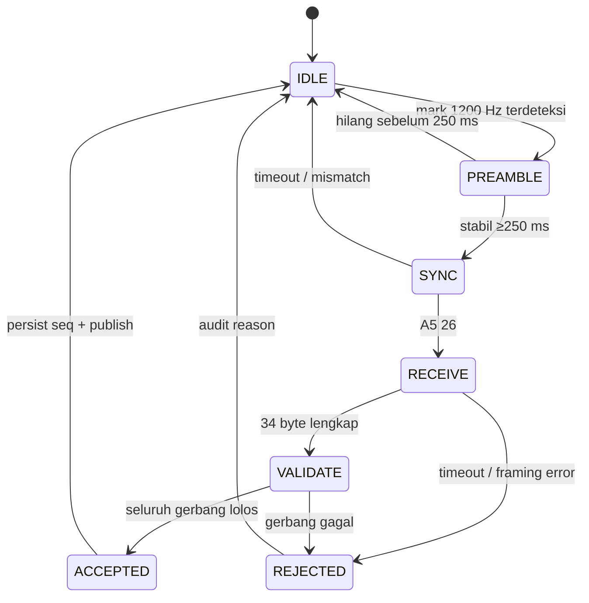
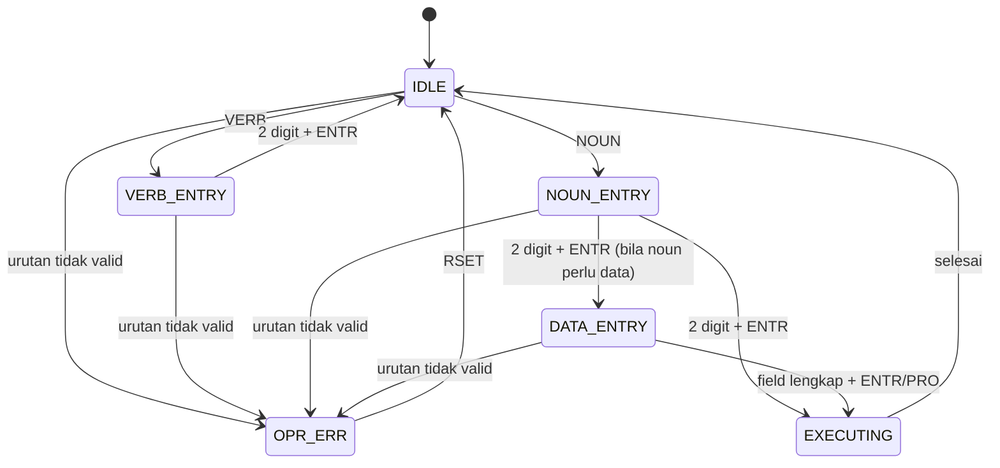
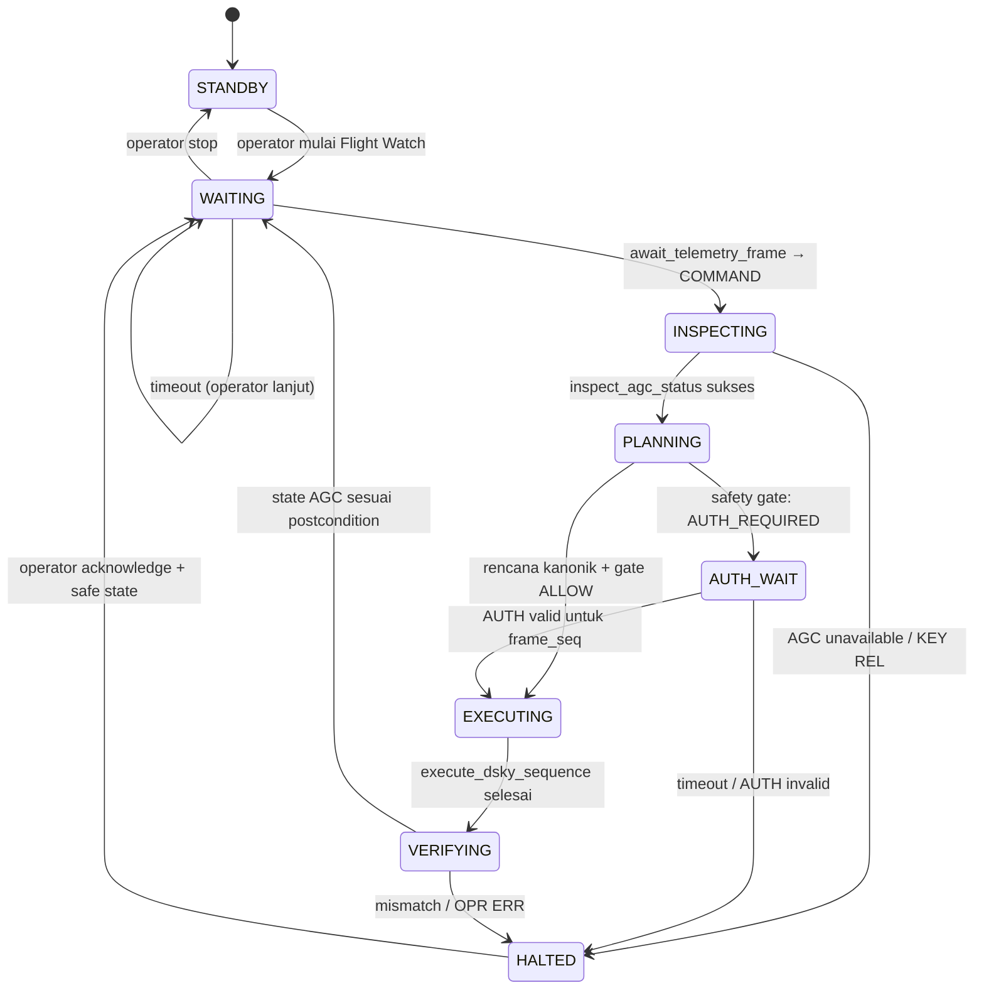
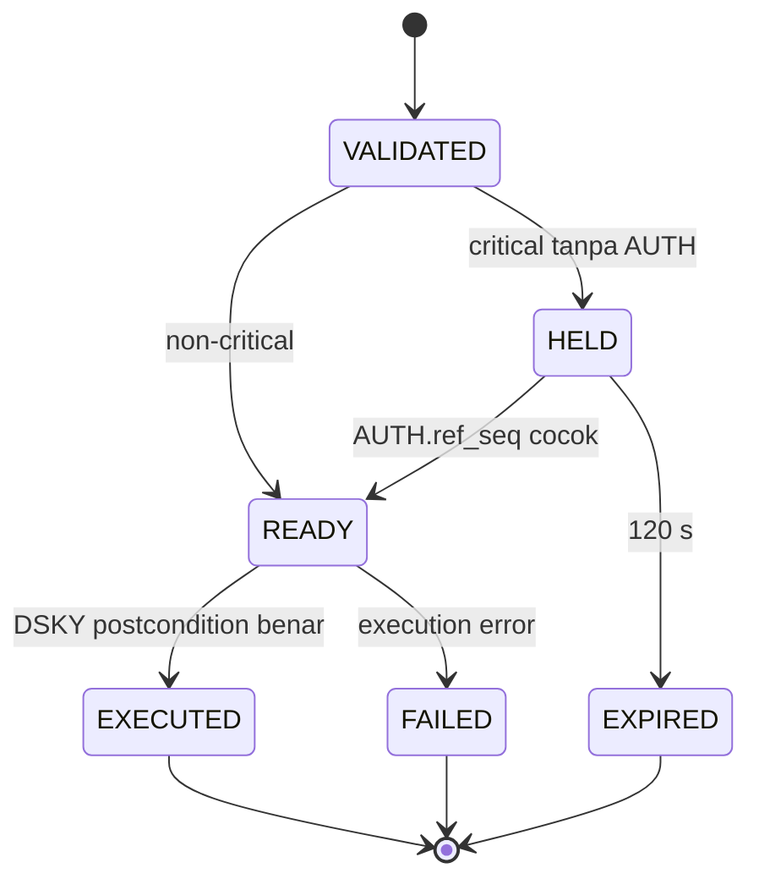

# Apollo-26 State Machines

State machine ini normatif untuk urutan kontrol. Detail wire format tetap mengikuti `contracts/acoustic-frame-v1.md`.

## 1. Acoustic receiver

| State | Input | Guard | Side effect | Error |
| :-- | :-- | :-- | :-- | :-- |
| IDLE | blok audio | energi mark di atas threshold | nyalakan `UPLINK ACTY`, mulai timer | — |
| PREAMBLE | blok audio | mark stabil ≥250 ms | cari sync | drift >50 Hz dicatat |
| SYNC | bits | `A5 26` ditemukan | mulai buffer 34 byte | `SYNC`/timeout |
| RECEIVE | bits 8N1 | 34 byte lengkap | freeze candidate | `LENGTH`/framing |
| VALIDATE | candidate | urutan §4.3 PRD | persist seq atomik | reason pertama |
| ACCEPTED | — | persist sukses | atomic-write inbox + event WS | `INTERNAL` fail-closed |
| REJECTED | — | — | atomic-write rejected audit | daemon tetap hidup |

## 2. DSKY input

Invariants:
- Tidak ada tombol diterima ketika `KEY REL` menyala.
- Jarak antar tombol minimal 100 ms.
- `OPR ERR` tidak mengubah program/register dan hanya pulih lewat `RSET`.
- V37 memakai urutan `VERB 3 7 ENTR <program> <program> ENTR`; bukan V37 + NOUN.
- State DSKY dimiliki `agc-core`, bukan DOM frontend.

## 3. Kiro Flight Watch

| Transisi | Tool wajib | Fail-closed condition |
| :-- | :-- | :-- |
| WAITING → INSPECTING | `await_telemetry_frame` | frame tidak valid tidak pernah keluar dari daemon |
| INSPECTING → PLANNING | `inspect_agc_status` | status gagal/KEY REL → tidak execute |
| PLANNING → gate | `plan_dsky_sequence` | rencana agen ≠ kanonik → tidak execute |
| gate → EXECUTING | `execute_dsky_sequence(keys, frame_seq)` | safety gate selalu hitung ulang aturan |
| EXECUTING → VERIFYING | `inspect_agc_status` | OPR ERR/mismatch → HALTED |

## 4. COMMAND/AUTH lifecycle

AUTH bersifat satu kali. `EXECUTED`, `EXPIRED`, atau `FAILED` menutup command; AUTH berikutnya untuk `ref_seq` yang sama ditolak dengan `STATE`.