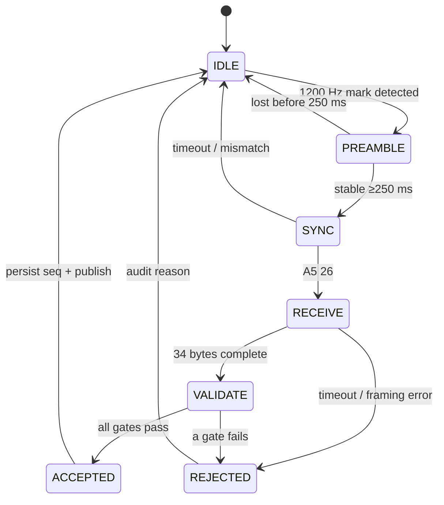
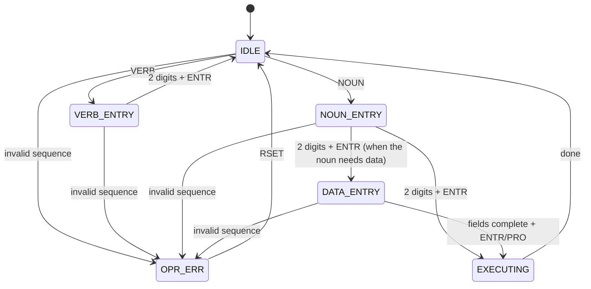
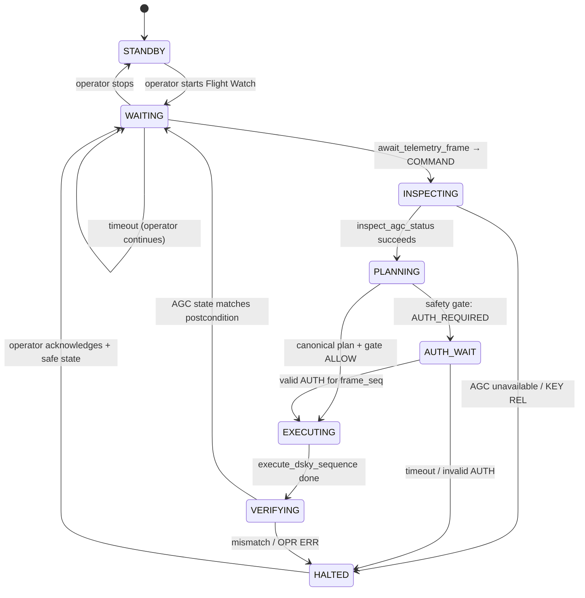
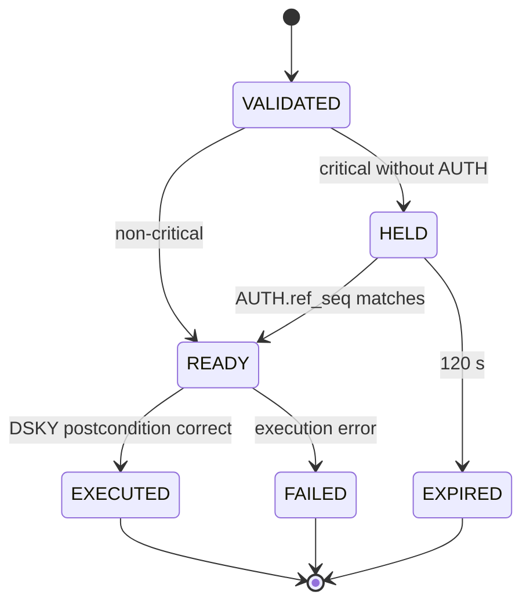

# Apollo-26 State Machines

These state machines are normative for control order. Wire-format details follow `contracts/acoustic-frame-v1.md`.

## 1. Acoustic receiver

| State | Input | Guard | Side effect | Error |
| :-- | :-- | :-- | :-- | :-- |
| IDLE | audio block | mark energy above threshold | turn on `UPLINK ACTY`, start timer | — |
| PREAMBLE | audio block | mark stable ≥250 ms | search for sync | drift >50 Hz logged |
| SYNC | bits | `A5 26` found | start 34-byte buffer | `SYNC`/timeout |
| RECEIVE | 8N1 bits | 34 bytes complete | freeze candidate | `LENGTH`/framing |
| VALIDATE | candidate | order in PRD §4.3 | persist seq atomically | first reason |
| ACCEPTED | — | persist succeeded | atomic-write inbox + WS event | `INTERNAL` fail-closed |
| REJECTED | — | — | atomic-write rejected audit | daemon stays up |

When the strict decoder fails in SYNC or RECEIVE after a qualified preamble, the receiver retries the same burst with the soft-decision fallback (contract §5.1). A recovered candidate re-enters VALIDATE from step 1; nothing skips validation.

## 2. DSKY input

Invariants:
- No key is accepted while `KEY REL` is lit.
- Keys are at least 100 ms apart.
- `OPR ERR` does not change program/registers and clears only through `RSET`.
- V37 uses the sequence `VERB 3 7 ENTR <program> <program> ENTR`, not V37 + NOUN.
- DSKY state is owned by `agc-core`, not the frontend DOM.

## 3. Kiro Flight Watch

| Transition | Required tool | Fail-closed condition |
| :-- | :-- | :-- |
| WAITING → INSPECTING | `await_telemetry_frame` | an invalid frame never leaves the daemon |
| INSPECTING → PLANNING | `inspect_agc_status` | status failure/KEY REL → no execute |
| PLANNING → gate | `plan_dsky_sequence` | agent plan ≠ canonical → no execute |
| gate → EXECUTING | `execute_dsky_sequence(keys, frame_seq)` | the safety gate always recomputes the rules |
| EXECUTING → VERIFYING | `inspect_agc_status` | OPR ERR/mismatch → HALTED |

## 4. COMMAND/AUTH lifecycle

AUTH is single-use. `EXECUTED`, `EXPIRED`, or `FAILED` closes the command; a later AUTH for the same `ref_seq` is rejected with `STATE`.
