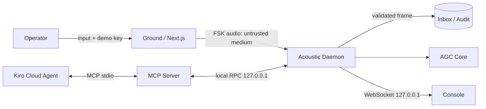

# Apollo-26 Threat Model

**Status:** Draft · **Scope:** ground transmitter, acoustic channel, daemon, local RPC/WebSocket, MCP server, Kiro Flight Watch, AGC emulator.

## 1. Assets
1. Integrity of COMMANDs and AGC state.
2. Operator authority over critical commands.
3. Integrity of the sequence counter and audit log.
4. Availability of the receiver and Flight Watch.
5. Confidentiality of local keys. The v1 payload is not confidential.

## 2. Trust boundaries

Main boundaries:
- B1: operator/browser → acoustic channel.
- B2: untrusted audio → daemon parser.
- B3: probabilistic Kiro agent → deterministic MCP safety gate.
- B4: local processes → AGC state.
- B5: environment secrets → browser/daemon.

## 3. Threat register (STRIDE)

| ID | Category | Threat | Impact | Mitigation | Verification | Residual |
| :-- | :-- | :-- | :-- | :-- | :-- | :-- |
| T-S1 | Spoofing | A foreign speaker sends a COMMAND | Fake maneuver | Link HMAC, constant-time compare | P6 | Demo keys are public, demo only |
| T-S2 | Spoofing | Operator AUTH is forged | Critical command passes | Separate operator key, `ref_seq`, single-use AUTH | P7 + E2E | The ground browser holds keys for the session |
| T-T1 | Tampering | Audio bits change because of noise | Damaged payload | CRC-16 before HMAC | P3/P4 | A burst can be lost, not silently altered |
| T-T2 | Tampering | Sequence file altered/corrupted | Replay or lockout | Atomic write, restrictive local access, fail-closed | integration restart test | A local OS user keeps full control |
| T-T3 | Tampering | The soft-decision fallback (`acoustic/recovery.py`) "repairs" a damaged frame into a different frame that passes CRC | A wrong candidate enters validation | Chase limited to 8 bits (≤255 trials, chance of passing CRC at random ≈0.4%); every candidate still has to pass the 64-bit HMAC and the replay check; sync bytes are never flipped | `test_recovered_candidates_from_garbage_are_never_accepted` | CRC loses part of its detection power; HMAC remains the sole authority |
| T-R1 | Repudiation | Operator denies a command | Weak audit | Timestamp, raw hex, seq, verdict, append-only session log | schema + audit test | No production-grade cryptographic non-repudiation |
| T-R2 | Repudiation | Identical copies of one repeated transmission are hidden from the audit | Replay trail lost | Only candidates byte-identical to a previous candidate within 6 s of samples count as `DuplicateEvent` (logged + `SourceSummary.duplicates`); a replay after 6 s is still audited as `REPLAY` | `test_repeated_burst_yields_one_candidate_and_duplicates` | A replay within 6 s does not appear as a separate audit row, but it cannot execute again either |
| T-I1 | Disclosure | Audio recorded by someone nearby | Payload leaks | Accepted in v1; documented without a confidentiality claim | evidence matrix | No encryption |
| T-I2 | Disclosure | Secret embedded in the Next.js bundle | Every frame can be forged | Keys entered at demo time; never built into JS; `.env` gitignored | secret scan + clean clone | Keys live in browser memory |
| T-D1 | DoS | Jamming at 1200/2200 Hz | Receiver unavailable | Carrier/drift detection, timeouts, audit, WAV fallback mode | audio integration | Jamming cannot be prevented |
| T-D2 | DoS | Random frames load the parser | High CPU/memory | Fixed 34-byte buffer, timeouts, bounded queue, bounded Chase search | P5 + load test | Audio device driver outside our control |
| T-E1 | Elevation | Agent bypasses steering | Critical command executes | Safety gate in code; canonical plan; PreToolUse guard | P7 + attack E2E | MCP server runs as the local user |
| T-E2 | Elevation | UI changes AGC state directly | Safety bypass | UI is read-only toward the AGC; every write goes through the MCP gate | architecture test/review | Manual process tampering is outside the threat model |
| T-E3 | Elevation | MCP write tool auto-approved | Execution without review | Never auto-approve `execute_dsky_sequence`; least privilege | config review | The user can change the config |

## 4. Abuse cases to demo/test
1. Valid COMMAND → accepted and planned.
2. COMMAND with a wrong CRC → rejected `CRC`.
3. COMMAND with a wrong HMAC but valid CRC → rejected `HMAC`.
4. Replay of an old sequence → rejected `REPLAY`, also after a daemon restart.
5. Critical P40 without AUTH → `HELD`; wrong AUTH → still held; correct AUTH → executes once.
6. Reused AUTH → rejected `STATE`/`REPLAY`.
7. Noise/jamming → no stray DSKY keys; daemon stays up.
8. Agent sends a sequence different from the canonical plan → safety gate refuses.

## 5. Accepted risks
- Apollo-26 is a demonstration, not a flight-certified system.
- The acoustic channel provides no confidentiality and can be jammed.
- HMAC is truncated to 64 bits to keep the demo frame short.
- Kiro uses a cloud LLM; only the local command path is network-restricted.
- A user with full local OS access can change processes, keys, and state.

The threat model is reviewed when the wire protocol, process boundaries, key handling, or safety policy change.
