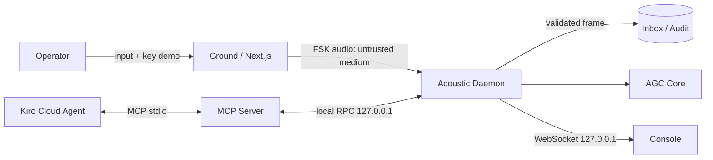

# Apollo-26 Threat Model

**Status:** Draft awal · **Scope:** ground transmitter, acoustic channel, daemon, local RPC/WebSocket, MCP server, Kiro Flight Watch, AGC emulator.

## 1. Aset
1. Integritas COMMAND dan state AGC.
2. Otoritas operator untuk perintah kritis.
3. Keutuhan sequence counter dan audit log.
4. Ketersediaan receiver dan Flight Watch.
5. Kerahasiaan key lokal. Payload v1 tidak dirahasiakan.

## 2. Trust boundaries

Boundary utama:
- B1: operator/browser → acoustic channel.
- B2: audio tak tepercaya → daemon parser.
- B3: Kiro probabilistik → MCP safety gate deterministik.
- B4: proses lokal → AGC state.
- B5: secret environment → browser/daemon.

## 3. Threat register (STRIDE)

| ID | Kategori | Ancaman | Dampak | Mitigasi | Verifikasi | Residual |
| :-- | :-- | :-- | :-- | :-- | :-- | :-- |
| T-S1 | Spoofing | Speaker asing mengirim COMMAND | Manuver palsu | HMAC link, constant-time compare | P6 | Key demo publik hanya untuk demo |
| T-S2 | Spoofing | AUTH operator dipalsukan | Perintah kritis lolos | Key operator terpisah, `ref_seq`, one-time AUTH | P7 + E2E | Browser ground menyimpan key selama sesi |
| T-T1 | Tampering | Bit audio berubah karena noise | Payload rusak | CRC-16 sebelum HMAC | P3/P4 | Burst dapat hilang, bukan berubah diam-diam |
| T-T2 | Tampering | File sequence diubah/korup | Replay atau lockout | Atomic write, restrictive local access, fail-closed | integration restart test | User OS lokal tetap berkuasa |
| T-R1 | Repudiation | Operator menyangkal perintah | Audit lemah | Timestamp, raw hex, seq, verdict, append-only session log | schema + audit test | Tidak ada non-repudiation kriptografis produksi |
| T-I1 | Disclosure | Audio direkam pihak dekat | Payload bocor | Diterima di v1; dokumentasikan tanpa klaim confidentiality | evidence matrix | Tidak ada enkripsi |
| T-I2 | Disclosure | Secret tertanam bundle Next.js | Semua frame dapat dipalsukan | Key dimasukkan saat demo; jangan build ke JS; `.env` gitignored | secret scan + clean clone | Key berada di memori browser |
| T-D1 | DoS | Jamming 1200/2200 Hz | Receiver tidak tersedia | Deteksi carrier/drift, timeout, audit, mode WAV fallback | audio integration | Jamming tidak dapat dicegah |
| T-D2 | DoS | Frame acak membebani parser | CPU/memori tinggi | Fixed 34-byte buffer, timeout, bounded queue | P5 + load test | Audio device driver di luar kontrol |
| T-E1 | Elevation | Agen melewati steering | Perintah kritis dieksekusi | Safety gate di kode; canonical plan; PreToolUse guard | P7 + attack E2E | MCP server berjalan sebagai user lokal |
| T-E2 | Elevation | UI mengubah state AGC langsung | Bypass safety | UI read-only terhadap AGC; semua write lewat MCP gate | architecture test/review | Manual process tampering di luar threat model |
| T-E3 | Elevation | MCP tool write auto-approved | Eksekusi tanpa review | Jangan auto-approve `execute_dsky_sequence`; least privilege | config review | User dapat mengubah config |

## 4. Abuse cases wajib demo/test
1. COMMAND valid → diterima dan direncanakan.
2. COMMAND dengan CRC salah → ditolak `CRC`.
3. COMMAND dengan HMAC salah tetapi CRC valid → ditolak `HMAC`.
4. Replay sequence lama → ditolak `REPLAY` setelah restart daemon.
5. P40 kritis tanpa AUTH → `HELD`; AUTH salah → tetap held; AUTH benar → satu kali execute.
6. AUTH dipakai ulang → ditolak `STATE`/`REPLAY`.
7. Noise/jamming → tidak ada tombol DSKY liar; daemon tetap hidup.
8. Agen mengirim urutan berbeda dari canonical plan → safety gate menolak.

## 5. Risiko diterima
- Apollo-26 adalah demonstrasi, bukan flight-certified system.
- Kanal akustik tidak menjaga confidentiality dan rentan jamming.
- HMAC dipotong 64-bit untuk durasi frame demo.
- Kiro memakai cloud LLM; hanya command path lokal yang dibatasi network-nya.
- Pengguna dengan akses penuh ke OS lokal dapat mengubah proses, key, dan state.

Threat model ditinjau ulang ketika wire protocol, boundary proses, key handling, atau safety policy berubah.